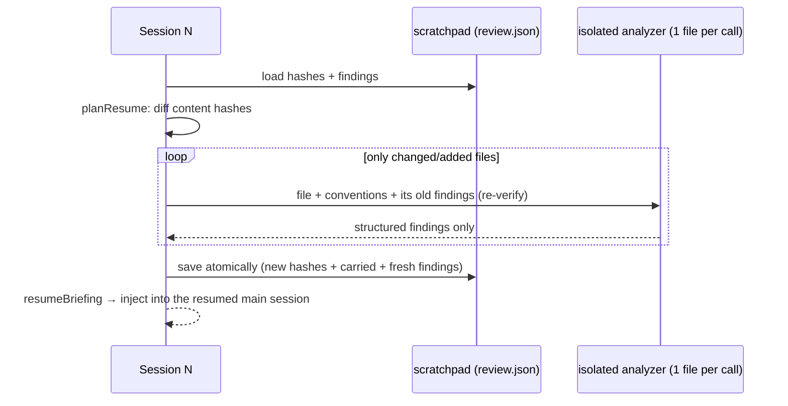

# L10 — Cross-session context: scratchpads, isolation, resumption

**Objectives:** O20 (subagent isolation, scratchpad files, targeted reads), O02 (session resumption: targeted
re-analysis of changed files, context injection)
**Scenario:** reviewing the Ledgerly service in `fixtures/codebase/` (conventions in `CONVENTIONS.md`)
**Read first:** [Part 4 lecture](../../teach-me/lectures/04-context-management/lecture.md), sections 4–5 (*How do you work on more than fits in one context?* and *How do you resume without redoing, or trusting stale, work?*)

## Situation

A code-review agent reads every file of the service into **one** growing conversation. On a large codebase it runs out of
context halfway through. When it's restarted the next day, it starts from scratch: it re-reads every file, re-reports the
same findings, and forgets nothing only because it remembers nothing.

You'll restructure it:



## Your task

1. `diffSnapshots`: detect changes by content hash, not just by file name.
2. `loadScratchpad` / `saveScratchpad`: a missing file returns `null`; save atomically with a temp file and `rename`.
3. `planResume`: analyze only changed and added files, carry the findings of unchanged files, re-verify the findings of changed files, and drop the findings of removed files.
4. `analyzeFile`: isolated context. Send one user message with only this file, put the conventions in the system prompt, and force `report_findings`.
5. `resumeReview`: wire it together, and persist the new state.
6. `resumeBriefing`: write a compact state summary for a resumed main session, without file contents.
7. `agentSdkResumeOptions`: build the Agent SDK `resume` and `forkSession` options.

```bash
npx vitest lessons/10
SOLUTION=1 npx vitest run lessons/10
npm run test:live -- lessons/10     # ~14 Haiku calls on the first session, 1 on the second
```

When you're done, read `solution/WHY.md`.
