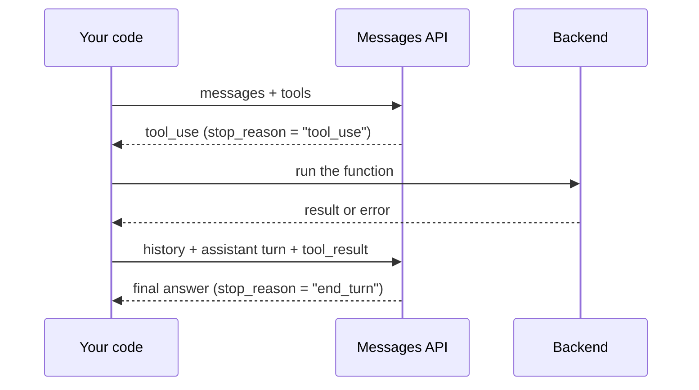

# Part 1 — Agentic loop and tool use

A language model on its own can only produce text. It can't look up a customer in your database, check where a parcel
is, or write a ticket into your helpdesk. Ask Claude "what's the status of order A1002?" with no tools, and the best it
can honestly do is tell you it doesn't know. The worst it can do is make something up.

**Tool use** closes that gap. You describe a few functions your application can run, Claude decides when it needs one
and asks you to run it, and you send the result back. Repeat that a few times and you have an **agent**: a program
in which the model, not your code, decides which step comes next. The pattern looks simple, and the basic version is.
Most of the bugs people hit (and most of the exam questions on this topic) come from a handful of details: what
exactly goes into each message, how to *force* a tool when your code depends on it, how to make one tool wait for
another, and how to let Claude do several independent things at once.

By the end of this chapter you'll be able to write a tool-use loop by hand, explain every field in it, and recognise
the classic failure modes from their symptoms. The two lessons that follow have you build exactly that.

> **Objectives:** O01 parallel tool calls · O27 tool use + JSON schema, `tool_choice` to guarantee invocation · O37 `tool_choice` + sequencing dependent tools
> **Lessons:** [L01](../../../lessons/01-tool-loop-and-tool-choice/) · [L02](../../../lessons/02-parallel-tool-calls/)
> **Sources checked:** 2026-10-18 (links in *Going deeper*). SDK pinned: `@anthropic-ai/sdk` 0.135.0.

## The running example

Throughout this chapter we'll work on one system: the support desk of a small online shop. It's the same data the
lessons use (`fixtures/support/`).

The shop has three customers:

| id | email | name | tier |
|----|-------|------|------|
| `cus_001` | ana.ortiz@example.com | Ana Ortiz | premium |
| `cus_002` | ben.kowalski@example.com | Ben Kowalski | standard |
| `cus_003` | chen.li@example.com | Chen Li | standard |

and a few orders. Ana has three (`A1001` delivered, `A1002` shipped, `A1003` processing), Ben has a delivered laptop
(`B2001`, $899.99) and a refunded order, and Chen has one cancelled order.

Four tickets have just arrived:

- **T-100** from Ben: *"Charged twice?? I see two charges for my laptop order last month… One of them needs to go back
  to me ASAP."*
- **T-101** from Ana: *"Can you tell me the status of orders A1001, A1002 and A1003? I need them before the weekend."*
- **T-102** from Chen: *"I've requested a password reset 3 times and no email arrives. Not urgent, just annoying."*
- **T-103** from `unknown.person@example.com`: *"I want a refund for my order."*

Our job is to **triage** each ticket, which means filling in a record with four fields:

| Field | Meaning | Allowed values |
|-------|---------|----------------|
| `category` | What the ticket is about | `billing`, `shipping`, `refund`, `account`, `technical`, `other` |
| `priority` | How fast someone must react | `low`, `normal`, `high`, `urgent` (`urgent` = money lost or account locked) |
| `summary` | One sentence a support agent can act on | any text |
| `needs_human` | Whether a person must step in | `true` / `false` |

The helpdesk software that receives the record is strict: it reads JSON with exactly those four fields and only the
allowed values, and it crashes on anything else.

To investigate, Claude gets two backend functions, `lookup_customer(email)` and `list_orders(customer_id)`. Notice
already that the second one needs an id that only the first one can produce. That dependency will matter in section 5.

## 1. What is an agentic loop?

### The problem

The Messages API is a single request and a single response. You send a list of messages, and Claude sends back one
assistant message. There is no hidden session on Anthropic's side that remembers what happened before, and Claude never
executes code on your machine. So how can Claude "call `lookup_customer`"?

### The idea

It can't call it. It can only **ask you** to call it. When you include a `tools` array in the request, Claude may end
its reply with a structured request instead of (or in addition to) prose. The response then has:

- `stop_reason: "tool_use"`, which tells you Claude stopped because it's waiting for a tool result, not because it
  finished;
- one or more `tool_use` content blocks, each with an `id` (unique for this call), the tool `name`, and an `input`
  object that follows the tool's schema.

Your code runs the function, then sends a **new** request containing the whole conversation so far, plus Claude's
tool request, plus your result. Claude reads the result and either asks for another tool or writes its final answer
(`stop_reason: "end_turn"`). That cycle (request → tool request → run it → send result → request again) is the
**agentic loop**.



Two consequences follow from the API being stateless, and both show up on the exam:

1. **You own the history.** Every request has to carry the full conversation. If you forget to append something, Claude
   simply never saw it.
2. **You own the stopping condition.** The loop runs until Claude stops asking for tools. A confused model, or a tool
   that keeps failing, can keep it going forever, so your code needs a turn limit.

### Worked example: ticket T-102

Chen's password-reset ticket needs one lookup. Here is the first request (shortened to the interesting parts):

```json
{
  "model": "claude-haiku-5-5",
  "max_tokens": 1024,
  "system": "You triage customer support tickets for an online shop. Investigate with the tools, then call record_triage.",
  "tools": [ { "name": "lookup_customer", "...": "..." }, { "name": "list_orders", "...": "..." }, { "name": "record_triage", "...": "..." } ],
  "messages": [
    { "role": "user", "content": "Ticket T-102 from chen.li@example.com\nSubject: Password reset not arriving\n\nI've requested a password reset 3 times and no email arrives. Not urgent, just annoying." }
  ]
}
```

Claude's response:

```json
{
  "role": "assistant",
  "stop_reason": "tool_use",
  "content": [
    { "type": "text", "text": "Let me look up this customer first." },
    { "type": "tool_use", "id": "toolu_01Ab", "name": "lookup_customer", "input": { "email": "chen.li@example.com" } }
  ]
}
```

Notice three things. The response mixes a `text` block and a `tool_use` block: Claude often narrates before acting, and
your code must not assume the tool call is the first block. The `input` is already a parsed JSON object, not a
string you need to parse. And the `id` `toolu_01Ab` is what you'll quote back when you send the result.

Your code runs `lookupCustomer("chen.li@example.com")`, gets `{ id: "cus_003", name: "Chen Li", tier: "standard" }`,
and sends the second request. Its `messages` array now has **three** entries:

```json
[
  { "role": "user", "content": "Ticket T-102 from chen.li@example.com ..." },
  { "role": "assistant", "content": [
      { "type": "text", "text": "Let me look up this customer first." },
      { "type": "tool_use", "id": "toolu_01Ab", "name": "lookup_customer", "input": { "email": "chen.li@example.com" } }
  ] },
  { "role": "user", "content": [
      { "type": "tool_result", "tool_use_id": "toolu_01Ab", "content": "{\"id\":\"cus_003\",\"email\":\"chen.li@example.com\",\"name\":\"Chen Li\",\"tier\":\"standard\"}" }
  ] }
]
```

Claude now has what it needs, and on the next turn it produces the triage record, the four fields the helpdesk expects
(see *The running example*):

```json
{
  "category": "account",
  "priority": "low",
  "summary": "Password reset emails are not arriving after three requests.",
  "needs_human": true
}
```

Where does this object come from? Not from prose that your code parses. Claude passes it as the `input` of a
`record_triage` tool call. Section 3 shows that tool's schema (which is where the allowed values are enforced), and
section 4 shows how to make sure Claude calls it.

In TypeScript, the skeleton of the loop is short:

```ts
const messages: MessageParam[] = [{ role: 'user', content: ticketText }];

for (let turn = 0; turn < maxTurns; turn++) {
  const response = await client.messages.create({ model, max_tokens: 1024, system, tools, messages });

  messages.push({ role: 'assistant', content: response.content }); // 1. keep Claude's turn, unchanged

  if (response.stop_reason !== 'tool_use') return response;         // 2. Claude is done (or stopped for another reason)

  const results = await runToolCalls(response.content, handlers);   // 3. run every tool_use block
  messages.push({ role: 'user', content: results });                // 4. send all results back in one user message
}
throw new Error(`No answer after ${maxTurns} turns`);
```

### The other stop reasons

`tool_use` and `end_turn` are the two you'll see most often, but a loop that only checks for those will
misbehave on the rest:

| `stop_reason` | What happened | What your loop should do |
|---|---|---|
| `end_turn` | Claude finished naturally | Use the answer |
| `tool_use` | Claude is waiting for client tool results | Run the tools, send results, loop |
| `max_tokens` | The reply hit your `max_tokens` cap | Treat it as truncated. If the last block is a `tool_use`, its input may be incomplete: **don't run it**. Retry with a higher limit |
| `stop_sequence` | One of your `stop_sequences` fired | Read `stop_sequence` to see which one |
| `pause_turn` | A *server* tool loop (web search, for example) hit its iteration limit | Send the assistant content back unchanged to let it continue |
| `refusal` | Claude declined (a normal HTTP 200) | Read `stop_details`; don't loop on it |
| `model_context_window_exceeded` | The reply filled the context window | Treat it as truncated |

### What goes wrong

**Forgetting the assistant turn.** A common first attempt pushes only the tool result:

```ts
messages.push({ role: 'user', content: results }); // ❌ where is the assistant message with toolu_01Ab?
```

The API rejects this with a 400 error. A `tool_result` must answer a `tool_use` that appears in the assistant message
**immediately before** it, and here there is none. The fix is to push `response.content` as the assistant turn
*unchanged*. Don't rebuild it, don't strip the text blocks, and don't re-order it.

**No turn limit.** `while (response.stop_reason === 'tool_use')` with no counter works in every demo and loops forever
the day a tool keeps returning an error Claude can't work around. Always bound the loop.

> **Check yourself:** Your loop only checks `if (response.stop_reason === 'end_turn') return`, and otherwise runs any
> `tool_use` blocks it finds. A long ticket produces a response with `stop_reason: "max_tokens"` whose last block is a
> `tool_use` for `record_triage`. What happens, and what should happen?
>
> <details><summary>Answer</summary>
>
> Your loop treats it like a normal tool call and runs (or records) a `tool_use` whose `input` may have been cut off
> halfway, so you could write a triage record with missing or garbled fields. `max_tokens` means "truncated". The
> correct handling is to not execute the incomplete call and to retry with a higher `max_tokens` (or a smaller task).
> Handle stop reasons explicitly instead of treating "not `end_turn`" as "tool use".
>
> </details>

## 2. Sending results back, including failures

### The problem

Running the tool is your code's job, and so is deciding what to tell Claude about it. Tools fail: the email isn't in
the database, the API times out, Claude passes an id that doesn't exist. If your handler throws, the loop crashes and
the customer gets nothing. If you tell Claude only "error", it has no idea what to try next.

### The idea

Each result is a `tool_result` content block inside a `user` message:

- `tool_use_id` is the `id` of the `tool_use` block this answers. That's how Claude matches results to requests, which
  matters when there are several.
- `content` is the result, usually a string (we use `JSON.stringify(output)`). It can also be a list of `text`,
  `image` or `document` blocks, or be left out entirely.
- `is_error: true` (optional) says "this call failed", and `content` then explains how.

The API enforces a few structural rules, and breaking any of them is a 400 error:

1. The user message with the results must come **immediately after** the assistant message that made the calls. Nothing
   may come between them.
2. Every `tool_use` in that assistant message needs a matching `tool_result`.
3. Inside the user message, `tool_result` blocks come **first**. Text is allowed after them, never before.

There's also a softer rule from the docs' troubleshooting advice: if you don't *need* to add text after the results,
don't. Text right after tool results can occasionally make Claude end its turn with an empty reply.

For failures, the docs' advice is to write **instructive** errors: say what went wrong *and what Claude should do
next*. Claude reads the error and adapts. When a call is invalid or missing parameters, Claude typically retries 2–3
times with corrections before giving up and apologising.

### Worked example: ticket T-103

The sender `unknown.person@example.com` isn't a customer. Claude calls `lookup_customer`, and our backend throws. The
backend in `fixtures/support/backend.ts` is written with this in mind. Its error message is addressed to the model:

```ts
throw new BackendError(
  `No customer with email "${email}". Do not guess an id; triage the ticket as needing a human.`,
);
```

Our `runToolCalls` catches it and turns it into a result instead of letting it crash the loop:

```json
{
  "role": "user",
  "content": [
    {
      "type": "tool_result",
      "tool_use_id": "toolu_02Cd",
      "is_error": true,
      "content": "No customer with email \"unknown.person@example.com\". Do not guess an id; triage the ticket as needing a human."
    }
  ]
}
```

On the next turn Claude doesn't invent `cus_004`. It records `category: "refund"` with `needs_human: true`, which is
exactly what the error told it to do. The error message did the job a prompt engineer would otherwise have to do in
the system prompt, and it does it at the moment it's relevant.

The same applies to tools Claude asks for that you don't have (a hallucinated or misspelled name): return an
`is_error` result that lists the available tools, rather than throwing.

```ts
if (!handler) {
  return { type: 'tool_result', tool_use_id: block.id, is_error: true,
           content: `Unknown tool "${block.name}". Available tools: ${Object.keys(handlers).join(', ')}.` };
}
```

### What goes wrong

**Text before the results.**

```json
{ "role": "user", "content": [
  { "type": "text", "text": "Here are the results:" },
  { "type": "tool_result", "tool_use_id": "toolu_02Cd", "content": "..." }
] }
```

That's a 400 error, because `tool_result` must come first. Put the text after the results, or leave it out.

**Vague errors.** `"content": "failed", "is_error": true` is legal, but Claude can only guess why. It may retry the
same call, or give up. Compare "Rate limit exceeded. Retry after 60 seconds." with "failed". Only the first gives
Claude something to act on.

**Exceptions instead of results.** If `lookupCustomer` throws and nothing catches it, the whole triage fails. And if you
catch it but *skip* the `tool_result`, the next request is a 400, because that `tool_use` has no answer.

> **Check yourself:** A teammate wants to put tool failures in the system prompt for the next request ("Note: the last
> lookup failed because…") instead of using `is_error`. Why is the `tool_result` the better place?
>
> <details><summary>Answer</summary>
>
> The API requires a `tool_result` for every `tool_use` anyway, so a result has to be sent regardless. Sending
> `is_error: true` with an instructive message puts the failure next to the call that caused it, where Claude
> associates it with that specific call and retries or adapts. A system-prompt note is detached from the call, gets
> stale on later turns, and there's no reason to rewrite the system prompt every turn. Tool output can also contain
> untrusted text (emails, web pages), which belongs in `tool_result` and never in the system prompt.
>
> </details>

## 3. Describing tools so Claude uses them well

### The problem

Claude decides *which* tool to call, *when*, and *with what arguments*, based only on what you write in the tool
definition. It can't read your backend's source code. A tool called `list_orders` with the description "Lists
orders." leaves a lot unanswered: whose orders? Identified how? Should I use it for a password reset?

### The idea

A tool definition has:

- `name`, matching `^[a-zA-Z0-9_-]{1,128}$`;
- `description`, free text that Claude reads;
- `input_schema`, a JSON Schema object describing the `input`;
- optionally `input_examples` (sample valid inputs, useful for complex or format-sensitive parameters) and
  `strict: true` (guarantees Claude's inputs match the schema exactly).

The official docs are blunt about which of these matters most. Detailed descriptions are "by far the most important
factor in tool performance". A good description says:

- what the tool does and what it returns;
- **when to use it, and when not to**;
- what each parameter means;
- its limits and caveats (what it does *not* return, what makes it fail).

The docs suggest at least 3–4 sentences per tool, more for complex ones.

The **schema** is the other half. A description *asks*, a schema *constrains*. `enum` limits a string to a fixed set of
values, and `required` says which fields must be present. With `strict: true`, the API guarantees the input conforms,
so you won't see a missing field or a wrong type.

### Worked example: `list_orders`, before and after

Before:

```ts
{
  name: 'list_orders',
  description: 'Lists orders.',
  input_schema: { type: 'object', properties: { customer_id: { type: 'string' } } },
}
```

After (this is the lesson's solution):

```ts
{
  name: 'list_orders',
  description:
    "List a customer's orders with status, total and dates. " +
    'Requires a customer_id returned by lookup_customer; call lookup_customer first. ' +
    'Use it when the ticket concerns payments, deliveries or refunds.',
  input_schema: {
    type: 'object',
    properties: {
      customer_id: { type: 'string', description: 'Id returned by lookup_customer, e.g. "cus_001".' },
    },
    required: ['customer_id'],
  },
}
```

Each added sentence prevents a specific mistake. "Requires a customer_id returned by lookup_customer" stops Claude
from inventing `cus_ben` or passing an email. "Use it when the ticket concerns payments, deliveries or refunds" stops
it from pulling Chen's orders for a password reset, which only wastes a turn and tokens. `required` makes a call without
the id invalid by contract, not just by convention.

The output tool deserves the same care, because its schema *is* the helpdesk's contract:

```ts
{
  name: 'record_triage',
  description:
    'Record the final triage decision for the ticket. Call exactly once, after investigating. ' +
    'This is the only output the ticketing system reads; text replies are ignored.',
  input_schema: {
    type: 'object',
    properties: {
      category: { type: 'string', enum: ['billing', 'shipping', 'refund', 'account', 'technical', 'other'] },
      priority: { type: 'string', enum: ['low', 'normal', 'high', 'urgent'],
                  description: 'urgent = money lost or account locked; high = premium customer or time-bound; low = cosmetic.' },
      summary: { type: 'string', description: 'One sentence a support agent can act on.' },
      needs_human: { type: 'boolean', description: 'True when the request cannot be resolved automatically.' },
    },
    required: ['category', 'priority', 'summary', 'needs_human'],
  },
}
```

Notice how the `priority` description carries *business rules* ("urgent = money lost"). That's how Ben's double
charge ends up `urgent` rather than `normal`.

### What goes wrong

Without `enum`, Claude may write `"category": "Billing issue"`, which is perfectly reasonable English and an invalid
value for the helpdesk. Without `required`, it may skip `needs_human` when the answer seems obvious. Both are schema
problems, not prompt problems. Adding "please use one of these categories" to the system prompt *requests* the right
behaviour, while the schema *enforces* it.

> **Check yourself:** Claude keeps calling `get_customer` when it should call `lookup_customer_by_email`, and the two
> descriptions are one line each. Your teammate suggests renaming the tools. What's the first fix the docs point to?
>
> <details><summary>Answer</summary>
>
> Rewrite the descriptions. Say what each tool does, when to use it and when *not* to, and what it returns. For
> example, "Use only when you already have a customer id; to find a customer from a ticket's sender, use
> lookup_customer_by_email." Names help (clear names and service prefixes reduce ambiguity), but the docs call the
> description the most important factor in tool performance.
>
> </details>

## 4. Controlling whether a tool is called: `tool_choice`

### The problem

Here's the integration as it existed before the lesson. It asked Claude to "reply only with JSON" and did this:

```ts
const triage = JSON.parse(response.content[0].text); // 💥 sometimes
```

It worked most of the time. Then one day Claude answered `Sure! Here's the triage: {"category": ...}`, `JSON.parse`
threw, and the ticket was lost. Prompting raises the success rate, but it never makes it 100%. And even with
`record_triage` defined as a tool, under the default settings Claude may still decide to answer in prose.

### The idea

`tool_choice` is a request parameter that controls whether Claude *may*, *must*, or *must not* call tools:

| `tool_choice` | Claude… | Text before the tool call? |
|---|---|---|
| `{ type: "auto" }` (default when `tools` is set) | decides: one tool, several, or a plain answer | Yes |
| `{ type: "any" }` | **must** call some tool (its choice which) | No |
| `{ type: "tool", name: "record_triage" }` | **must** call exactly that tool | No |
| `{ type: "none" }` (default when there are no tools) | can't call tools | n/a |

The "text before?" column comes from how forcing works. With `any` or `tool`, the API *prefills* the start of
Claude's reply so it begins with a tool call. Claude therefore can't write an explanation first, even if you ask it to.
If you need a preamble, use `auto` and say "use the record_triage tool" in the user message.

Forcing a tool gives you **structured output**. Define a tool whose `input_schema` is exactly the shape you want, force
it, and read `tool_use.input`, which is already a parsed object. The model can't "forget" to call it and can't wrap it
in chit-chat. You don't actually need to *run* anything for `record_triage`: the call itself is the output.

### Worked example: forcing the final record

When the loop reaches the point where it needs the answer, it sends:

```ts
const final = await client.messages.create({
  model, max_tokens: 1024, system, tools, messages,
  tool_choice: { type: 'tool', name: 'record_triage' },
});
const call = final.content.find((b) => b.type === 'tool_use' && b.name === 'record_triage');
const triage = call.input as Triage; // { category: 'account', priority: 'low', summary: '…', needs_human: true }
```

and the response's content is a single block:

```json
[{ "type": "tool_use", "id": "toolu_03Ef", "name": "record_triage",
   "input": { "category": "account", "priority": "low", "summary": "Password reset emails are not arriving after three requests.", "needs_human": true } }]
```

No prose and no `JSON.parse`. The helpdesk receives a record that matches the schema.

### Current-API caveats

This part matters both for real code and for the exam, because the two differ. The exam tests the **classic
pattern** above: "force the tool with `tool_choice` to guarantee it is called". The current API adds restrictions:

- **Claude Opus 5.5, Sonnet 5.5, Fable 5.1 and Mythos 5.1 reject `any` and `tool` with a 400 error.** On those models,
  use `auto` with `strict: true` tools (which guarantees schema-valid inputs, though not that a tool is called), or use
  **structured outputs** when you need a reply in a fixed JSON shape. Claude Haiku 5.5, our lesson default, still
  accepts forcing.
- **Manual extended thinking** (`thinking: { type: "enabled" }`) doesn't allow `any` or `tool`.
- On models that accept forcing, **a forced call skips thinking**: the response starts with the `tool_use` block. To
  let Claude think first, use `auto` plus an instruction.
- With **prompt caching**, changing `tool_choice` between requests invalidates the cached *message* blocks (tools and
  system prompt stay cached). Switching `tool_choice` per turn has a cost.
- On models that accept it, `any` combined with `strict: true` tools guarantees *both* that a tool is called and that
  its input follows the schema.

### What goes wrong

**Forcing every turn.** A team sets `tool_choice: { type: "tool", name: "record_triage" }` on every request "to be
safe". Now Claude must record a triage on turn 0, before it has looked anything up. It never gets to call
`lookup_customer`, so the triage is a guess. Force only at the moments where your *code* needs a specific call, which
for us means the final record (and, as the next section shows, the very first step).

**Asking for reasoning with `any`.** "Explain your reasoning, then call a tool" under `tool_choice: any` produces a
tool call with no explanation. That isn't a model bug. The prefill makes a preamble impossible.

> **Check yourself:** A downstream invoice system crashes about 3% of the time because Claude answers
> conversationally. Options: (a) add "respond ONLY with valid JSON" in capitals, (b) retry until `JSON.parse`
> succeeds, (c) define a tool whose schema is the invoice shape and force it with `tool_choice`, (d) lower the
> temperature. Which, and why not the others?
>
> <details><summary>Answer</summary>
>
> (c). Forcing a tool whose `input_schema` is the required shape guarantees a structured call, and the SDK gives you a
> parsed object. (a) and (d) only make prose *less likely*. (b) hides the problem and burns money and latency. On a
> model that rejects forcing (Opus/Sonnet 5.5), the modern equivalent is structured outputs, or `auto` with a `strict`
> tool. The principle is the same: enforce the shape with the API, don't ask for it in the prompt.
>
> </details>

## 5. Tools that depend on each other

### The problem

Ticket T-100: Ben was charged twice for his laptop. To triage it well, Claude needs his orders, and `list_orders`
needs a `customer_id` that only `lookup_customer` returns. Without guidance, a few things can happen. Claude might call
`list_orders` first with a guessed id (`"cus_ben"`, or the email itself). It might emit `lookup_customer` and
`list_orders` **in the same turn** (we'll see in section 6 that Claude can do that), in which case the second call
can't possibly have the real id yet. Or it might skip the lookup and triage from the ticket text alone.

### The idea

You have three levers, from weakest to strongest. In practice you combine them.

1. **Say it in the descriptions.** "Requires a customer_id returned by lookup_customer; call lookup_customer first."
   (in `list_orders`), and "Always call this first: every other customer tool needs the id it returns." (in
   `lookup_customer`). Claude follows this most of the time.
2. **Make the schema and errors teach the order.** The parameter description says the id comes from
   `lookup_customer`. If Claude gets it wrong anyway, the backend answers with an instructive `is_error`:
   `Unknown customer_id "cus_ben". Call lookup_customer first and use the id it returns.` The next turn corrects
   itself, at the cost of one wasted round trip.
3. **Force the first step with `tool_choice`.** On turn 0, send `tool_choice: { type: "tool", name: "lookup_customer" }`.
   The prerequisite *will* happen first. From turn 1, switch back to `auto` so Claude can decide what else it needs.

Add one more sentence to the system prompt so a dependent pair is never batched together: *"Only batch tool calls that
are independent of each other."*

The lesson's `toolChoiceFor` puts the whole policy in one small function:

```ts
export function toolChoiceFor(step: { turn: number; phase: 'investigate' | 'finalize' }): ToolChoice {
  if (step.phase === 'finalize') return { type: 'tool', name: 'record_triage' }; // the contract needs structured output
  if (step.turn === 0) return { type: 'tool', name: 'lookup_customer' };         // the prerequisite comes first
  return { type: 'auto' };                                                       // otherwise, let Claude judge
}
```

This is the pattern to remember: **force at the edges, `auto` in the middle.** You force where your contract has a
hard requirement (the first step must happen, the final output must be structured) and leave the investigation to the
model.

### Worked example: ticket T-100, turn by turn

| Turn | `tool_choice` | Claude does | Your code sends back |
|---|---|---|---|
| 0 | `tool: lookup_customer` | `lookup_customer({ email: "ben.kowalski@example.com" })` | `{ id: "cus_002", tier: "standard", … }` |
| 1 | `auto` | `list_orders({ customer_id: "cus_002" })`, using the id from turn 0 | `[B2001 delivered $899.99, B2002 refunded $35]` |
| 2 | `auto` | Ends its turn, or calls `record_triage` itself | (finalize if needed) |
| 3 | `tool: record_triage` *(only if turn 2 was prose)* | `record_triage({ category: "billing", priority: "urgent", … needs_human: true })` | done |

Turn 2 is where the lesson's loop has a safety net. If Claude answers in prose instead of calling `record_triage`, the
loop doesn't hand that prose to the helpdesk. It appends Claude's turn, adds a short user message ("Record your triage
decision now."), and makes one more request with the forced `record_triage`.

### What goes wrong

**Forcing the dependent tool instead of the prerequisite.** Forcing `list_orders` on turn 0 guarantees that Claude
calls it, with an id it doesn't have. The forced tool must be the one with no prerequisites.

**Relying on parallelism for a dependent pair.** If both calls arrive in one turn and your code runs them concurrently,
`list_orders` runs with whatever id Claude guessed. Even if your code ran them sequentially, the second call's input was
already written before the first result existed. The fix is in the prompt and the tool choice, not in execution order.

> **Check yourself:** `get_invoice_lines(account_id)` must run only after `find_account(email)` returns the id. Claude
> sometimes calls `get_invoice_lines` first with a made-up id. Rank these fixes: (a) put the dependency in
> `get_invoice_lines`'s description, (b) force `find_account` on the first turn, (c) force `get_invoice_lines` on every
> turn, (d) return an instructive `is_error` for unknown ids.
>
> <details><summary>Answer</summary>
>
> (b) is the strongest guarantee, (a) is the cheap and important baseline, and (d) is the safety net that turns a wrong
> call into a self-correction. Use all three together. (c) is wrong twice over: it forces the *dependent* tool, which
> guarantees the bad call, and it forces on *every* turn, so Claude can never call `find_account` or finish.
>
> </details>

## 6. Doing independent things at once: parallel tool calls

### The problem

Ticket T-101: Ana asks about three orders. The order-status bot from Lesson 2 has a `get_order(order_id)` tool. In
the broken version, the logs show this:

```text
turn 1 → get_order(A1001) → result
turn 2 → get_order(A1002) → result
turn 3 → get_order(A1003) → result
turn 4 → answer
```

That's four model calls, each paying the full latency of a round trip, for three lookups that don't depend on each other
at all.

### The idea

Claude 4 and later models can put **several `tool_use` blocks in a single response**, and they do so by default when
the calls are independent. The ideal transcript for T-101 is:

```json
{
  "stop_reason": "tool_use",
  "content": [
    { "type": "tool_use", "id": "toolu_A", "name": "get_order", "input": { "order_id": "A1001" } },
    { "type": "tool_use", "id": "toolu_B", "name": "get_order", "input": { "order_id": "A1002" } },
    { "type": "tool_use", "id": "toolu_C", "name": "get_order", "input": { "order_id": "A1003" } }
  ]
}
```

Your code answers with **one** user message containing all three results, each matched by `tool_use_id`:

```json
{
  "role": "user",
  "content": [
    { "type": "tool_result", "tool_use_id": "toolu_A", "content": "{\"id\":\"A1001\",\"status\":\"delivered\",…}" },
    { "type": "tool_result", "tool_use_id": "toolu_B", "content": "{\"id\":\"A1002\",\"status\":\"shipped\",\"carrier\":\"DHL\",…}" },
    { "type": "tool_result", "tool_use_id": "toolu_C", "content": "{\"id\":\"A1003\",\"status\":\"processing\",…}" }
  ]
}
```

and the next response is the answer. That's two model calls instead of four.

When parallel calls *don't* happen, there are four usual suspects, and Lesson 2 has one bug for each:

1. **It's switched off.** `disable_parallel_tool_use: true` caps each response. Note *where* it lives: **inside
   `tool_choice`**, not as a top-level request parameter. With `auto` it means *at most one* tool call per response.
   With `any` or `tool` it means *exactly one*.
   ```ts
   tool_choice: { type: 'auto', disable_parallel_tool_use: true } // ← the culprit
   ```
2. **The results are split across messages.** This is the most common cause in the docs' troubleshooting section.
   If your code appends one user message per result, the conversation history now *shows* Claude a pattern of one
   call, one result, one call, one result. Claude continues the pattern it sees, so the history "teaches" it to stop
   batching. Always send every result of a turn in one user message.
   ```ts
   // ❌ three user messages: valid-looking, and it trains serial behaviour
   for (const r of results) messages.push({ role: 'user', content: [r] });
   // ✅ one user message
   messages.push({ role: 'user', content: results });
   ```
3. **Nothing invites it.** If the default isn't enough, the docs recommend this system-prompt sentence: *"For maximum
   efficiency, whenever you need to perform multiple independent operations, invoke all relevant tools simultaneously
   rather than sequentially."* Pair it with "Only batch tool calls that are independent of each other" from section 5.
4. **Your code runs them one by one.** Parallel *emission* saves round trips to the model. To also save wall-clock time
   on your side, *execute* the calls concurrently. The API doesn't prescribe an order.

### Worked example: executing a parallel turn

```ts
const calls = response.content.filter((b) => b.type === 'tool_use');
const settled = await Promise.allSettled(calls.map((c) => handlers[c.name](c.input)));

const results = calls.map((c, i) => {
  const s = settled[i];
  return s.status === 'fulfilled'
    ? { type: 'tool_result', tool_use_id: c.id, content: JSON.stringify(s.value) }
    : { type: 'tool_result', tool_use_id: c.id, is_error: true, content: String(s.reason?.message ?? s.reason) };
});

messages.push({ role: 'assistant', content: response.content }, { role: 'user', content: results });
```

Two details are deliberate. `Promise.allSettled` rather than `Promise.all`: if `A1002`'s lookup throws, `Promise.all`
rejects and you lose the other two results, while `allSettled` gives you all three outcomes, so the failed one becomes
an `is_error` result and the others still succeed. And `calls.map` keeps the results in `tool_use` order with the right
ids, which keeps the history easy to read (matching is by `tool_use_id`, so the order isn't required, but it makes
debugging easier).

**Measuring it.** Count `tool_use` blocks per tool-calling response and average them. 1.0 means everything is serial,
and anything above means some batching is happening. For T-101 you'd hope to see 3.0. Lesson 2's live test checks
that the average is above 1.

### When *not* to run in parallel

Concurrency is safe for independent, read-only lookups. It isn't automatically safe for tools with **side effects,
shared state, or ordering requirements**. Think of `write_file(config.json)` batched with `run_tests()`, where the tests
sometimes see the old config. Run those sequentially, stop at the first failure, and remember that every `tool_use`
still needs an answer:

```json
{ "type": "tool_result", "tool_use_id": "toolu_02", "is_error": true,
  "content": "Not executed: the preceding write_file call failed." }
```

`disable_parallel_tool_use: true` has legitimate uses too: a tool that isn't safe to run concurrently, or a
step-by-step audit trail. It trades latency for control.

> **Check yourself:** After a refactor, an agent that used to read three files in one turn now reads them one per turn.
> The tool definitions and system prompt didn't change. What's the first thing to check in the diff?
>
> <details><summary>Answer</summary>
>
> How tool results are appended to the history. A refactor that started sending each `tool_result` in its own user
> message makes the history show one call per turn, and Claude follows it. The second thing to check is whether
> `disable_parallel_tool_use: true` appeared inside `tool_choice`.
>
> </details>

## 7. Putting it together

Here's ticket T-100 one more time, end to end, with every idea from this chapter in place. (You'll write this code
yourself in L01 and L02, so this is the narrated run rather than the full solution.)

1. **Setup.** The request has the system prompt ("Investigate with the tools, then call record_triage. Only batch
   tool calls that are independent of each other."), three tools with full descriptions, and `record_triage`'s
   schema with enums and `required` (section 3). `maxTurns = 6`.
2. **Turn 0.** `toolChoiceFor` returns `{ type: "tool", name: "lookup_customer" }`, because the prerequisite is
   forced (section 5). Claude calls `lookup_customer({ email: "ben.kowalski@example.com" })`. There's no preamble text,
   because a forced call can't have one (section 4).
3. **Run and reply.** The loop appends the assistant turn unchanged, runs the handler, and appends one user message
   with the `tool_result` for that `tool_use_id`, results first (sections 1–2).
4. **Turn 1.** `tool_choice` is `auto`. Claude calls `list_orders({ customer_id: "cus_002" })` with the real id. Had it
   guessed, the backend's instructive `is_error` would have pointed it back to `lookup_customer`.
5. **Turn 2.** Claude has the facts: B2001 is an $899.99 laptop. It either calls `record_triage` itself or ends with
   prose. In the prose case, the loop makes one more request with `tool_choice: { type: "tool", name: "record_triage" }`.
6. **Result.** The helpdesk receives `{ category: "billing", priority: "urgent", summary: "Customer reports a duplicate
   charge on laptop order B2001 ($899.99) and wants one refunded.", needs_human: true }`. It's schema-valid and
   needed no parsing.

If Ben had asked about three separate orders instead, turn 1 would have contained three parallel `get_order`-style
calls, executed with `Promise.allSettled` and answered in one user message (section 6).

You don't have to write this loop by hand in production. The SDK's **Tool Runner** runs it for you, with result
formatting and retries included. The exam, however, tests the manual mechanics, and you can't debug a Tool Runner
problem without knowing what it does underneath.

## Summary

- An **agent** is a loop: call the API, run any `tool_use` blocks, send `tool_result`s back, repeat until
  `stop_reason` isn't `tool_use`. The API is stateless, so you own the history and the turn limit.
- Append Claude's assistant turn **unchanged**, then **one** user message with a `tool_result` for **every**
  `tool_use`, results **first**. Breaking any of these is a 400.
- Handle every `stop_reason`. In particular, `max_tokens` means a truncated reply, so never execute a cut-off `tool_use`.
- Failures go back as `is_error: true` with an **instructive** message: what went wrong and what to do next.
- The tool **description** is the biggest lever on tool behaviour. The **schema** (`enum`, `required`, `strict`)
  enforces what the description asks for.
- `tool_choice`: `auto` (Claude decides), `any` (some tool), `tool` (that tool), `none`. Forcing gives you structured
  output and suppresses preamble text. Opus/Sonnet 5.5, Fable 5.1 and Mythos 5.1 reject forcing, so use `strict` +
  `auto` or structured outputs there.
- Dependent tools: description + instructive errors + force the **prerequisite** on turn 0, then `auto`. Force at the
  edges, `auto` in the middle.
- Parallel calls are on by default. They're blocked by `disable_parallel_tool_use` (inside `tool_choice`) or by
  results split across messages, and they're helped by the "invoke all relevant tools simultaneously" prompt. Execute
  them concurrently with `allSettled`, but keep side-effecting tools sequential.

## Traps and decision rules

| If the scenario says… | The answer is… | The tempting wrong answer |
|---|---|---|
| Downstream system breaks when Claude replies in prose | A tool whose schema is the output shape, forced with `tool_choice` (on 5.5 models: structured outputs, or `strict` + `auto`) | "Respond only in JSON" in the prompt, or retry until it parses |
| Claude calls the dependent tool before it has the id | Prerequisite in the description, force the *first* tool on turn 0, instructive `is_error` | Force the dependent tool, or force on every turn |
| N independent lookups take N round trips | Check `disable_parallel_tool_use`, return results in one message, add the parallel prompt, execute concurrently | Add more tools, or raise `max_tokens` |
| Parallel calls stopped after a refactor | Results are now sent one per user message | The model got worse |
| You need commentary before the tool call | `auto` plus an instruction to use the tool | `any`/`tool` plus "explain first" (the preamble is suppressed) |
| One parallel call fails | `is_error` for that one, real results for the others, all in one message | Drop the failed call's result (a 400), or fail the whole turn |
| Batched calls include a write and a dependent read | Run sequentially, and answer skipped calls with `is_error: "Not executed: …"` | Run everything with `Promise.all` |
| Truncated reply ends in a `tool_use` | Don't execute it; retry with a higher `max_tokens` | Run it with whatever input arrived |
| Untrusted content (emails, web pages) comes back from a tool | Keep it inside `tool_result` | Copy it into the system prompt |
| `disable_parallel_tool_use` question | It's a field **inside** `tool_choice`: at most one with `auto`, exactly one with `any`/`tool` | A top-level request parameter |

And one trap about over-engineering: **don't force where judgement is the point.** Forcing every turn removes Claude's
ability to decide what to investigate, and can trap the loop. Force only where a contract demands it.

## Going deeper

- [Define tools](https://platform.claude.com/docs/en/agents-and-tools/tool-use/define-tools): tool definition fields, description best practices with good and bad examples, `input_examples`, `tool_choice` and the forcing caveats table.
- [Handle tool calls](https://platform.claude.com/docs/en/agents-and-tools/tool-use/handle-tool-calls): `tool_result` format, the ordering rules that cause 400s, `is_error` and instructive errors.
- [Parallel tool use](https://platform.claude.com/docs/en/agents-and-tools/tool-use/parallel-tool-use): execution semantics, `disable_parallel_tool_use`, the recommended prompts, troubleshooting and measuring.
- [Handling stop reasons](https://platform.claude.com/docs/en/build-with-claude/handling-stop-reasons): every `stop_reason`, truncated tool calls, `pause_turn`, empty responses.
- [Strict tool use](https://platform.claude.com/docs/en/agents-and-tools/tool-use/strict-tool-use) and [Tool Runner](https://platform.claude.com/docs/en/agents-and-tools/tool-use/tool-runner): schema guarantees, and the SDK helper that runs this loop for you.
- [Writing tools for agents](https://www.anthropic.com/engineering/writing-tools-for-agents): Anthropic's engineering post on tool design (consolidation, naming, response shaping).
- Next: **Part 2 — Structured output and extraction**: choosing between a tool schema, the prompt and prefill (O25), and designing nullable extraction fields so Claude doesn't invent data (O26).
