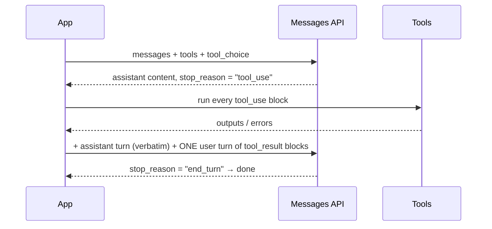

# Part 1 — Agentic loop and tool use

> **Objectives:** O01 parallel tool calls · O27 tool use + JSON schema, `tool_choice` to guarantee invocation · O37 `tool_choice` + sequencing dependent tools
> **Lessons:** [L01](../../../lessons/01-tool-loop-and-tool-choice/) · [L02](../../../lessons/02-parallel-tool-calls/)
> **Sources checked:** 2026-10-18 (links in *Going deeper*). SDK pinned: `@anthropic-ai/sdk` 0.135.0.

## TL;DR

An agent is a loop: call the Messages API, run any tools Claude asks for, send back the results, and repeat until Claude
stops asking. Three settings decide whether that loop is reliable. **`tool_choice`** decides *whether* and *which* tool
must be called. The **tool schema and description** shape *how* the tool gets called. **How you format tool results**
decides whether Claude keeps calling independent tools *in parallel*. On your last attempt you scored 0% on parallel
calls and 50% on `tool_choice`, and this part covers both.

## Core concepts

### The agentic loop



Rules the API enforces:

- A response with `stop_reason: "tool_use"` contains one or more `tool_use` blocks, each with an `id`, a `name` and an `input`.
- Your next request must append the **assistant turn unchanged**, followed by a **user** message whose content starts with
  one `tool_result` for every `tool_use` (matched by `tool_use_id`). Nothing may come between the two messages.
- In that user message, `tool_result` blocks come **first**. Text after them is fine, but text *before* them returns a 400.
- If a tool fails, send a `tool_result` with `is_error: true` and an **instructive** message ("No customer with that email;
  do not guess an id"). Claude reads it and adapts. With invalid input it typically retries 2–3 times.
- Keep a turn limit. Other `stop_reason` values to handle: `end_turn`, `max_tokens` (a truncated response; the
  `tool_use` input may be incomplete), `pause_turn` (server tools), `refusal`, `stop_sequence`, and `model_context_window_exceeded`.

### Tool definitions

A tool has a `name` (`^[a-zA-Z0-9_-]{1,128}$`), a `description`, an `input_schema` (JSON Schema), and optionally
`input_examples` and `strict`. The docs call the **description** "by far the most important factor in tool
performance". It should say what the tool does, when to use it and when not to, what each parameter means, and its
limits, in 3–4 sentences or more. Use `enum` and `required` in the schema so the contract is enforced, not just
requested. `strict: true` guarantees that inputs match the schema.

### Forcing tools with `tool_choice`

| `tool_choice` | Behaviour | Text before the call? |
|---------------|-----------|-----------------------|
| `{type: "auto"}` (default when tools are given) | Claude decides: a tool, several tools, or a plain answer | Yes |
| `{type: "any"}` | Must call *some* tool | No: the API prefills the turn |
| `{type: "tool", name: "x"}` | Must call tool `x` | No |
| `{type: "none"}` (default with no tools) | Can't call tools | – |

**Structured output via a tool:** define a tool whose `input_schema` is the shape you want (for example `record_triage`) and force
it with `{type: "tool", name: "record_triage"}`. Then read `tool_use.input`, which is already parsed JSON. That's more
reliable than asking for JSON in prose and parsing the text.

**Current-API caveats** (they matter in real code, and the exam may still expect the classic pattern):
- On **Opus 5.5, Sonnet 5.5, Fable 5.1 and Mythos 5.1**, `any` and `tool` return a 400 error. Use `auto` with `strict: true` tools, or structured outputs.
- With manual extended thinking (`thinking: {type: "enabled"}`), `any` and `tool` return an error.
- A forced call skips thinking: the response starts with `tool_use`.
- Changing `tool_choice` invalidates cached message blocks (prompt caching).

### Sequencing dependent tools

When tool B needs output from tool A (`list_orders` needs the `customer_id` that `lookup_customer` returns), you can
make that ordering more reliable in three ways, from weakest to strongest:

1. **Say it in the descriptions.** For example: "Requires a customer_id returned by lookup_customer; call lookup_customer first."
2. **Shape the schema** so B takes an id that only A can produce, and return an `is_error` hint if it's wrong.
3. **Force the first step** with `tool_choice: {type: "tool", name: "lookup_customer"}` on turn 0, then switch to `auto`.

Also add "Only batch tool calls that are independent of each other" to the system prompt, so a dependent pair isn't
emitted in the same parallel turn.

### Parallel tool calls

Claude 4 and later models can emit **several `tool_use` blocks in one turn**. Parallel calls are **on by default**.

- Turn them off with `disable_parallel_tool_use: true` **inside `tool_choice`**. It isn't a top-level parameter. With
  `auto` it means *at most one* tool call; with `any` or `tool` it means *exactly one*.
- Encourage parallel calls in the system prompt: *"For maximum efficiency, whenever you need to perform multiple independent operations,
  invoke all relevant tools simultaneously rather than sequentially."*
- **Return every result in one user message.** Sending one user message per result is the most common reason parallel
  calls stop: the history "teaches" Claude to call one tool at a time.
- Parallel *emission* only cuts latency if you also *execute* the calls concurrently (`Promise.all` or `allSettled`).
  The API doesn't prescribe an execution order.
- Measure it: average `tool_use` blocks per tool-calling response. Above 1.0 means parallel calls are happening.

```ts
// one round trip for three independent lookups
const calls = response.content.filter((b) => b.type === 'tool_use');
const settled = await Promise.allSettled(calls.map((c) => handlers[c.name](c.input)));
messages.push(
  { role: 'assistant', content: response.content },
  { role: 'user', content: calls.map((c, i) => toToolResult(c.id, settled[i])) }, // ONE message
);
```

## How it applies to what you were doing

The exam frames these as scenarios. Some decision rules:

- *"The downstream system crashes when Claude answers conversationally."* → Use a tool whose schema is the output shape,
  plus forced `tool_choice` (or `strict` + `auto` on models that can't be forced). The wrong answers are "add 'respond only in JSON'
  to the prompt" or "retry until it parses".
- *"Claude calls `get_details` before it has the id."* → Describe the prerequisite in the dependent tool, force the
  first tool on turn 0, and return an instructive `is_error`.
- *"The agent needs N round trips for N independent lookups."* → Check for `disable_parallel_tool_use: true`, check that results come back as one
  message, add the parallel prompt, and execute concurrently.
- *"An agent stopped making parallel calls after a refactor."* → Check whether the refactor started sending one
  `tool_result` per user message.
- *"You need commentary before the tool call."* → Use `auto` plus an instruction. `any` and `tool` suppress preamble text.

## Trade-offs / when NOT to use it

- **Over-forcing.** Forcing a tool on every turn removes the model's judgement and can create loops. Force only at the
  points where the contract requires it: the first prerequisite, and the final structured output.
- **Parallel execution with side effects.** Writes, shared state and ordered operations should run sequentially. Stop
  at the first failure and return `is_error: true` ("Not executed: …") for the calls you skipped, since every
  `tool_use` still needs a result.
- **`disable_parallel_tool_use` has valid uses.** For example, a tool that isn't safe to run concurrently, or a
  strict step-by-step audit trail. It trades latency for control.
- **Truncation.** With `stop_reason: "max_tokens"` during a tool call, the input may be incomplete. Don't execute it;
  retry with a higher limit or a smaller task (see Part 2, truncation).
- **Untrusted tool output.** Web pages and emails inside `tool_result` can carry prompt injection. Keep them inside
  `tool_result`, never in the system prompt.

## Going deeper

- [Define tools](https://platform.claude.com/docs/en/agents-and-tools/tool-use/define-tools): tool definitions, description best practices, `tool_choice`, forcing caveats
- [Handle tool calls](https://platform.claude.com/docs/en/agents-and-tools/tool-use/handle-tool-calls): `tool_result` format and ordering, `is_error`
- [Parallel tool use](https://platform.claude.com/docs/en/agents-and-tools/tool-use/parallel-tool-use): execution, formatting, prompting, troubleshooting
- [Strict tool use](https://platform.claude.com/docs/en/agents-and-tools/tool-use/strict-tool-use) and [Tool Runner](https://platform.claude.com/docs/en/agents-and-tools/tool-use/tool-runner) (the SDK loop helper)
- [Writing tools for agents](https://www.anthropic.com/engineering/writing-tools-for-agents)
- Next: **Part 2 — Structured output and extraction**, which covers choosing between tool schema, prompt and prefill (O25) and nullable extraction fields (O26).
