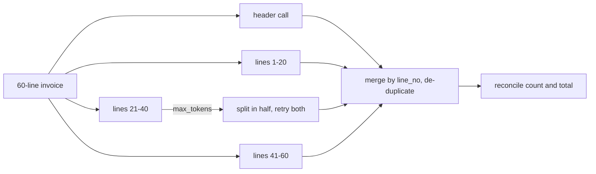

# Part 2 — Structured output and extraction

Most real uses of Claude end with a program, not a person, reading the answer. An accounts-payable system wants the
invoice number, the date and the total as fields it can store. A ticketing system wants a category from a fixed
list. A spreadsheet wants numbers, not "about fifteen hundred euros". For all of these, a beautifully written
paragraph is useless, and a JSON object that is *almost* right is worse than useless: it gets imported, and the
mistake surfaces weeks later in a reconciliation report.

So extraction has to give you three things at once. The **shape** must be right every time, or your parser crashes.
The model must be **honest** about what the document doesn't say, or it will fill gaps with plausible inventions. And
the **values** must be right across messy, varied inputs: German decimals, American dates, credit notes, handwriting.
On top of that come two operational problems: what to do when the answer is too big to fit in one response, and how
to improve the prompt systematically instead of patching one failure at a time.

By the end of this chapter you'll be able to pick the right output method for a model and a use case, design a schema
that lets the model say "not in the document", add the accuracy patterns that make values right, split work that
doesn't fit, and run a refinement loop that converges. The four lessons that follow have you build each piece.

> **Objectives:** O25 choose the output method · O26 extraction schemas that don't force fabrication · O29 accuracy patterns · O31 inclusion and exclusion criteria · O28 truncation by splitting · O12 iterative refinement
> **Lessons:** [Lesson 3](../../../lessons/03-structured-output-and-extraction-schema/) · [Lesson 4](../../../lessons/04-extraction-accuracy-and-criteria/) · [Lesson 5](../../../lessons/05-truncation-split-and-merge/) · [Lesson 6](../../../lessons/06-iterative-refinement/)
> **Sources checked:** 2026-10-18 (links in *Going deeper*). SDK pinned: `@anthropic-ai/sdk` 0.135.0 (`output_config.format`).

## The running example

Throughout this chapter we'll work on the accounts-payable inbox (the mailbox where suppliers send the bills to be paid) of **Northwind Traders LLC**, a small company
that receives supplier documents by email and scan. It's the same data the lessons use (`fixtures/invoices/`). Every
document arrives as plain text after OCR, and they are deliberately unalike:

| id | What it is | What makes it tricky |
|----|------------|----------------------|
| `INV-1` | Acme Office Supply invoice | US dates (`03/04/2026` = 4 March), `$1,245.50` |
| `INV-2` | Müller Industrietechnik *Rechnung* | German dates (`04.03.2026` = 4 March), `1.234,56 €`, no PO (purchase order number), bank details printed |
| `INV-3` | Acme credit note | The total is a credit: `-$189.00` |
| `INV-4` | J. Barker & Sons, handwritten | `£340`, "5th march '26", a margin note in a different pen: *"PAID?? check w/ Tom"* |
| `INV-5` | Brightline Consulting | `Date: 02/03/2026` (February 3 or March 2?), `Amount due: 1,500.00` with **no currency**, "Please pay within 15 days" |
| `INV-6` | Cloudway Hosting *Master Services Agreement* | A contract, not an invoice: "GBP 2,000.00 per month" |
| `INV-8` | Polish *Faktura VAT* | `2 460,00 zł` (space as thousands separator, comma as decimal) |
| `INV-7` | Globex Industrial Supply | 60 line items: too big to extract in one modest response |

The target is one record per document, an `InvoiceExtraction`:

```ts
interface InvoiceExtraction {
  document_type: 'invoice' | 'credit_note' | 'contract' | 'other';
  vendor_name: string | null;
  invoice_number: string | null;
  po_number: string | null;
  issue_date: string | null;      // YYYY-MM-DD
  due_date: string | null;        // YYYY-MM-DD
  currency: 'USD' | 'EUR' | 'GBP' | 'PLN' | 'other' | null;
  total_amount: number | null;    // '.' decimal separator, negative for credit notes
  line_items: { description: string; quantity: number | null; unit_price: number | null; amount: number }[];
  payment_terms: string | null;
  ambiguous_fields: ('issue_date' | 'due_date' | 'currency' | 'total_amount' | 'vendor_name')[];
}
```

The record goes straight into the ledger import, which is strict: it rejects anything that doesn't match this type,
and it can't tell a real PO number from an invented one. Each fixture also carries the **ground truth**, the record a
careful human would produce. Notice already how many `null`s it contains: `INV-2` has no PO, `INV-5` has no currency
and an unreadable date, and `INV-6` has no invoice number or total. Getting those `null`s right is half of this chapter.

## 1. How do you get JSON you can trust?

### The problem

The first version of every extraction pipeline looks like this: put "Return the result as JSON with these fields…"
in the prompt, take the reply text, and call `JSON.parse`. It works on the first ten documents. Then one reply starts
with "Here is the extracted data:", another wraps the JSON in a Markdown code fence, and a third leaves out
`po_number` because the document didn't have one. Each of these crashes the import, and none of them shows up in a
demo. The prompt *asked* for a shape; nothing *enforced* it.

### The idea

There are several ways to get structured output from Claude, and they differ in one crucial property: whether the
shape is **guaranteed** or merely **requested**.

**JSON outputs** (the structured outputs feature) is the strongest. You pass a JSON Schema in the request under
`output_config.format`, and the API uses **constrained decoding**: while generating, the model can only produce tokens
that keep the output valid against your schema. The reply's text block is then guaranteed to parse and to match the
schema, with two exceptions covered below. It's generally available on all current models, including Opus, Sonnet and
Haiku 5.5. (Older code used a top-level `output_format` parameter; it's deprecated in favour of
`output_config.format`. The SDK helpers `zodOutputFormat()` and `jsonSchemaOutputFormat()` build the field for you.)

**Strict tool use** applies the same guarantee to tool *inputs*: set `strict: true` on a tool definition, and every
`tool_use.input` Claude produces for that tool matches its `input_schema`. Use it when what you need is validated
*function arguments*. It can be combined with JSON outputs in the same request.

**A forced tool** is the classic pattern from Part 1: define a tool whose `input_schema` *is* the shape you want
(say, `record_invoice`), force it with `tool_choice: { type: "tool", name: "record_invoice" }`, and read
`tool_use.input`. The tool schema shapes the output. This was *the* way to get reliable structured output before
structured outputs existed, and it's still the classic exam answer to "guarantee structured output". Remember Part 1's
caveat, though: Opus 5.5, Sonnet 5.5 and Fable 5.1 reject forced `tool_choice` with a 400 error.

**Prompt only** means you describe the JSON in the prompt and show an example, and nothing else:

```ts
const prompt = `Extract the invoice below. Reply with JSON only, like this:
{"vendor_name": "Acme Office Supply Inc.", "invoice_number": "10234", "total_amount": 1245.5}

${documentText}`;
```

Nothing enforces it, so the reply may come back as `Here's the JSON: {…}`, with a missing field, or with
`"total_amount": "1,245.50"` as a string. That's acceptable only when best effort is good enough and your code has a
fallback: try `JSON.parse` and validate, and if that fails, send the error back and ask again.

**Prefill** means you write the first characters of Claude's reply yourself. You end the `messages` array with an
`assistant` message containing just `{`, and the model carries on writing from that point:

```ts
messages: [
  { role: 'user', content: prompt },
  { role: 'assistant', content: '{' }, // the reply "starts" here
]
// the model continues with:  "vendor_name": "Acme Office Supply Inc.", ...}
// your code glues it back:    JSON.parse('{' + reply)
```

The trick stops Claude from opening with "Here's the JSON:", because the reply has already started inside the object.
That's all it does: the rest can still have a missing field or a wrong type. On current models you can't use it at all.
Ending the request with an assistant message returns a **400 error on Claude 4.6 and later**, including every 5.x
model. You need to recognise it in old code, but it's never the right answer for "most reliable".

| Method | How | Guarantee | Use when |
|--------|-----|-----------|----------|
| JSON outputs | `output_config: { format: { type: "json_schema", schema } }` | Parses and matches the schema (except on `refusal` / `max_tokens`) | You need the final response in a fixed shape |
| Strict tool use | Tool with `input_schema` + `strict: true` | Tool inputs match the schema | You need validated function arguments |
| Forced tool (classic) | Output-shaped tool + `tool_choice: {type: "tool", name}` | Shape enforced by the tool schema | Models without structured outputs that accept forcing |
| Prompt only | "Return JSON matching…" + example | None | Best effort is acceptable, with a fallback |
| Prefill (legacy) | Assistant turn starting with `{` | None | Legacy models only; 400 error on Claude 4.6+ |

The decision rule is: **pick the strictest method the model supports that the use case actually needs.**

### Worked example: extracting `INV-1`

Here is the request the Lesson 3 solution builds for Acme's invoice (schema shortened):

```json
{
  "model": "claude-haiku-5-5",
  "max_tokens": 2048,
  "system": "You extract data from accounts-payable documents. Copy values only from the document. If a value is not in the document, return null; never guess or derive it. If a value can be read more than one way, return null for it and list the field in ambiguous_fields.",
  "output_config": {
    "format": {
      "type": "json_schema",
      "schema": { "type": "object", "additionalProperties": false, "properties": { "...": "..." }, "required": ["document_type", "vendor_name", "..."] }
    }
  },
  "messages": [
    { "role": "user", "content": "<document id=\"INV-1\">\nACME OFFICE SUPPLY INC.\n...\nInvoice Date: 03/04/2026\n...\nTOTAL USD    $1,245.50\nTerms: Net 30\n</document>" }
  ]
}
```

Notice that there's no `tools` array and no prefill. The response is an ordinary assistant message whose text block
is the JSON:

```json
{
  "stop_reason": "end_turn",
  "content": [
    { "type": "text", "text": "{\"document_type\":\"invoice\",\"vendor_name\":\"Acme Office Supply Inc.\",\"invoice_number\":\"10234\",\"po_number\":\"4500-1182\",\"issue_date\":\"2026-03-04\",\"due_date\":\"2026-04-03\",\"currency\":\"USD\",\"total_amount\":1245.5,\"line_items\":[...],\"payment_terms\":\"Net 30\",\"ambiguous_fields\":[]}" }
  ]
}
```

No preamble, no code fence, every key present. `JSON.parse` on that text can't fail, *provided the response is
complete*. That condition is the one thing you still have to check, so the solution's parser looks at `stop_reason`
before it trusts anything:

```ts
export function parseExtraction(message: Message): InvoiceExtraction {
  if (message.stop_reason === 'refusal') throw new ExtractionError('Model refused; output may not match the schema');
  if (message.stop_reason === 'max_tokens') throw new ExtractionError('Truncated at max_tokens; output may be incomplete');
  const block = message.content.find((b) => b.type === 'text');
  if (block?.type !== 'text') throw new ExtractionError('No text block in response');
  return JSON.parse(block.text) as InvoiceExtraction;
}
```

Choosing the method is a short decision you make once per pipeline, not code you run per request:

| Need | Model has structured outputs (Haiku/Sonnet/Opus 5.5) | Legacy model without them |
|------|------------------------------------------------------|---------------------------|
| Best effort | Prompt instructions (+ an example) | Prompt instructions (+ an example) |
| Guaranteed shape | `output_config.format` | A tool whose `input_schema` is the shape, forced with `tool_choice` |

Prefill never appears in the table: it can't guarantee anything, and the current models reject it.

### What goes wrong

**Prefill on a current model.** The Lesson 3 starter sends an assistant turn of `"{"` to "help" the model start with JSON.
On any Claude 4.6+ model the whole request fails with a 400 error before a single token is generated. The fix is to
delete the prefill and use `output_config.format`.

**Trusting the guarantee on a cut-off response.** The guarantee covers *complete* responses. If the reply stops at
`max_tokens`, the JSON is cut off mid-array; if the model refuses (`stop_reason: "refusal"`), the text may not follow
the schema at all. A parser that skips the `stop_reason` check turns both into a confusing `SyntaxError` far from the
cause, or worse, imports a partial record.

**Prompt wording as a "fix".** "Respond ONLY with valid JSON, NO OTHER TEXT" in capitals lowers the failure rate. It
doesn't make it zero, and at thousands of documents a day, "rarely" is "every day". When the consumer is code, the
fix is a method with a guarantee.

> **Check yourself:** A team running Sonnet 5.5 must guarantee that every reply parses into their schema. One engineer
> proposes a forced `record_invoice` tool; another proposes prefilling `{` and a stronger prompt. What do you recommend?
>
> <details><summary>Answer</summary>
>
> Neither. On Sonnet 5.5 a forced `tool_choice` returns a 400 error, and prefilling the assistant turn also returns a
> 400 error on Claude 4.6+ models; even where prefill works, it only seeds the first tokens and guarantees nothing.
> Use JSON outputs: `output_config.format` with the schema, which is constrained decoding and is available on Sonnet
> 5.5. (Strict tool use with `auto` is the alternative if the output really is a function call.) Then check
> `stop_reason` before parsing, because a refusal or a `max_tokens` cut isn't covered by the guarantee.
>
> </details>

## 2. What should the model say when the document doesn't say?

### The problem

Switch the pipeline to JSON outputs with a straightforward schema (every field a plain `string` or `number`, all
`required`) and the parse errors disappear. Then the auditors find something worse. Müller's invoice (`INV-2`) has
no PO number, but the record says `po_number: "RE-2026-0457"`, the invoice number reused. Brightline's invoice
(`INV-5`) states no currency, but the record says `"USD"`. The Cloudway contract (`INV-6`) has no invoice number, but
the record has one anyway.

The model didn't malfunction. **The schema forced it.** A schema is a contract the model must satisfy, and with
constrained decoding it *cannot* leave a required string empty or write anything but a string there. If the contract
demands a value the document doesn't contain, the model produces the most plausible one. That's fabrication caused by
the schema, not by the model.

### The idea

The cure is to make "not in the document" a valid, explicit answer. A few design rules get you there.

**Nullable fields.** A field that can legitimately be absent gets a union type: `"type": ["string", "null"]`. Now
`null` is an allowed value, and the description says when to use it ("null if not shown").

**Required *and* nullable, rather than optional.** You could instead make `po_number` optional (leave it out of
`required`). But then an absent key could mean "the document has no PO" or "the model forgot to look", and your
downstream code and evals have to handle two shapes. Required + nullable means every key is always present, and
`null` always means *"I looked; it isn't there."* One stable shape.

**Enums with an escape value.** A closed enum is a forced choice. `currency: { enum: ["USD", "EUR", "GBP", "PLN"] }`
leaves the model no correct answer for Brightline's invoice, so it picks the likeliest, `"USD"`. Give every enum an
exit: `"other"` for a value outside the list, and `null` for "not stated". The same goes for `document_type`: without
`"contract"` and `"other"`, the Cloudway agreement has to be labelled an invoice.

**An ambiguity channel.** Some values are present but have two readings. `INV-5`'s `Date: 02/03/2026` is 3 February
in the US convention and 2 March in most of Europe, and the document gives no clue which. Picking one is a coin flip
presented as fact. Instead, return `null` for the field and list it in an `ambiguous_fields` array. This is more than
honesty: Part 3 uses exactly this array to route the document to a human reviewer who checks only that field.

**Stay inside what structured outputs accepts.** Constrained decoding supports a subset of JSON Schema. Every object
must set `additionalProperties: false`. Numeric and string constraints (`minimum`, `maximum`, `minLength`,
`maxLength`) and `minItems` above 1 are rejected with a 400 error, so express such rules in the field's `description`
and check them in code (section 3). There are also complexity limits: at most 16 union-typed parameters (each
nullable field counts) and 24 optional parameters across a request's schemas. And the docs note that enum *casing*
isn't guaranteed, so compare enum values case-insensitively downstream.

### Worked example: the schema, and `INV-5`

These are the fields from the Lesson 3 solution that matter here:

```json
{
  "type": "object",
  "additionalProperties": false,
  "properties": {
    "document_type": { "type": "string", "enum": ["invoice", "credit_note", "contract", "other"],
                       "description": "Use \"other\" for anything that is not an invoice, credit note or contract." },
    "po_number":     { "type": ["string", "null"],
                       "description": "Customer purchase-order number. null if not shown; never reuse another number." },
    "issue_date":    { "type": ["string", "null"], "format": "date",
                       "description": "YYYY-MM-DD. null if absent or ambiguous." },
    "currency":      { "type": ["string", "null"], "enum": ["USD", "EUR", "GBP", "PLN", "other", null],
                       "description": "ISO 4217 code; \"other\" if not listed; null if the document states none." },
    "ambiguous_fields": { "type": "array",
                          "items": { "type": "string", "enum": ["issue_date", "due_date", "currency", "total_amount", "vendor_name"] },
                          "description": "Fields whose printed value supports more than one reading." }
  },
  "required": ["document_type", "vendor_name", "invoice_number", "po_number", "issue_date", "due_date",
               "currency", "total_amount", "line_items", "payment_terms", "ambiguous_fields"]
}
```

Run Brightline's invoice through it and the honest record is now *expressible*:

```json
{
  "document_type": "invoice",
  "vendor_name": "Brightline Consulting",
  "invoice_number": "2026-031",
  "po_number": null,
  "issue_date": null,
  "due_date": null,
  "currency": null,
  "total_amount": 1500,
  "line_items": [{ "description": "Professional services – workshop facilitation (2 days)", "quantity": null, "unit_price": null, "amount": 1500 }],
  "payment_terms": "within 15 days",
  "ambiguous_fields": ["issue_date", "currency"]
}
```

Notice each `null` has a different reason. `po_number` is simply absent. `issue_date` is present but ambiguous, so it
is also listed in `ambiguous_fields`. `currency` is absent, and because "1,500.00" from a consulting firm could be in
several currencies, it's flagged too. `due_date` is null because the document only gives a relative term ("within 15
days"); section 4 explains why the model must not compute a date from it. Every one of these `null`s matches the
ground truth, and none could have been produced by the first schema.

The schema is half the fix; the system prompt states the same contract in words: *"Copy values only from the
document. If a value is not in the document, return null; never guess or derive it. If a value can be read more than
one way, return null for it and list the field in ambiguous_fields."*

### What goes wrong

**A constraint structured outputs rejects.** A well-meaning schema adds `"total_amount": { "type": "number",
"minimum": 0 }` to stop negative totals. The request fails with a 400 error, because `minimum` isn't supported. (It
would also have been wrong: credit notes like `INV-3` are negative.) Lesson 3's tests walk your schema and report such problems
before the API does:

```text
$.total_amount: minimum
$.line_items: minItems > 1
$.line_items[]: additionalProperties must be false
```

**Nullable everything, measured nothing.** Making every field nullable can over-correct: a lazy extraction returns
`null` where the value *is* printed. Required + nullable plus an instruction to copy printed values keeps the model
honest in both directions, but you only know it works by measuring the null rate per field against ground truth,
which is exactly what section 6's evaluation does.

> **Check yourself:** An extraction schema has `"currency": { "type": "string", "enum": ["USD", "EUR", "GBP"] }`, and
> every invoice from a Swiss supplier comes back as `"EUR"`. The team proposes adding "Be careful with currency" to the
> prompt. What's the real problem, and the fix?
>
> <details><summary>Answer</summary>
>
> The schema is a forced choice with no correct answer: CHF isn't in the enum, and the field can't be null, so the
> model must pick one of the three listed values and "EUR" is the closest. A prompt warning can't override a schema
> that makes the right answer impossible. Add an escape value (`"other"`, or the missing code) and make the field
> nullable for documents that state no currency, then describe when to use each. If the value can genuinely be read
> two ways, route it through `ambiguous_fields` rather than guessing.
>
> </details>

## 3. How do you make the values right, not just the shape?

### The problem

With JSON outputs and an honest schema, every record parses and the `null`s are in the right places. Run the whole
inbox, though, and value errors remain:

- Müller's (`INV-2`) total `1.234,56 €` comes back as `1.23456` (the German thousands dot read as a decimal point)
  or as `1234`.
- Müller's `Rechnungsdatum: 04.03.2026` comes back as `"2026-04-03"`, the US reading of a German date, so 3 April instead
  of 4 March.
- The credit note's (`INV-3`) total comes back positive.

Structured outputs guarantees **shape**, not **truth**. A number field accepts `1.23456` just as happily as `1234.56`.
Value errors come from two sources: varied input formats that the model has to normalise, and guessing where the
model should have been told exactly what to do.

### The idea

Four patterns, used together, take care of most value errors.

**1. Normalisation instructions with worked examples.** Tell the model the one canonical form for each value type, and
show the conversion for the formats it will meet. Abstract rules ("use a dot as decimal separator") are easy to
misapply; concrete before → after pairs are not:

```text
- Dates: output YYYY-MM-DD. Read US documents (MM/DD/YYYY) and European documents (DD.MM.YYYY) by their own convention.
- Amounts: plain number, '.' as decimal separator, no thousands separator:
  '1.234,56 €' → 1234.56, '2 460,00 zł' → 2460, '$1,245.50' → 1245.5.
- Credit notes: total_amount and line amounts are negative.
- Currency: ISO 4217 code from an explicit symbol or code (€ → EUR, £ → GBP, zł → PLN, $ with a US address → USD).
```

**2. Few-shot examples.** An *example* (or "shot") is a complete input document paired with its correct output. The
prompting docs recommend 3–5 examples that are **relevant** (the same task) and **diverse** (covering the edge cases),
wrapped in `<examples><example>…</example></examples>` tags so Claude can tell them apart from the instructions.
Diversity is the point: five clean US invoices teach the model nothing about German decimals; one US, one German and
one handwritten invoice teach it the rules. And never use the target document as its own example; that tests nothing
and leaks the answer.

**3. Validation in code.** Some rules can't be expressed in a schema that structured outputs accepts, and some are
cross-field facts: the line items should sum to the total, dates should match `YYYY-MM-DD`, a credit note's total
should be negative. Check them deterministically after extraction. Code is cheap, exact and never gets tired.

**4. Retry with the specific error, then route to a human.** When validation fails, don't just ask again. Send the
model its own output plus the exact failure ("total_amount 1.23456 does not equal the sum of line item amounts
1234.56") and ask it to re-read the document. Cap the retries (Lesson 4 uses 2 attempts). Whatever still fails is not
discarded and not force-accepted: it's returned as an open issue so a human can resolve it (Part 3 builds that
routing).

### Worked example: `INV-2`, from wrong to right

First, the few-shot examples. Lesson 4 picks them once, by hand, and sends the same three with every document:

| Example | What its output demonstrates |
|---------|------------------------------|
| `INV-8` (Polish) | EU date, space thousands and comma decimals (`2 460,00 zł` → `2460`), PLN |
| `INV-3` (credit note) | negative total and line amounts |
| `INV-4` (Barker) | GBP, an informal date, the handwritten "PAID??" note ignored |

Three examples that between them cover the conversions and boundaries the rules describe. A fixed set keeps the
system prompt identical on every request, so prompt caching can reuse it; choosing examples per document would change
the prompt on every call. And none of the three is among the documents the lesson scores: an example that is also
a test case gets copied, not extracted. That's why `INV-2`, the document below, isn't an example: its German decimals
and its IBAN have to be handled by the normalisation rules and the `<exclude>` rule alone.

**Rule or example?** Use both, for different jobs. Every boundary gets a written rule (category, reason, safe output);
examples then show the rules applied, and show conversions that are easy to misread from words alone. Don't rely on
examples to teach an exclusion: an output shows *that* a field is null, not *why*, so the model may learn the wrong
pattern.

Now suppose the first extraction of `INV-2` misreads the total as `1.23456`. `validateExtraction` sums the line items
(`225.00 + 1009.56 = 1234.56`) and reports:

```text
total_amount 1.23456 does not equal the sum of line item amounts 1234.56
```

`extractWithValidation` appends the model's own output and a targeted correction to the conversation:

```json
[
  { "role": "user", "content": "<document id=\"INV-2\">\nMüller Industrietechnik GmbH\n...\nGesamtbetrag  1.234,56 €\n...</document>" },
  { "role": "assistant", "content": "{\"document_type\":\"invoice\", ... ,\"total_amount\":1.23456, ...}" },
  { "role": "user", "content": "Your extraction failed these checks:\n- total_amount 1.23456 does not equal the sum of line item amounts 1234.56\nRe-read the document and return the corrected extraction. Change only what the evidence supports." }
]
```

The second attempt returns `1234.56`, validation passes, and the result is `{ extraction, attempts: 2, issues: [] }`.
Had it still failed, the result would carry the remaining issue for a reviewer instead of throwing it away.

Notice how the patterns divide the work. Normalisation rules and examples *prevent* most errors; validation *detects*
the rest; the targeted retry *repairs* what it can; and the issue list *escalates* what it can't.

### What goes wrong

**Unrepresentative examples.** Five examples, all clean US invoices, make the model *better* at US invoices and
*worse* at everything else, because it copies their quirks (dollar signs, MM/DD dates) onto documents where they don't
apply. Pick for coverage, not for convenience.

**Retrying blind.** "That's wrong, try again" gives the model nothing to fix; it may return the same mistake, or
change a field that was right. The retry message must name the field, the bad value and the evidence.

**Discarding or force-accepting after the cap.** Dropping a document that failed validation twice loses an invoice
someone has to pay. Accepting it anyway imports a wrong total. Neither is right: return it with its issues and let a
human decide.

> **Check yourself:** An extraction pipeline handles US, German and Japanese invoices. Accuracy on German totals is
> 70%. The team adds two more few-shot examples, both US invoices, "to give the model more practice". Will this help?
> What would?
>
> <details><summary>Answer</summary>
>
> Probably not, and it may hurt: more examples of the same format reinforce US conventions (comma thousands
> separators) that are exactly what breaks German totals. What helps is diversity and explicit rules: replace an
> example with a German invoice showing `1.234,56 €` → `1234.56`, add that conversion to the normalisation
> instructions, and validate totals against the line-item sum in code, retrying with the specific mismatch.
>
> </details>

## 4. Where should the model refuse to answer?

### The problem

Some errors aren't format problems. Run the inbox again and look at what the model *volunteers*:

- For Brightline (`INV-5`), "Please pay within 15 days" becomes `due_date: "2026-02-18"`, computed from an issue date
  the model couldn't even read reliably.
- For a supplier with a German address, a missing currency becomes `"EUR"`.
- Müller's IBAN ends up in `payment_terms`.
- Barker's margin note in a different pen, *"PAID?? check w/ Tom"*, lands in `payment_terms` too.

Each of these is the model being helpful. Each is also a category where it is **unreliable**: date arithmetic on
uncertain inputs, inference from weak signals, sensitive data in the wrong field, annotations of unknown authority.
The model *can* produce an answer in these categories; the answers just can't be trusted at the rate a ledger needs.

### The idea

Define the boundaries explicitly. An **inclusion criterion** says what is in scope; an **exclusion criterion** names a
category to leave alone, **why**, and **what to output instead**. The last part matters most. An exclusion without a
safe alternative ("don't compute due dates") still leaves the model with a required field and nothing to put in it,
so it's under pressure to fill the gap anyway. "Output null and keep the terms in `payment_terms`" removes the
pressure.

Lesson 4's solution keeps the boundaries as data and renders them into tagged prompt sections:

```ts
export const SCOPE: Scope = {
  include: [
    'Values printed on the document by the issuer: numbers, dates, amounts, terms, line items.',
    'For contracts: parties, currency and payment terms only.',
  ],
  exclude: [
    { what: 'Bank details (IBAN, BIC, account numbers).',
      reason: 'Not part of the record and sensitive; never copy them into any field.' },
    { what: 'Handwritten margin notes or annotations added after the document was issued (e.g. "PAID?").',
      reason: 'Unreliable OCR and not issued by the vendor; ignore them entirely.' },
    { what: 'Due dates calculated from relative terms such as "within 15 days" or "Net 30".',
      reason: 'Date arithmetic from an uncertain issue date produces confident wrong dates; output null and keep the terms in payment_terms.' },
    { what: 'Currency inferred from the vendor country or language when no symbol or code is printed.',
      reason: 'Country is not currency; output null and list currency in ambiguous_fields.' },
    { what: 'Totals or line items for contracts and recurring fees.',
      reason: 'A monthly fee is not a document total; output null total_amount and an empty line_items list.' },
  ],
};
```

which `buildSystemPrompt` turns into:

```xml
<include>
- Values printed on the document by the issuer: numbers, dates, amounts, terms, line items.
- For contracts: parties, currency and payment terms only.
</include>
<exclude>
Do NOT extract the following, even if present:
- Bank details (IBAN, BIC, account numbers). Not part of the record and sensitive; never copy them into any field.
- Due dates calculated from relative terms such as "within 15 days" or "Net 30". Date arithmetic from an uncertain issue date produces confident wrong dates; output null and keep the terms in payment_terms.
- ...
</exclude>
```

### Worked example: the contract and the handwritten invoice

The Cloudway agreement (`INV-6`) says "Fees: GBP 2,000.00 per month, invoiced monthly in advance." Without the
contract exclusion, a model will happily return `total_amount: 2000` and a line item, and the ledger will book a
£2,000 invoice that doesn't exist. With it, the record is:

```json
{ "document_type": "contract", "vendor_name": "Cloudway Hosting Ltd", "invoice_number": null, "po_number": null,
  "issue_date": null, "due_date": null, "currency": "GBP", "total_amount": null, "line_items": [],
  "payment_terms": "30 days from invoice date", "ambiguous_fields": [] }
```

`currency` is still `"GBP"`, because the contract prints it; the inclusion criterion keeps what's in scope.

For Barker's handwritten invoice (`INV-4`), the exclusion of later annotations keeps *"PAID?? check w/ Tom"* out of
every field: `payment_terms` is `null`, because the vendor printed none. Whether the invoice was paid is a question
for Tom, not for the extractor.

The same principle carries over to review prompts, which Part 8 builds. "Report only security issues of types X, Y
and Z; do not comment on style" stops a reviewer from producing findings in categories where its false-positive rate
is high. Precision comes from saying what *not* to report.

### What goes wrong

**"Be careful" instead of a boundary.** "Be careful with due dates" doesn't tell the model what careful *means*. It
still has a required `due_date` and a tempting "within 15 days"; it will compute. An explicit exclusion with a safe
output works where exhortation doesn't.

**Excluding without a reason.** "Do not extract bank details" with no reason can be over-applied (dropping the vendor
name because it's near the bank block) or under-applied (copying the IBAN into a "notes"-like field because that's not
technically "extracting bank details"). The reason tells the model the *intent*, so it can apply the rule to cases
the wording didn't anticipate.

> **Check yourself:** A review prompt for pull requests produces many useful security findings but also dozens of
> low-value comments about variable names and formatting, which reviewers have learned to ignore, so they now miss
> the security findings too. Which change addresses this most directly?
>
> <details><summary>Answer</summary>
>
> Define explicit inclusion and exclusion criteria: list the categories to report (for example injection,
> authorization and secrets handling) and exclude style and naming with a reason ("handled by the linter; do not
> comment"). The model is unreliable, or at least unhelpful, in those categories, and an explicit boundary removes them
> entirely. Asking it to "focus on important issues" or raising a vague "confidence threshold" leaves the boundary
> undefined.
>
> </details>

## 5. What do you do when the answer doesn't fit?

### The problem

Globex's invoice (`INV-7`) has 60 line items. The extractor sends it in one call with `max_tokens: 4096`, and the
reply stops partway through the `line_items` array:

```json
{ "stop_reason": "max_tokens",
  "content": [{ "type": "text", "text": "{\"document_type\":\"invoice\", ... ,\"line_items\":[{\"description\":\"Fastener kit SKU-1001\", ... }, ... ,{\"description\":\"Fastener kit SKU-1037\",\"quantity\":3,\"unit_pr" }] }
```

`max_tokens` is a hard cap you set on the length of the reply. When the model reaches it mid-answer, the API stops
generating and reports `stop_reason: "max_tokens"`. The text is cut off wherever it happened to be. For JSON, that
means the output is almost certainly invalid; for a tool call, the `tool_use` input may be incomplete; and the
structured-outputs guarantee doesn't apply to a truncated response. (Section 1's `parseExtraction` throws exactly
here.)

The obvious fix is to raise `max_tokens` to 64,000 and retry. It works today. It's slow and expensive, it runs into
model and SDK limits (the stop-reasons docs note, for example, that the Python SDK requires streaming for large
`max_tokens` values, around 21k and up), and next month's 200-line invoice breaks it again.

### The idea

There are two different situations behind `max_tokens`, and they have different fixes.

If the **output size is fixed** and you're just slightly over (a one-page summary that needs 1,200 tokens with a
1,024 cap), raising `max_tokens`, or continuing the response, is the right fix. That's the docs' default advice.

If the **output grows with the input** (line items per invoice, findings per file, rows per spreadsheet), no cap is
ever safe. The fix is to **split the work into smaller scoped calls and merge the results.** Each call handles a
bounded slice, so each reply has a bounded size, whatever the document's total length.

A good split has four properties:

1. **Shared context in every call.** Each chunk call includes the document header, so the model knows the vendor,
   the currency and the column layout.
2. **A bounded `max_tokens` per call.** Small calls stay fast, and a truncation is a local event.
3. **A stable key per item** (here `line_no`, as printed), so merging can sort and de-duplicate overlaps.
4. **Reconciliation against the source.** After merging, check the count of items against the printed line count,
   and their sum against the printed total.

And if one chunk still truncates? Don't raise its limit: **split that chunk in half** and retry both halves.



### Worked example: `INV-7` in five calls

`splitDocument` separates the invoice at its `LINE ITEMS` / `END LINE ITEMS` markers into a header (vendor, number,
dates, PO, currency, and the column-header line), 60 item lines, and a footer (`TOTAL DUE: … USD`, `Terms: Net 30`).
`chunkLines` cuts the items into three chunks of 20.

The header call uses a small schema without `line_items` (`HEADER_SCHEMA`) and `max_tokens: 1024`. Each chunk call
looks like this:

```json
{
  "max_tokens": 4096,
  "system": "Extract every line item you are given, and only those. Keep each line_no as printed.",
  "output_config": { "format": { "type": "json_schema", "schema": { "...": "LINE_ITEMS_SCHEMA: { line_items: [{ line_no, description, quantity, unit_price, amount }] }" } } },
  "messages": [{ "role": "user", "content": "<document_header>\nGLOBEX INDUSTRIAL SUPPLY\nINVOICE GX-55120\n...\nNo.  Description  Qty  Unit  Amount\n</document_header>\n<line_items part=\"2/3\">\n 21  Fastener kit SKU-1021 ...\n...\n 40  Fastener kit SKU-1040 ...\n</line_items>" }]
}
```

All four calls (header plus three chunks) run concurrently with `Promise.all`. Suppose chunk 2 still comes back with
`stop_reason: "max_tokens"`. `extractChunk` splits its 20 lines into 21–30 and 31–40 and retries both halves, also
concurrently; each fits comfortably. That's five Messages API calls in total, none with a large `max_tokens`.

`mergeLineItems` then flattens all the chunk results, keeps the first item for each `line_no` (so overlaps from
retried halves are harmless), sorts by `line_no`, and drops the key. Finally the reconciliation:

```text
merged 60 line items  ==  60 item lines in the document  ✓
sum of amounts        ==  TOTAL DUE                      ✓
```

If either check failed, `extractLargeInvoice` would return the discrepancy in `issues` ("expected 60 line items,
merged 59"), which is a far better failure than a JSON syntax error.

### What goes wrong

**Chunks without context.** A chunk that contains only `21  Fastener kit SKU-1021  2  79.15  158.30` has no idea of
the currency or which column is the unit price. Always send the shared header.

**Merging without keys.** Concatenating chunk outputs works until a retry overlaps a boundary; then line 30 appears
twice and the total is wrong. Merge by a stable key and de-duplicate.

**No reconciliation.** Splitting introduces a new failure mode: a chunk can silently skip a line. Count and sum
checks against the source catch it; without them, the record looks complete and isn't.

**Splitting what doesn't need it.** For a fixed-size output that's slightly over the cap, splitting adds calls,
latency and merge code for nothing. Raise the limit (or continue) instead.

> **Check yourself:** A code-review job asks Claude for a JSON list of findings across a whole repository. On large
> repositories the response stops with `stop_reason: "max_tokens"` and the JSON fails to parse. A teammate sets
> `max_tokens` to the model's maximum. What's the better fix, and why?
>
> <details><summary>Answer</summary>
>
> The number of findings grows with the size of the input, so no fixed `max_tokens` is safe; the maximum just moves
> the failure to a bigger repository while making every call slower and costlier. Split the review into scoped calls
> (per file or per directory), each with a bounded output, run them concurrently, and merge the findings by a stable
> key (file plus line), de-duplicating overlaps. Raise `max_tokens` only when the output size is fixed and slightly
> over the cap.
>
> </details>

## 6. How do you improve the prompt without going in circles?

### The problem

The extraction prompt is good but not perfect, and the team improves it with Claude's help. Their loop: run one
document, find a mistake, send "This one is wrong, please improve the prompt", accept the revision, move to the next
document. After a week:

- Fixing Brightline's currency (now `null` instead of `"USD"`) made the model return `null` for Acme's currency too.
- Fixing Müller's date format broke the Polish invoice's dates.
- Nobody can say whether today's prompt is better than Tuesday's.

Each revision fixes the failure it was shown and quietly breaks others, because the reviser never sees them. The
loop **oscillates** instead of **converging**.

### The idea

A refinement loop converges when every round looks at the whole picture and fixes causes rather than anecdotes.
Concretely:

**Evaluate the whole set, every round, at field level.** Run the current prompt on all documents and compare each key
field to the ground truth. A *failure* names the document, the field, the expected value and the actual value. The
*score* is the share of field checks that passed. Now any change can be judged against everything, not against the
one document you were looking at.

**Give targeted feedback.** "Some outputs are wrong" gives the reviser nothing. "`INV-5`, field `currency`: expected
`null`, got `"USD"`" tells it exactly what to fix.

**Batch the issues into one message per round, grouped by field.** When the reviser sees all the currency failures
together ("wrong on `INV-5` and on two other documents, always `USD`"), it can find the shared cause, a default to
USD, and fix it once. Seen one at a time, the same failures look like unrelated anecdotes, and each patch can
contradict the last.

**Include concrete input → expected output examples.** For each failing field, show the actual document text, the
expected value and the actual value. A concrete example communicates the desired behaviour more precisely than any
description of it.

**Keep the history, return the best, and stop.** Record every round's prompt and score. A revision can make things
worse, so the loop returns the *best* prompt seen, not the latest. Stop when the score reaches the target or after a
fixed number of rounds.

| Do | Don't |
|----|-------|
| Evaluate the **whole** set every round, with a field-level score | Judge a change by the one document you were looking at |
| Give **targeted** feedback: document, field, expected, actual | "Some outputs are wrong, please improve" |
| Send **one batched** message per round, grouped by field | One revision request per failure, patching anecdotes in sequence |
| Include **concrete input → expected output** examples for failing cases | Describe the desired behaviour only in abstract terms |
| Keep history and return the **best** prompt; stop at the target or after N rounds | Accept the latest revision; loop forever |

### Worked example: one round on the invoice inbox

`evaluate` checks seven `KEY_FIELDS` (`document_type`, `invoice_number`, `po_number`, `issue_date`, `due_date`,
`currency`, `total_amount`) on each of the seven everyday documents: 49 checks. Suppose round 1 finds six failures,
a score of 43/49 ≈ 0.88. `buildBatchedFeedback` turns them into a single message, grouped by field, with up to two
concrete examples per field (shortened here):

```xml
Evaluation round: 6 field failures across 4 documents.

Fix the causes of ALL of them in one revision. Keep instructions that already work.

<field name="currency" failures="2" docs="INV-5,INV-4">
<example doc="INV-5">
<input>
Brightline Consulting
Invoice 2026-031
Date: 02/03/2026
...
Amount due: 1,500.00
</input>
<expected>null</expected>
<actual>"USD"</actual>
</example>
...
</field>

<field name="issue_date" failures="2" docs="INV-2,INV-5">
...
</field>

<field name="due_date" failures="2" docs="INV-5,INV-8">
...
</field>
```

The revision request sends the current prompt and this feedback, and asks for a `revised_prompt` plus a list of
`changes` (each naming the field it addresses), using JSON outputs so the reply is machine-readable. Then the whole
set is evaluated again with the revised prompt. A run might look like this (illustrative numbers):

| Round | Score | Failures | Kept? |
|-------|-------|----------|-------|
| 1 | 0.88 | 6 | |
| 2 | 0.96 | 2 | **best** |
| 3 | 0.94 | 3 | |

Round 3 made things slightly worse, which happens. Because the loop keeps history, `refinePrompt` returns round 2's
prompt rather than the latest. With `maxRounds: 3` it stops there either way.

### What goes wrong

**Overfitting to the evaluation set.** Seven documents are enough to learn the mechanics, not to trust the result. A
prompt tuned until it scores 1.0 on seven documents may have memorised their quirks. Keep a held-out set that the
loop never sees, and check the final prompt against it.

**Abstract feedback.** "Handle currencies better" invites a generic paragraph about currencies. The concrete
`<input>`/`<expected>`/`<actual>` triple invites the specific fix: *don't default to USD when no symbol is printed*.

**Unbounded loops.** "Keep going until it's perfect" never terminates on a hard set. A target score and a round cap
make the cost predictable.

> **Check yourself:** A team iterates on a classification prompt by fixing one misclassified example at a time. Each
> fix works for that example, but the overall accuracy hasn't moved in two weeks. What should they change about the
> process?
>
> <details><summary>Answer</summary>
>
> Stop judging changes one example at a time. Each round, evaluate the whole labelled set, collect every
> misclassification with its input, expected and actual label, group them by pattern, and send them to the reviser in
> one batched message so it can fix shared causes once. Re-evaluate the whole set after each revision, keep the best
> version (a revision can regress), stop at a target or a round cap, and confirm on a held-out set to avoid
> overfitting.
>
> </details>

## 7. Putting it together

Here's the whole inbox flowing through the pipeline you build in Lessons 3–6, with each idea in its place.

1. **Method.** The records feed an import that must never fail to parse, and Haiku 5.5 supports structured outputs,
   so every request uses `output_config.format`. No prefill, no prompt-only JSON (section 1).
2. **Schema.** Required + nullable fields, enums with `"other"` and `null`, `ambiguous_fields`, and nothing
   structured outputs would reject (section 2).
3. **Prompt.** Normalisation rules with before → after examples, `<include>`/`<exclude>` boundaries with reasons
   and safe outputs, and a fixed set of three diverse few-shot examples in the system prompt (sections 3–4).
4. **Everyday documents.** Each is extracted, the `stop_reason` checked, and the record validated in code. `INV-2`'s
   misread total fails the line-sum check, is retried with the specific error, and passes on attempt 2. `INV-5` comes
   back with `issue_date` and `currency` null and flagged as ambiguous, ready for Part 3's review routing.
   `INV-6` comes back as a `contract` with no total.
5. **The big one.** `INV-7` is split into a header call and line-item chunks, run concurrently, with any truncated
   chunk split in half; the merged items are reconciled against the printed count and total (section 5).
6. **Getting better.** Periodically, `refinePrompt` evaluates the whole set, sends one batched, field-grouped
   feedback message per round, and keeps the best prompt (section 6).

Every document ends in one of two states: a schema-valid record whose values passed validation, or a record with an
explicit list of open issues and ambiguous fields. What you never get is a confident invention.

## Summary

- **Shape:** pick the strictest method the model supports that the use case needs. JSON outputs
  (`output_config.format`, constrained decoding) is the default on current models; the forced tool is the classic
  pattern for legacy models; prompt-only is best effort; prefill is legacy and returns a 400 error on Claude 4.6+.
- The schema guarantee covers **complete** responses only. Check `stop_reason` for `refusal` and `max_tokens` before
  parsing.
- **Honesty:** a schema that requires a value the document lacks *causes* fabrication. Use required + nullable
  fields, enums with `"other"`/`null` escapes, and an `ambiguous_fields` channel.
- Structured outputs rejects `minimum`/`maximum`/`minLength`/`maxLength` and `minItems` above 1, requires
  `additionalProperties: false`, and limits unions (16) and optional parameters (24). Put such rules in descriptions
  and in code.
- **Truth:** normalisation rules with examples, 3–5 diverse few-shot examples in tags, deterministic validation,
  and retries with the specific error. Unresolved issues go to a human; they're never dropped or force-accepted.
- **Boundaries:** exclude categories where the model is unreliable, each with a reason and a safe output.
- **Truncation:** if the output grows with the input, split into scoped calls with shared context and bounded
  `max_tokens`, merge by a stable key, reconcile against the source. Raise `max_tokens` only for fixed-size outputs.
- **Refinement:** evaluate the whole set every round, batch field-level feedback with concrete input → expected
  examples, keep the best version, stop at a target or a round cap, and check a held-out set.

## Traps and decision rules

| If the scenario says… | The answer is… | The tempting wrong answer |
|---|---|---|
| Downstream crashes on unparseable output; which method is MOST reliable? | JSON outputs (`output_config.format`), or a strict/forced tool schema on models that need it | Stronger prompt wording, or prefill |
| Current model, must guarantee the schema | `output_config.format` (or `strict` + `auto` for function arguments) | A forced `tool_choice` on Opus/Sonnet 5.5 (400) or prefill on 4.6+ (400) |
| The model invents PO numbers for invoices without one | Make the field nullable (and required), "null if absent" in its description | "Do not hallucinate" in the prompt; post-filter suspicious values |
| A closed enum keeps getting a near-miss value | Add an escape value (`"other"`) and `null` | Add more enum values until it stops, or "be careful" |
| A value has two readings (`02/03/2026`) | `null` plus an `ambiguous_fields` entry, routed to review | Pick the most common convention |
| Shape is right, values are wrong across many formats | Normalisation rules with examples, diverse few-shot examples in tags, code validation, targeted retry | More examples of the format that already works |
| Category X is extracted wrongly 30% of the time | Exclude it explicitly with a reason and a safe output, or route it to review | "Be extra careful with X" |
| JSON breaks only on the biggest documents | Truncation: split into scoped calls, merge by key, reconcile | `max_tokens` at the model maximum |
| A validation retry still fails at the cap | Return it with its issues for human review | Drop the document, or import it anyway |
| Prompt tuning keeps regressing other cases | Evaluate the whole set, batched field-level feedback with I/O examples, keep the best version | One fix per failure, accepting each revision |
| A schema with `minimum: 0` returns a 400 | Structured outputs doesn't support `minimum`; move the rule to the description and to code | Switch to prompt-only JSON |

And one trap about scope: **structured outputs is not an accuracy feature.** It removes parse errors and makes
`null` expressible; everything about whether the values are *right* is still sections 2–4.

## Going deeper

- [Structured outputs](https://platform.claude.com/docs/en/build-with-claude/structured-outputs): `output_config.format`, the supported JSON Schema subset and its limits, behaviour on refusals and `max_tokens`, grammar caching.
- [Strict tool use](https://platform.claude.com/docs/en/agents-and-tools/tool-use/strict-tool-use): the same guarantee for tool inputs, and how it combines with `tool_choice`.
- [Prompting best practices](https://platform.claude.com/docs/en/build-with-claude/prompt-engineering/claude-prompting-best-practices): *Use examples effectively* (3–5 diverse examples in tags) and *Migrating away from prefilled responses*.
- [Handling stop reasons](https://platform.claude.com/docs/en/build-with-claude/handling-stop-reasons): `max_tokens`, incomplete `tool_use` blocks, `model_context_window_exceeded`, and when to continue instead of retrying.
- [Define success criteria and build evaluations](https://platform.claude.com/docs/en/test-and-evaluate/develop-tests): designing the field-level evaluations that make refinement measurable.
- Trade-offs worth knowing: the first request with a new schema pays a grammar-compilation latency (compiled grammars are cached for 24 hours from last use); few-shot examples cost tokens on every call (consider prompt caching); more chunks mean more request overhead and cross-chunk context to reconcile.
- Next: **Part 3 — Processing modes and review routing**: when to use the Messages API vs the Message Batches API (O23), and how to route extractions to human reviewers using confidence, document traits and the `ambiguous_fields` from this chapter (O22).
