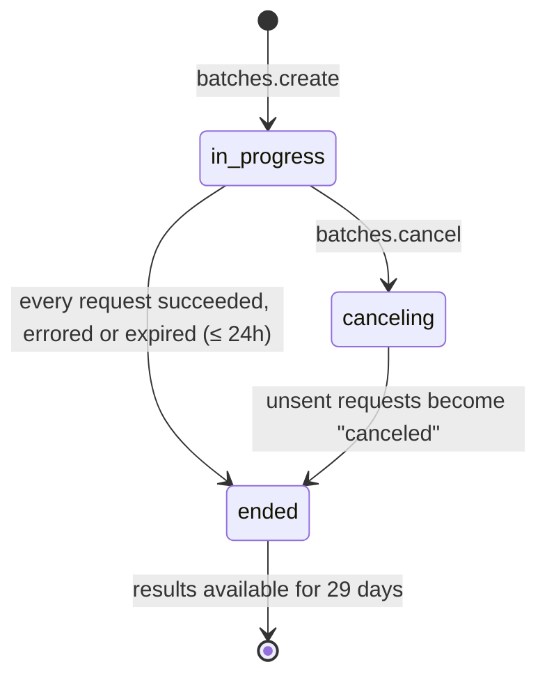
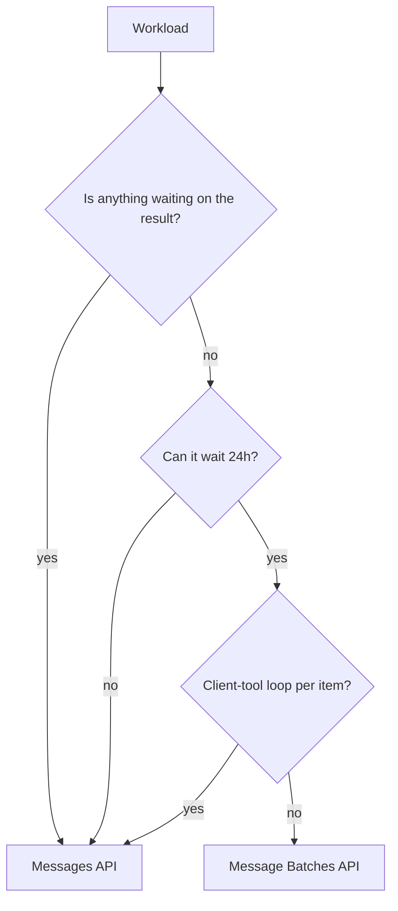
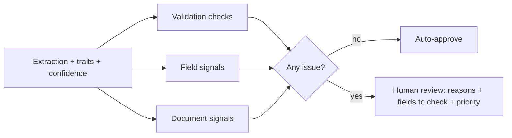
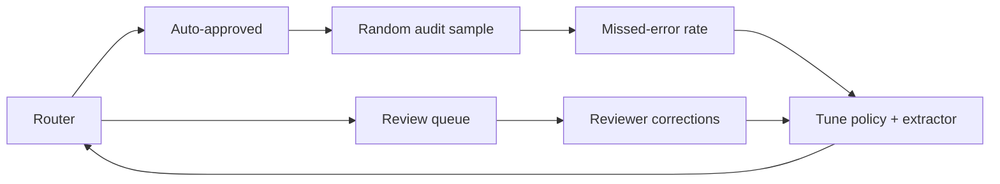

# Part 3 — Processing modes and review routing

Part 2 ended with an extraction request that works: a structured-output schema, nullable fields, normalisation rules
and few-shot examples. Now the finance team wants to run it on *everything*, meaning thousands of invoices a month,
plus a backlog. Two new questions follow, and neither is about prompting.

The first is about **how the requests are sent**. You can call the Messages API once per document and get each answer
in seconds, or hand the whole lot to the **Message Batches API**, which costs half as much but may take up to a day.
Picking the wrong one is expensive both ways: a pipeline that could have waited until morning pays double, and a
developer waiting on a CI check waits for hours. The exam tests whether you choose on the right criterion. It isn't
volume.

The second is about **what happens to the results**. Even a good extractor gets some documents wrong, and money moves on
these numbers, so a person has to check some of them. Which ones? Teams usually start by checking a random sample,
and that's the wrong answer: it spends reviewers' time evenly across clean and broken documents and lets most errors
through. By the end of this chapter you'll be able to choose a processing mode from a scenario's requirements, run a
batch correctly from submission to retry, and design a review router that sends the *risky* extractions to a person,
with reasons, and that you can measure.

> **Objectives:**
>
> - O23 Messages API vs Message Batches API
> - O22 human review routing by confidence, document characteristics and field ambiguity
>
> **Lessons:**
>
> - Lesson 7 Messages API or Message Batches API?
> - Lesson 8 Routing extractions to human review
>
> **Sources checked:** 2026-10-18 (links in *Going deeper*). SDK pinned: `@anthropic-ai/sdk` 0.135.0.

## The running example

We stay with **Northwind Traders' accounts-payable inbox** from Part 2 (`fixtures/invoices/`). After OCR, every
incoming document is plain text, and the extractor turns it into the `InvoiceExtraction` record: `document_type`,
`vendor_name`, `invoice_number`, `po_number` (purchase order number), `issue_date`, `due_date`, `currency`, `total_amount`, `line_items`,
`payment_terms` and `ambiguous_fields`. Every field is required but nullable, so "not in the document" is an explicit
`null`.

Seven documents arrived this week:

| id | What it is | Traits from intake |
|----|-----------|--------------------|
| INV-1 | Acme Office Supply invoice, $1,245.50 | US date, USD, clean |
| INV-2 | Müller Industrietechnik invoice, €1.234,56 | EU date, EU decimal comma, no PO |
| INV-3 | Acme credit note, −$189.00 | credit note, negative total |
| INV-4 | J. Barker & Sons, handwritten, £340 | handwritten, informal date "5/3" |
| INV-5 | Brightline Consulting, 1,500 with no currency | ambiguous date "02/03", relative due date |
| INV-6 | Cloudway Hosting **contract** (not an invoice) | recurring fee, no total |
| INV-8 | Polish invoice, 2 460,00 zł | space thousands separator, PLN |

Finance runs extraction **overnight**: documents that arrive during the day must be extracted, checked and ready for
the payment run at 9 a.m. two days later. Alongside finance, the support desk from Part 1 has its own workloads, which
we'll use when comparing processing modes: live chat replies, a nightly re-triage of 10,000 old tickets, and a
pre-merge CI job that reviews changed files.

Last night's extraction run produced seven records. Three of them are wrong, and the model doesn't know which:

- **INV-2** reads "1.234,56" as `123456`. The model reported 0.95 confidence on `total_amount`.
- **INV-4** reads the handwritten "5/3" as 3 May, not 5 March. The model reported 0.55 confidence on `issue_date`.
- **INV-8** has a PO number, `4500-1182`, that appears nowhere on the document. It was copied from an Acme invoice
  seen earlier. The model reported 0.92.

Sections 1–3 get the extractions run cheaply and reliably. Sections 4–6 decide which of them a person must look at.

## 1. What is the Message Batches API, and what does it trade away?

### The problem

The obvious way to extract 2,000 invoices is a loop around `client.messages.create`. It works, but it has three costs.
You pay full price for every token. You compete with your own interactive traffic for **rate limits**, so the overnight
loop can slow down the support chat. And your code has to handle retries, backoff and partial failure across thousands of
calls. None of that buys you anything if nobody needs the answers before morning.

### The idea

The **Message Batches API** takes many ordinary Messages requests in one submission and processes them
**asynchronously**: you submit, walk away, and collect the results later. In exchange for giving up immediacy, you get:

- **50% off** all usage (input tokens, output tokens and special tokens) compared with standard prices.
- **Separate rate limits.** Batch usage doesn't count against your Messages API rate limits. Batches have their own
  limits on HTTP requests and on the number of requests waiting to be processed.
- **Scale.** A single batch can hold up to **100,000 requests or 256 MB**, whichever comes first.

What you give up is a latency **guarantee**. Most batches finish within an hour, but the only promise is **24 hours**:
a batch that hasn't finished by then **expires**, and the requests that weren't processed come back as `expired`. You can
fetch results once every request has finished or the 24 hours are up, whichever comes first. Results then stay
available for **29 days** after the batch was created.

Each request in a batch has two parts:

- **`custom_id`**: your label for the request, 1–64 characters matching `^[a-zA-Z0-9_-]{1,64}$`, unique within the
  batch. It's the only thing that links a result back to its input.
- **`params`**: exactly the body you'd send to `messages.create`. Tools, vision, system prompts, multi-turn messages,
  extended thinking, structured outputs and most beta features all work. Three things don't: `stream: true` (results
  come back as a file, not a stream), `speed` (fast mode only tunes synchronous latency) and `max_tokens: 0` (cache
  pre-warming makes no sense when you don't control timing).

A batch moves through three `processing_status` values:



### Worked example: submitting INV-1 and INV-3

Here's the batch request for two documents. Notice that `params` is the same object the synchronous extractor
sends. That's deliberate: you can test the shape with one synchronous call before submitting ten thousand.

```ts
const batch = await client.messages.batches.create({
  requests: [
    { custom_id: 'INV-1', params: buildExtractionParams(invoiceDoc('INV-1')) },
    { custom_id: 'INV-3', params: buildExtractionParams(invoiceDoc('INV-3')) },
  ],
});
```

The response is a `MessageBatch` object, not any extraction results:

```json
{
  "id": "msgbatch_01HkcTjaV5uDC8jWR4ZsDV8d",
  "type": "message_batch",
  "processing_status": "in_progress",
  "request_counts": { "processing": 2, "succeeded": 0, "errored": 0, "canceled": 0, "expired": 0 },
  "created_at": "2026-10-18T22:00:00Z",
  "expires_at": "2026-10-19T22:00:00Z",
  "ended_at": null,
  "results_url": null
}
```

Two things to notice. `expires_at` is exactly 24 hours after `created_at`: that's your worst case. And
`request_counts` shows everything as `processing`: the other counters stay at zero until the *whole batch* has ended.
You can't watch individual requests finish one at a time.

### What goes wrong

**An invalid `custom_id`.** A natural first attempt builds ids like `INV-1/us-date`. The slash isn't allowed, and the
batch is rejected. Real keys often contain slashes, spaces or are longer than 64 characters (`FV/2026/03/112` is a real
Polish invoice number), so sanitise them and check they're unique:

```ts
const toCustomId = (key: string) => key.replace(/[^a-zA-Z0-9_-]/g, '_').slice(0, 64);
```

Sanitising can create collisions (`FV/2026` and `FV_2026` both become `FV_2026`), and two results with the same
`custom_id` can't be told apart. Throw on duplicates when you build the batch, not when you read the results.

**Streaming habits.** Code that always sets `stream: true` gets a validation error inside a batch. A batch request is
the *non-streaming* request shape.

> **Check yourself:** A team moves a nightly job of 40,000 summarisation requests from a `messages.create` loop to a
> batch. Their Messages API rate-limit errors in the daytime chat product disappear too. Coincidence?
>
> <details><summary>Answer</summary>
>
> No. Batch usage has its own rate limits and doesn't count against Messages API limits, so the nightly loop no
> longer competes with interactive traffic. That's one of the three benefits, alongside the 50% discount and the scale
> (up to 100,000 requests per batch). The cost is latency: results are only guaranteed within 24 hours.
>
> </details>

## 2. When should a workload use a batch?

### The problem

The tempting rule is "lots of requests → batch, a few → sync". A natural first version of the pipeline used exactly that rule
(`requestCount > 100`), and it made two mistakes. It sent a 300-file pre-merge CI review to a batch, so a developer
waited hours for a check that blocks their merge. And it sent three month-end invoices to the synchronous API, paying
double for results nobody needed until the day after tomorrow.

Volume affects *how much* you save. It doesn't decide *whether* a batch is acceptable.

### The idea

Ask three questions, in this order.

1. **Is anything waiting on the result?** A person in a chat, a CI job gating a merge, the next step of a pipeline that
   can't start without this output. If so, the workflow **blocks**, and it must be synchronous, however many requests
   there are.
2. **Can the consumer wait the full 24 hours?** "Usually within an hour" isn't a guarantee. If the result is needed in
   four hours, a batch will *usually* be fine and *sometimes* miss the deadline. Compare the acceptable wait with the
   24-hour window, not with the typical case.
3. **Does each item need a client-tool loop?** A batch request is a single Messages call. If the model stops with
   `stop_reason: "tool_use"` because it wants *your* code to look something up, the conversation can only continue in
   a **new** request: another batch, another wait of up to 24 hours. Server tools (web search, web fetch, code
   execution and so on) are different: they run inside the batch, using the same server-side loop as the synchronous
   API. A paused server-tool turn comes back with `pause_turn`, and you continue it with a follow-up request.

If nothing blocks, a 24-hour window is acceptable, and there's no client-tool loop, use a batch and take the 50%. The
number of requests doesn't appear in these rules. A batch of three is perfectly valid.



### Worked example: six workloads

Here are six workloads, classified with the three questions:

| # | Workload | Blocking? | Acceptable wait | Client tools? | Mode | Why |
|---|---|---|---|---|---|---|
| 1 | Live chat reply | yes (a customer) | seconds | no | **sync** | someone is waiting |
| 2 | Nightly re-triage of 10,000 tickets, due in 36h | no | 36h | no | **batch** | ≥ 24h and non-blocking |
| 3 | Pre-merge CI review of 300 files | yes (the merge) | 15 min | no | **sync** | blocking beats volume |
| 4 | 3 invoices for month-end close, due in 2 days | no | 48h | no | **batch** | small but patient |
| 5 | 5,000-ticket report needed by 9 a.m. (in 4h) | no | 4h | no | **sync** | 4h < the 24h guarantee |
| 6 | 2,000 tickets each needing internal API lookups | no | 48h | yes | **sync** | every tool round trip would be another batch |

Row 5 is the subtle one. Nothing *blocks* in the technical sense, and a batch would very probably finish in
time. But "very probably" isn't the requirement. If the 9 a.m. report must exist, you need the synchronous API (or the
batch submitted at least 24 hours earlier).

Row 6 also shows a hybrid that's often the right design: do the tool lookups **in your own code first**, then put
the lookup results into each prompt, and the task becomes a single call per ticket that a batch can run.

### What goes wrong

**Choosing on volume.** This is the most common exam distractor: "the CI job reviews hundreds of files, so use batches
to save 50%." If the scenario says the result gates a merge, a deploy or a user, the saving is irrelevant.

**Choosing on the typical case.** "Most batches finish in under an hour, so it's fine for a report due in two hours."
Most isn't all, and the exam cares about the guarantee.

**Batching an agent.** An agentic loop with client tools turns one 24-hour wait into N of them. Either run it
synchronously, or restructure it so each batched request is self-contained.

> **Check yourself:** A legal team wants 800 contracts summarised "by the end of the week" (four days away). A
> colleague says that since it's only 800 documents, a batch isn't worth the complexity, so use the Messages API.
> What do you recommend?
>
> <details><summary>Answer</summary>
>
> Use a batch. Nothing is waiting on the results, four days is well beyond the 24-hour window, and summarisation needs
> no client tools. Volume isn't the criterion: 800 requests at half price is a real saving, and the code is a
> create-poll-collect loop. The tempting wrong answer, "too few requests for a batch", applies a volume rule the API
> doesn't have.
>
> </details>

## 3. How do you get batch results back reliably?

### The problem

You submitted INV-1 to INV-8 last night. The batch is `ended`. The naïve collector reads the results file, puts them
into an array in arrival order, and assumes item `i` belongs to document `i`. It also keeps only the successes, so a
request that expired simply vanishes from the output, and nobody notices that INV-4 was never extracted.

### The idea

Collecting a batch has four steps, and each has one rule.

**Poll until `ended`.** Call `batches.retrieve(id)` on an interval until `processing_status === "ended"`. While the batch
is `in_progress`, there are no results to read. Use a sensible interval (a minute is plenty for an overnight job), and
put a ceiling on how long you'll wait so a stuck job alerts someone instead of hanging forever.

**Match by `custom_id`, never by position.** The results file is JSON Lines (`.jsonl`), one result per line, and the
docs are explicit that results are **not guaranteed to be in request order**. In the SDK, `batches.results(id)` gives
you an async iterator over those lines.

**Handle all four result types.** Each line has a `result.type`:

| `result.type` | Meaning | Billed? | What to do |
|---|---|---|---|
| `succeeded` | A `message` is included | yes | Use it, after checking its `stop_reason` |
| `errored` | The request failed: invalid params, or a server error | no | Retry transient errors; *fix* `invalid_request_error` |
| `canceled` | You canceled the batch before this request ran | no | Resubmit if still needed |
| `expired` | The 24 hours ran out before this request ran | no | Resubmit |

**Retry only what failed, and only what can succeed.** Expired and canceled requests never reached the model, so
resubmitting them is safe and you weren't charged for them. Errored requests split in two. Transient errors
(`api_error`, `overloaded_error`, `rate_limit_error`, `timeout_error`) are worth another try. An
`invalid_request_error` will fail identically the next time: it needs a code fix, not a retry. A batch can't be edited
after you submit it, so a retry is always a **new, smaller batch** of just those requests, with the same `custom_id`s.

There's one more trap inside `succeeded`. A result can succeed at the transport level and still be unusable: if its
`stop_reason` is `max_tokens`, the JSON is cut off. Resubmitting the same request gives the same truncation. That's a
non-retryable failure that needs a bigger `max_tokens` or a split task (Part 2).

### Worked example: last night's results

Here's last night's batch file, in the order it actually arrived (shortened):

```json
{"custom_id":"INV-3","result":{"type":"succeeded","message":{"stop_reason":"end_turn","content":[{"type":"text","text":"{\"document_type\":\"credit_note\",…}"}]}}}
{"custom_id":"INV-1","result":{"type":"succeeded","message":{"stop_reason":"end_turn","content":[…]}}}
{"custom_id":"INV-4","result":{"type":"expired"}}
{"custom_id":"INV-5","result":{"type":"errored","error":{"type":"error","error":{"type":"invalid_request_error","message":"…"}}}}
{"custom_id":"INV-2","result":{"type":"succeeded","message":{…}}}
```

Notice that INV-3 arrives before INV-1, so positional matching would have given INV-1 the credit note's
`total_amount` of −189. A `collectResults` helper builds a `Map` keyed by `custom_id`, and it produces two failure records:
INV-4 `expired` (retryable) and INV-5 `invalid_request_error` (not retryable: someone has to look at that request).
`runBatchExtraction` then submits a second batch containing **only INV-4**. At the end of the run, the code reports the
permanent failure (INV-5) and the successful extractions, which are handed to the review router in section 4.

```ts
for await (const line of await client.messages.batches.results(batchId)) {
  const { result } = line;
  switch (result.type) {
    case 'succeeded': succeeded.set(line.custom_id, parseExtraction(result.message)); break;
    case 'errored':   failed.push({ custom_id: line.custom_id, type: 'errored',
                                    retryable: RETRYABLE.has(result.error.error.type), detail: result.error.error.message }); break;
    case 'canceled':
    case 'expired':   failed.push({ custom_id: line.custom_id, type: result.type, retryable: true, detail: result.type }); break;
  }
}
```

### What goes wrong

**Reading too early.** Checking `retrieve` once and moving on, or reading `request_counts.succeeded` mid-run (it's 0
until the end), makes a running batch look like a failed one.

**Resubmitting the whole batch.** "Some requests failed, run it again" pays a second time for every success and
retries the invalid requests that can't succeed.

**Silently dropping failures.** An extraction pipeline that "finished" with six of seven documents and no error is
worse than one that crashed. Every `custom_id` you submitted must come back either as a result or as a reported failure.

> **Check yourself:** After an overnight batch of 5,000 extractions, 4,930 succeeded, 50 expired and 20 errored with
> `invalid_request_error`. Your on-call colleague proposes resubmitting the full 5,000 "to be safe". What's wrong
> with that, and what should happen instead?
>
> <details><summary>Answer</summary>
>
> It pays again for 4,930 successes, and the 20 invalid requests will fail again. Instead, submit a new batch with only
> the 50 expired requests (same `custom_id`s; they weren't billed and never reached the model), and investigate the 20
> invalid ones, since their params need fixing first. Then merge the new results into the existing map by `custom_id`.
>
> </details>

## 4. Why not just review a random sample?

### The problem

Now we have seven extractions, and finance needs to know which ones are safe to pay from. The first policy anyone
proposes is a **random sample**: have a person check 20% of the documents and trust the rest. It sounds fair and
statistically respectable. Let's see what it does to last night's run.

Three of the seven extractions are wrong (INV-2, INV-4, INV-8). With an independent 20% chance of review each, the
expected number of errors caught is 0.6: on average, more than two of the three wrong records go straight to payment.
The chance of catching *none* of them is 0.8³ ≈ 51%. Meanwhile, the reviewer's time is just as likely to land on INV-1,
a clean typed invoice, as on the handwritten one.

### The idea

Random sampling spreads review effort in proportion to **volume**. What you want is review effort in proportion to
**risk**. A **review router** decides, per extraction, whether a human must check it, based on evidence about *that
specific extraction*. The evidence comes in three families:

1. **Validation**: deterministic checks on the output. Do the line items add up to the total? Does a credit note
   have a negative total? Is the due date after the issue date? Are the fields needed for payment present?
2. **Field-level signals**: the model's own **confidence** per field, and the fields it explicitly marked as
   **ambiguous**. Part 2's schema gave the model a way to say "this date supports two readings" (`ambiguous_fields`)
   instead of guessing.
3. **Document characteristics**: what we know about the *input*, independent of the model's answer:
   handwritten, a credit note, an unusually high amount, a document that isn't an invoice at all.

Any signal sends the extraction to a person. The router also says **why**, and **which fields** to check, because a
reviewer can check one date in seconds but needs minutes to re-read a whole invoice.



Random sampling still has a job, just a different one. You'll see it in section 6.

### Worked example: routing last night's run

Here's what the router decides for the seven records:

| Doc | Issues found | Route | Fields to check | Actually wrong? |
|-----|-------------|-------|-----------------|-----------------|
| INV-1 | — | auto-approve | — | no |
| INV-2 | `sum_mismatch` (lines sum to 1234.56, total is 123456), `high_value` (≥ 10,000) | **review, high** | `total_amount` | **yes** |
| INV-3 | `risky_document` (credit note) | review | — | no |
| INV-4 | `low_confidence` on `issue_date` (0.55), `risky_document` (handwritten) | review | `issue_date` | **yes** |
| INV-5 | `ambiguous` + `missing_required` + `low_confidence` on `issue_date` and `currency` | review | `issue_date`, `currency` | no |
| INV-6 | `not_invoice` (a contract) | review | — | no |
| INV-8 | — | auto-approve | — | **yes** |

Two of the three errors are caught, and each one comes with a precise instruction to the reviewer. INV-2 is caught
**despite** 0.95 confidence, because arithmetic doesn't care how sure the model is. INV-8 gets through. Section 6 deals
with that.

### What goes wrong

**Sampling as the mechanism.** "Review 10% at random, and raise it to 20% if errors are found" is still random. It will
keep missing the same high-risk documents while reviewing clean ones. The exam phrases the correct answer as routing
"based on confidence scores, document characteristics and field-level ambiguity **rather than random sampling**".

**Whole-document review.** Sending the reviewer "INV-4, please check" without saying *what* to check makes every review
slow, and you lose the data about which fields fail most often, which is exactly the data you need to improve the
extractor.

> **Check yourself:** A claims-processing team reviews a random 15% of AI-extracted claim forms. Their auditors find
> that most extraction errors are on faxed forms, which make up 10% of the volume. What should change?
>
> <details><summary>Answer</summary>
>
> Stop using random sampling as the routing mechanism. Route by document characteristics (every faxed form goes to
> review), and add field-level signals (low confidence, ambiguity flags) and validation checks for the rest. A random
> 15% reviews only about 15% of the faxed forms and spends 85% of the review effort on the cleaner inputs. Raising the
> sample rate (the tempting answer) costs more and still misses most of the faxed-form errors.
>
> </details>

## 5. Which signals should send an extraction to a person?

### The problem

The obvious signal is the model's own confidence: ask it how sure it is about each field, and review anything below a
threshold. It's cheap and it's already in the output, so why not route on it alone? INV-2 is the reason. The model
was 0.95 sure of a total that's off by a factor of 100. Self-reported confidence is a useful signal, but it isn't
**calibrated**: a stated 0.95 doesn't mean the field is right 95% of the time. The most dangerous errors are the
confident ones.

### The idea

Use the three signal families from section 4, and understand what each one is good for.

**Validation catches confident mistakes.** These checks are deterministic: they don't depend on the model at all. The
router runs four:

- `sum_mismatch`: the line items don't add up to `total_amount` (within a cent). This catches decimal and thousands
  separator misreads, missed lines and OCR digit errors.
- `sign_mismatch`: a credit note with a positive total, or an invoice with a negative one.
- `date_order`: the due date is before the issue date, which is typical of US/EU day–month swaps.
- `missing_required`: a payable document (invoice or credit note) with a `null` vendor, number, issue date, currency or
  total. The null is *correct* behaviour from the extractor (Part 2 taught it not to invent values), but a person has
  to fill the gap before anyone pays.

These checks also make good **few-shot targets**: the same rules that route a document can feed the retry-with-feedback
loop from Part 2.

**Field-level signals catch uncertain reads.** Ask for a confidence per key field in the same structured-output call
(for example, a `field_confidence` object next to the extraction). Structured outputs reject `minimum` and
`maximum`, so the 0–1 range goes in the field description. Then:

- `low_confidence`: any field below the policy threshold. Pick the threshold by **measuring**: run the router on a
  labelled set, and choose the value that gives the recall you need at a review rate you can afford. Don't pick 0.8
  because it sounds reasonable.
- `ambiguous`: any field the model listed in `ambiguous_fields`. This is usually the most precise signal you have,
  because the model is pointing at the exact field and saying it saw two readings.

The docs' guidance on reducing hallucinations supports the same design from the other side: give the model explicit
permission to say it doesn't know (our nulls and `ambiguous_fields`), and "always validate critical information,
especially for high-stakes decisions." Another signal mentioned there is **best-of-N disagreement**: run the same
extraction twice, and if the runs disagree on a field, that field is uncertain. It costs double, so keep it for
high-value documents.

**Document characteristics catch risky inputs.** Some documents are error-prone or costly whatever the model says:
handwriting, credit notes (sign conventions), totals above a value threshold, and documents that aren't payable at all
(`not_invoice`). These come from intake and from the extraction's `document_type`, and they're your best defence when
the model is confidently wrong in a way no arithmetic check can see.

Each issue also sets a **priority**. Here, anything that would move the wrong amount of money (`sum_mismatch`,
`sign_mismatch`, `high_value`) is high priority, and the queue puts those first. After that come the items with the
most issues.

### Worked example: three ways of being caught

Look again at the three records the router flagged.

INV-2's extraction looks perfect to the confidence signal (every field ≥ 0.95). Validation computes `1234.56` from the
line items, compares it with the total of `123456`, and raises `sum_mismatch` on `total_amount`. Independently, the
misread total is above the 10,000 value threshold, so the document characteristics raise `high_value` on the same
field. This is the router's actual decision for INV-2:

```json
{
  "docId": "INV-2",
  "route": "human_review",
  "priority": "high",
  "issues": [
    { "field": "total_amount", "code": "sum_mismatch", "detail": "line items sum to 1234.56, total is 123456" },
    { "field": "total_amount", "code": "high_value", "detail": "|total| ≥ 10000" }
  ],
  "fieldsToCheck": ["total_amount"]
}
```

Notice what's absent: no `low_confidence` issue, because the model was sure. Notice too that `fieldsToCheck` is a
single field, even though two signals fired. The reviewer opens the document, sees "1.234,56 €", and fixes it in
seconds.

INV-4's validation passes: the line items add up and the dates are in order. But the model's confidence on `issue_date`
is 0.55, and the document carries the `handwritten` trait. Two independent signals point at the same document, and
the router names `issue_date` as the field to check.

INV-5 is *correctly* extracted: `issue_date` and `currency` are `null` because the document really doesn't settle
them. It still goes to review, and it should. A person must decide whether "02/03" is February or March, and in which
currency to pay. Here the router isn't catching a mistake; it's routing a **decision the model must not make**.

### What goes wrong

**Confidence-only routing.** `if (minConfidence < 0.8) review()` would have auto-approved INV-2, the most expensive
error in the run.

**Treating nulls as failures to retry.** If INV-5's nulls trigger an automatic "try again and fill these in" loop,
you're pushing the model to fabricate a currency. Nulls from a well-designed schema are a routing signal, not an
extraction failure.

**A threshold nobody measured.** A threshold picked by feel either floods reviewers (too high) or quietly lets errors
through (too low), and you can't tell which without the measurement in section 6.

> **Check yourself:** Your extractor reports 0.9+ confidence on 97% of fields, and review rates are low. Then finance
> finds several invoices paid at the wrong amount, all from one vendor whose PDFs use a comma as the decimal separator.
> What's the most effective change to the router?
>
> <details><summary>Answer</summary>
>
> Add deterministic validation that doesn't depend on the model's confidence: check that the line-item sum equals the
> total, and route mismatches to review at high priority. A per-vendor or per-format trait ("EU decimal format") as a
> document characteristic would also help. Lowering the confidence threshold (the tempting answer) does little, because
> the model was confident about these errors. Self-reported confidence doesn't catch systematic misreads.
>
> </details>

## 6. How do you know the routing works?

### The problem

You've built a router, and it flags five of seven documents. Is that good? Maybe it catches every error, or maybe it
flags so much that reviewers start rubber-stamping. Maybe there's a class of errors it never sees. Without numbers, you
can't tell, and you can't defend a threshold change to the finance team.

### The idea

Treat the router like any classifier and measure it against **ground truth**: a set of documents where you know the
correct extraction. An extraction is *wrong* if any key field differs from the truth. Then:

- **Recall** = wrong extractions that were sent to review ÷ all wrong extractions. How many errors reach a human?
- **Precision** = wrong extractions among those reviewed ÷ all reviewed. How much reviewer effort lands on real errors?
- **Review rate** = reviewed ÷ all. The cost.
- **Missed** = the wrong extractions that were auto-approved. These are what you study next.

Recall usually matters most when money moves, so tune for the recall you need, then reduce the review rate without
losing it.

This is where random sampling earns its place: as **calibration**, not as routing. Take a small random **audit sample
of the auto-approved items only**. Errors found there are exactly the ones your router missed. That's the only
estimate you'll get of your missed-error rate in production, where you have no ground truth. Sampling the reviewed
items as well would waste audit effort on documents a person is already checking.

### Worked example: scoring last night

With the router on the seven-document run:

- Review rate: 5/7 ≈ 71%. That's high, but this is a deliberately hard sample. On a normal day most invoices are
  typed, in one format, from known vendors.
- Recall: 2/3 ≈ 67%. INV-2 and INV-4 were caught.
- Precision: 2/5 = 40%. INV-3, INV-5 and INV-6 were reviewed without being wrong. INV-5 and INV-6 *needed* a person
  anyway (a decision and a non-invoice), so the effort wasn't wasted, even though it doesn't count as catching an error.
- Missed: **INV-8**.

INV-8 is the instructive one. The PO number `4500-1182` passes every check: it's well formed, the arithmetic is fine,
the model is confident, and nothing about a typed Polish invoice is risky. It's a **confident, internally consistent
fabrication**. The audit sample (with a 10% rate over the two auto-approved items, at least one is drawn) has a good
chance of finding it, and once found it suggests new signals:

- **External validation**: look up the PO in the purchasing system, and route if it doesn't exist or belongs to another vendor.
- **Grounding**: require that string fields like `po_number` appear verbatim in the document text, and route if they don't.
- **Better extraction**: tighten the instruction ("never reuse a number from another document"), or add an example
  (Part 2, O26/O29).

Each of these turns a missed error into a routed one, and the next night's metrics show whether it worked.



### What goes wrong

**Measuring review rate only.** "We review 12% of documents" says nothing about whether the right 12% are reviewed.

**Auditing everything at random.** Mixing reviewed and auto-approved items into one audit sample dilutes it. The
question is what the *router* lets through, so sample only from what it let through.

**Never feeding corrections back.** Every reviewer correction is a labelled example. Use the corrections to grow the
ground-truth set, pick few-shot examples, and re-tune thresholds.

> **Check yourself:** A team's router has 95% recall on their labelled test set, but finance still finds wrong payments
> every week. Their audit process re-checks a random 5% of *all* processed documents. Why might the audit fail to
> explain the problem, and what should they change?
>
> <details><summary>Answer</summary>
>
> If most documents are reviewed, most of the audit sample lands on documents a person has already checked, so it says
> little about what the router auto-approves. And the labelled test set may not match production (new vendors, new
> formats). Audit a random sample of the **auto-approved** items only, to measure the production missed-error rate,
> and add the errors found there to the labelled set and the routing signals. Raising the audit to 10% of everything
> (the tempting answer) mostly re-checks reviewed work.
>
> </details>

## 7. Putting it together

Here's the full overnight pipeline for Northwind, combining both halves of the chapter.

1. **Choose the mode** (section 2). The extraction job blocks nothing, finance can wait 36 hours, and there's no client
   tool loop, so it runs as a batch.
2. **Build the batch** (section 1). One request per document: `custom_id` = sanitised document id (duplicates throw),
   `params` = the same structured-output extraction request that works synchronously.
3. **Submit and poll** (section 3). `batches.create`, then `retrieve` every minute until `ended`, with a ceiling well
   under the payment deadline so a stuck batch raises an alert.
4. **Collect by `custom_id`**: successes into a map; `expired`, `canceled` and transient errors into a retry list;
   `invalid_request_error` and truncated successes into a permanent-failure list for an engineer.
5. **Retry once** with a smaller batch of only the retryable failures, and merge the results by `custom_id`.
6. **Route every extraction** (sections 4–5): validation, field signals and document signals produce issues; any issue
   means human review, with a priority and specific fields to check. Clean extractions are auto-approved.
7. **Queue for reviewers**: high priority (money at risk) first, then by number of issues.
8. **Audit and measure** (section 6): a small random sample of auto-approved items goes to a reviewer too. Precision,
   recall and missed errors are tracked, and corrections feed the next tuning round.

On a night like section 3's, INV-4 comes back on the retry and INV-5's invalid request goes to an engineer instead of
disappearing. On last night's run, where all seven extractions came back, the pipeline sends INV-2 to the top of the queue with one field to check, routes INV-4 and INV-5 with their uncertain fields,
diverts the INV-6 contract away from the payment run, and leaves INV-1 and INV-8 auto-approved. The audit then has the
chance to discover INV-8's fabricated PO. Total model cost: half the synchronous price.

## Summary

- The **Message Batches API** processes Messages requests asynchronously: **50% cheaper**, separate rate limits, up to
  **100,000 requests / 256 MB** per batch. Most batches finish within an hour, but the only guarantee is **24 hours**.
  Results are available for **29 days**.
- **Choose sync vs batch by blocking and acceptable wait, not volume.** Something waiting on the result → sync. Needed
  in less than 24h → sync. Client-tool loop per item → sync (each round trip would be another batch). Otherwise → batch.
- Each request is `{ custom_id, params }`. `custom_id` matches `^[a-zA-Z0-9_-]{1,64}$` and is unique; `params` is the
  normal non-streaming Messages body (`stream`, `speed` and `max_tokens: 0` aren't allowed).
- Poll `retrieve` until `processing_status` is `ended`. Results come back in **any order**, so match them by `custom_id`.
- Result types: `succeeded`, `errored` (retry transient errors, fix invalid requests), `canceled` and `expired` (not
  billed, safe to resubmit). Retry only the failures, in a new batch. A truncated success isn't retryable.
- **Route extractions to review on evidence, not at random**: validation checks, field-level confidence and ambiguity,
  and document characteristics. Tell reviewers which fields to check, and prioritise money-moving issues.
- Self-reported confidence isn't calibrated. Validation catches **confident** errors, and ambiguity flags catch reads the
  model itself doubts.
- Measure the router with **precision, recall and missed errors**. Use random sampling only as an **audit of
  auto-approved items**, to estimate what the router misses.

## Traps and decision rules

| If the scenario says… | The answer is… | The tempting wrong answer |
|---|---|---|
| A CI check / a user / the next pipeline step waits on the results | Messages API, whatever the volume | "Hundreds of requests, so batch them for 50% off" |
| Large or small job, nobody waiting, deadline ≥ 24h away | Message Batches API | "Too few requests for a batch" |
| Results needed in a few hours, nothing blocks | Messages API (a batch only guarantees 24h) | "Most batches finish within an hour" |
| Each item needs your own tools mid-conversation | Messages API, or pre-fetch the data so each request is self-contained | Batch the agent loop |
| Matching batch results to inputs | By `custom_id` | By array position / request order |
| Some requests `expired` | Resubmit only those, in a new batch (they weren't billed) | Resubmit the whole batch |
| `errored` with `invalid_request_error` | Fix the request; retrying won't help | Retry until it works |
| Want a streamed response from a batch | Not possible: results are a file | Set `stream: true` in `params` |
| Deciding which extractions a person reviews | Route by validation failures, low/ambiguous fields and risky document traits | A random X% sample |
| The model reports high confidence | Still run validation; confidence isn't calibrated | Auto-approve anything ≥ 0.9 |
| A field is `null` because the document doesn't state it | Route to a person to decide | Retry until the model fills it in |
| Estimating the errors the router misses | Random audit of **auto-approved** items | Random audit of everything, or none |
| Reviewer workload is too high | Measure precision/recall, tune thresholds and signals | Switch to random sampling |

## Practice

You've seen every piece of this chapter's running example. Now build it yourself: the overnight batch run for Northwind's invoices and the review router that decides which extractions a person checks.

- **Lesson 7 — Messages API or Message Batches API?** (`lessons/07-messages-vs-batches/`): fix a pipeline that picks the processing mode by volume, builds invalid `custom_id`s, reads the batch status once, matches results by position and resubmits the whole batch on failure.
- **Lesson 8 — Routing extractions to human review** (`lessons/08-human-review-routing/`): replace a random 20% review sample with a router built on validation checks, field-level confidence and ambiguity, and document characteristics, then measure it with precision, recall and an audit of auto-approved items.
- **Quiz:** 12 exam-style questions on this part in the teach-me portal.

## Going deeper

- [Batch processing](https://platform.claude.com/docs/en/build-with-claude/batch-processing): the full Message Batches
  guide: limits, what can be batched, polling, result types and billing, prompt caching in batches, server tools and
  `pause_turn`, the 300k-output beta, best practices and FAQ.
- [Message Batches API reference](https://platform.claude.com/docs/en/api/messages/batches/create): the create, retrieve,
  list, cancel, results and delete endpoints, with the `MessageBatch` object.
- [Rate limits: Message Batches API](https://platform.claude.com/docs/en/api/rate-limits#message-batches-api): batch
  limits, separate from Messages API limits.
- [Pricing](https://claude.com/pricing#anthropic-api): batch prices per model (50% of standard), which stack with
  prompt-caching discounts.
- [Reduce hallucinations](https://platform.claude.com/docs/en/test-and-evaluate/strengthen-guardrails/reduce-hallucinations):
  allowing "I don't know", grounding in quotes, best-of-N verification, and "always validate critical information".
- [Structured outputs](https://platform.claude.com/docs/en/build-with-claude/structured-outputs): the schema
  constraints that apply to the `field_confidence` object (no `minimum`/`maximum`).
- Back: **Part 2 — Structured output and extraction**, the nullable schema and `ambiguous_fields` this chapter routes on.
- Next: **Part 4 — Context management**: keeping long conversations and multi-session work inside the context window
  (O21, O20, O02).
