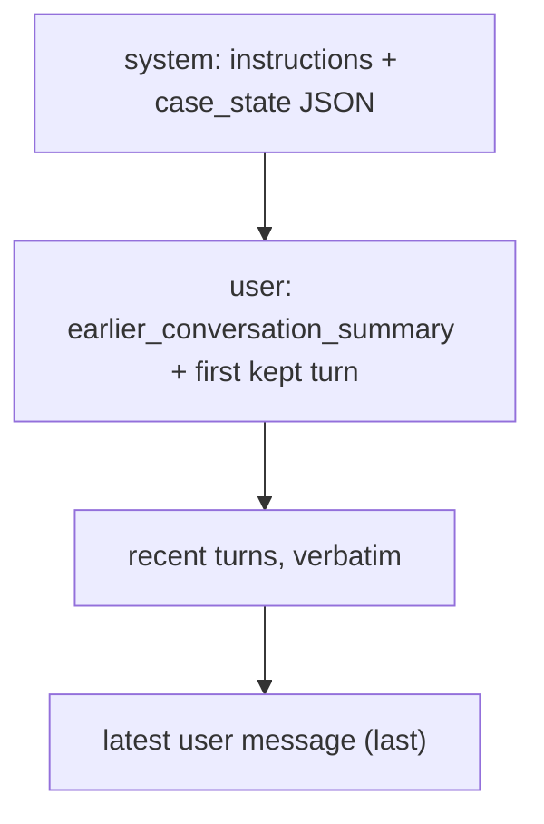

# Part 4 — Context management

Every request you send to Claude carries everything Claude knows about the task: the system prompt, the tool
definitions, and the whole conversation so far. Nothing else exists for the model. That makes the context window
the agent's entire working memory, and like any working memory it fills up. A support chat that runs for forty turns,
an agent that reads thirty files, a review that has to continue tomorrow: each of these eventually needs more than one
request can hold, or more than one session lasts.

The tempting answer is "use a bigger window". Current models give you a million tokens, after all. But a fuller window
is not a better one. As the token count grows, the model's recall of any single detail gets worse, cost and latency
grow with every turn, and the one fact that matters (the refund amount, the promise you made, the bug you already
found) drowns among the ones that don't. The real skill is **curation**: deciding what Claude sees on each request, what
gets compressed, what gets written to disk, and what a later session should re-check instead of trusting.

By the end of this chapter you'll be able to keep a long conversation inside a token budget without losing exact
values, explain why a summary alone is not enough, split work that's too big for one context across isolated subagents
and scratchpad files, and resume a multi-session task without redoing finished work or trusting stale results. Lessons
L09 and L10 have you build each of these.

> **Objectives:** O21 context window optimization (summarization, sliding windows, structured state, selective retention) · O20 context across sessions (subagent isolation, scratchpad files, targeted reads) · O02 session resumption (targeted re-analysis of changed files, context injection)
> **Lessons:** [L09](../../../lessons/09-context-window-optimization/) · [L10](../../../lessons/10-cross-session-context/)
> **Sources checked:** 2026-10-18 (links in *Going deeper*). SDKs pinned: `@anthropic-ai/sdk` 0.135.0, `@anthropic-ai/claude-agent-sdk` 0.3.302.

## The running example

This chapter follows two problems that the lessons use. The first lives inside one conversation; the second spans
several sessions.

**A long support chat (L09).** Ben Kowalski, the customer from Part 1, opens a chat about ticket T-100: he was charged
twice for his laptop. The first six messages settle everything that matters:

| Turn | Who | What it establishes |
|------|-----|---------------------|
| 1 | Ben | "I was charged twice for my laptop order. I am ben.kowalski@example.com." |
| 2–3 | Agent + tool | `lookup_customer` → customer `cus_002`, standard tier |
| 4 | Agent | Order `B2001`, **$899.99**, placed 2026-08-21 |
| 5 | Ben | "Both charges were on 2026-08-22, each $899.99." |
| 6 | Agent | Opens refund case **RF-7731** and **promises the refund within 5 business days** |

Then the chat drifts. Ben asks a dozen padded questions about newsletter preferences, each answered at length. Finally
he comes back to the point: *"So when exactly will I get my money back, and how much?"* To answer correctly, the agent
needs `$899.99`, `RF-7731` and "5 business days" from turns 4–6, while thirty-odd turns of small talk sit in between.
The lesson's `conversation.ts` generates exactly this history, with the padding length as a parameter.

**A code review that outgrows one session (L10).** A review agent checks *Ledgerly*, a small order-and-billing service in
`fixtures/codebase/`, against its `CONVENTIONS.md`. The service has about fifteen source files: routes
(`src/routes/orders.ts`, `src/routes/invoices.ts`), services (`billingService.ts`, `orderService.ts`), repositories,
`auth.ts`, `config.ts`, utilities and a frozen `src/legacy/` folder. The conventions say things like "all amounts are
integer cents, rounded once", "SQL goes through `Db.query(sql, params)` with placeholders", and "every route that reads
customer data must call `authorize` first". The codebase hides real issues, such as SQL built by string concatenation
in `orderRepository.findByCustomer` and tax computed before the discount in `billingService.computeTotals`.

The first version of the agent reads every file into one growing conversation. On a larger codebase it runs out of
context halfway through. When it's restarted the next day, after a developer has fixed two files, it starts again from
scratch, re-reads everything and re-reports issues that no longer exist.

## 1. What fills the context window, and why does a fuller window hurt?

### The problem

It's natural to think of the context window as the size of the conversation. That undercounts it, and the
undercount is where budgets go wrong. It's also natural to think that as long as everything fits, more context can only
help. That's the assumption the rest of this chapter takes apart.

### The idea

The **context window** is the total number of tokens the model can attend to in one request, input and output
together. Everything counts:

- the system prompt;
- every message in `messages`, including `tool_use` inputs, `tool_result` contents, images and documents;
- the tool definitions (names, descriptions, schemas);
- the tokens Claude generates in its reply, thinking included.

Because the API is stateless (Part 1), previous turns accumulate **in full** in every request unless your code
removes them. **Prompt caching doesn't help here**: a cached prefix is cheaper to send, but it still occupies the window.
Caching changes the price, not the size.

Current models such as Opus, Sonnet and Haiku 5.5 have a **1M-token** window (some other models have 200k). Two
different things happen at the edge:

- If the **input alone** is larger than the window, the request fails with a 400 ("prompt is too long").
- If the input fits but **generation** runs into the limit, newer models stop with
  `stop_reason: "model_context_window_exceeded"`. Treat that like `max_tokens`: the reply is truncated.

Fitting is not the same as working well. As the number of tokens grows, the model's ability to recall and use any
particular detail degrades. Anthropic's engineering writing calls this **context rot**. A long window is a resource
with diminishing returns, so the practical rule is to treat tokens as a **budget you spend on signal**: the smallest set
of high-signal tokens that gets the job done.

To manage a budget you have to measure it. The **token counting API** does that before you send anything:

```ts
const { input_tokens } = await client.messages.countTokens({ model, system, tools, messages });
```

It takes the same `model`, `system`, `tools` and `messages` you'd send to `messages.create` and returns
`{ input_tokens }`. It's free but rate-limited, and the number is an estimate. Count with the model you'll actually
call: tokenizers differ, and Claude 4.7+ tokenizers produce roughly 30% more tokens for the same text than older ones.

### Worked example: where Ben's chat spends its tokens

In Ben's conversation, the six turns that hold the facts are short: a couple of hundred tokens. Each padded newsletter
exchange costs far more, because both the question and the answer are long. After a dozen of them, well over 90% of the
history is small talk, and the three facts the final question depends on sit near the top of a long transcript. Nothing
has gone wrong yet; everything still fits. But every request now pays for all of it, and the model has to pick out
`$899.99` and "5 business days" from a page of noise.

L09 makes this concrete with a budget. `manageContext` builds the full request, counts it, and only acts when the count
is over budget:

```ts
const plain = buildContext(state, '', history);
if ((await countTokens(plain.system, plain.messages)) <= opts.budget) {
  return { ...plain, state, compacted: false }; // fits: change nothing
}
```

The counter is injected (`TokenCounter`). In production it wraps `client.messages.countTokens`; in the offline tests
it's a deterministic characters-divided-by-four estimate, so tests don't need the network.

### What goes wrong

**Counting only the messages.** A budget check that measures `messages` but not `system` and `tools` is wrong in the
direction that hurts: a large tool set or a long system prompt can push a "within budget" request over the edge.
Count the request you'll actually send.

**Treating "it fits" as "it's fine".** The 1M window lets a sloppy design run for a long time before anything breaks,
and then it fails subtly: the agent quotes a slightly wrong amount or forgets a commitment, with no error anywhere. The
exam frames this as a quality problem, and the fix is never "use a bigger window".

> **Check yourself:** A team enables prompt caching on a long-running support agent and reports that "context window
> problems are solved, because the history is cached now". The agent still forgets early details in long chats. Why?
>
> <details><summary>Answer</summary>
>
> Caching reduces the cost and latency of re-sending a prefix, but cached tokens still occupy the context window and
> still dilute attention. The history is just as long as before. The fix is to curate what's in the window (trim,
> summarize, keep structured state), not to cache it.
>
> </details>

## 2. How do you keep a long conversation inside the budget?

### The problem

When Ben's chat goes over budget, the simplest fix is to drop old messages. Keep the last N, discard the rest. That
works for chit-chat, and it's exactly wrong for this conversation, because the oldest turns are the important ones.

### The idea

There are two basic tools, and they're complementary.

A **sliding window** keeps the most recent turns **verbatim** and removes everything older. It's cheap (no extra model
call) and it preserves the current exchange exactly. What it loses is everything before the cut.

**Summarization** replaces the older turns with a summary, usually written by the model. Done repeatedly as the
conversation grows, it's called **progressive summarization**. It keeps the gist of the older history at a fraction of
the tokens. What it loses is exact wording, and in practice that most often means **numbers, ids, dates and promises**:
"a refund of about $900 should arrive soon" is a perfectly good summary sentence and a support failure.

Most designs combine the two: summarize the older part, keep a recent window verbatim, and send the summary in front of
the window.

Where you cut matters as much as how much you keep. The API has structural rules about history (Part 1): a
`tool_result` must directly follow the assistant turn that contains its `tool_use`, and the conversation must start with a
user message. A cut in the wrong place breaks both. The safe rule is to cut only at a **human-turn boundary**: a user
message that is real user input, not a message carrying tool results. L09 implements it like this:

```ts
/** A human turn starts with a user message that is not just tool results. */
function isHumanTurn(message: MessageParam): boolean {
  if (message.role !== 'user') return false;
  if (typeof message.content === 'string') return true;
  return !message.content.some((b) => b.type === 'tool_result');
}

export function slidingWindow(messages: MessageParam[], keepTurns: number) {
  const starts = messages.flatMap((m, i) => (isHumanTurn(m) ? [i] : []));
  if (starts.length <= keepTurns) return { older: [], recent: messages };
  const cut = starts[starts.length - keepTurns]!;
  return { older: messages.slice(0, cut), recent: messages.slice(cut) };
}
```

Because `cut` is always the index of a human turn, `recent` always starts with a user message, and a `tool_use` and its
`tool_result` always end up on the same side of the cut.

The summary itself needs instructions, and the most important one is about exact values. L09's summarizer prompt:

```text
Summarize the support conversation below for the agent who will continue it. Preserve exactly, never paraphrased
or rounded: order ids, customer ids, amounts, dates, and every commitment made to the customer. Note what was tried
and what is still open. Drop greetings and small talk.
```

### Worked example: compacting Ben's chat

Say the budget is exceeded and `keepTurns` is 2. `slidingWindow` finds the human turns, keeps the last two (the final
newsletter question and "So when exactly will I get my money back, and how much?"), and returns everything before them
as `older`. That `older` slice contains turns 1–6 plus most of the padding.

The summarizer turns `older` into a few sentences: Ben (cus_002) reported a duplicate charge of $899.99 on B2001, both
charges on 2026-08-22; refund case RF-7731 was opened with a promise of a refund within 5 business days; he also asked
about newsletter settings, which were explained. The summary is sent in front of the recent turns:

```json
[
  { "role": "user", "content": [
      { "type": "text", "text": "<earlier_conversation_summary>\nBen Kowalski (cus_002) ... RF-7731 ... within 5 business days ...\n</earlier_conversation_summary>" },
      { "type": "text", "text": "Follow-up 12: also, how do I change my newsletter preferences? ..." }
  ] },
  { "role": "assistant", "content": "Newsletter answer 12: go to Account > Preferences. ..." },
  { "role": "user", "content": "So when exactly will I get my money back, and how much?" }
]
```

Notice that the summary is **prepended to the first kept user message** rather than sent as its own message. A separate
user message would put two user turns next to each other; merging keeps the roles alternating, and the recent turns
stay verbatim.

### What goes wrong

**Truncating from the front with a fixed message count.** `messages.slice(-10)` is the most common first attempt. It
throws away turns 1–6, so the agent answers "I don't see a refund amount in our conversation". If the cut lands
between a `tool_use` and its `tool_result`, the next request is a 400 instead.

**A summary-only design.** Even with a good prompt, a summary is a lossy rewrite done by a model, and every round of
progressive summarization rewrites the previous summary again. Over several compactions "$899.99" drifts towards
"about $900" and "within 5 business days" towards "soon". Section 3 is the fix.

**Summarizing a conversation that fits.** Each summary is an extra model call, adds latency, and throws away detail.
L09 leaves short histories untouched; compaction only runs when the budget is actually exceeded.

> **Check yourself:** After a refactor, a chat agent occasionally fails with a 400 that mentions `tool_use` ids without
> `tool_result` blocks, but only in long conversations. The refactor changed the trimming code to "keep the last 12
> messages". What's the likely cause and the fix?
>
> <details><summary>Answer</summary>
>
> Cutting by message count sometimes keeps a user message of `tool_result` blocks while dropping the assistant message
> with the matching `tool_use` (or vice versa). The fix is to cut only at human-turn boundaries, a user message that
> isn't tool results, so tool calls and their results always stay together and the history starts with a real user
> turn. Making the window bigger only makes the failure rarer.
>
> </details>

## 3. Which facts must never be paraphrased?

### The problem

Sections 1 and 2 keep the conversation small, but they can't guarantee that the exact amount and the promise survive.
The summary is prose, written by a model, rewritten on every compaction. If the business depends on an exact value, it
can't live only in prose.

### The idea

Keep the critical facts in a **structured state object**: a small JSON record, separate from the summary, merged turn by
turn and injected into every request. It's the agent's equivalent of the case notes a human support agent keeps next to
the chat window. L09's version:

```ts
export interface CaseState {
  customer_id: string | null;
  order_ids: string[];
  /** Exact values keyed by name, e.g. { refund_amount: "$899.99" }. Never paraphrased. */
  facts: Record<string, string>;
  /** Promises made to the customer, verbatim. */
  commitments: string[];
  open_issues: string[];
}
```

Deciding what goes into it, and how new information updates it, is **selective retention**. Not every fact deserves to
survive, and not every fact updates the same way:

- **Identifiers and promises accumulate.** Once a commitment is made, it stays until it's fulfilled. A new order id
  joins the list; it doesn't replace the old one.
- **Exact facts are replaced by newer exact facts.** If a later turn corrects the amount, the newer value wins.
- **Transient status is replaced wholesale.** `open_issues` reflects the latest view of what's still open.
- **Small talk is dropped.** The newsletter answers never enter the state.

```ts
export function mergeState(state: CaseState, extracted: CaseState): CaseState {
  const union = (a: string[], b: string[]) => [...new Set([...a, ...b])];
  return {
    customer_id: extracted.customer_id ?? state.customer_id,
    order_ids: union(state.order_ids, extracted.order_ids),
    facts: { ...state.facts, ...extracted.facts },
    commitments: union(state.commitments, extracted.commitments),
    open_issues: extracted.open_issues,
  };
}
```

How do the facts get extracted from the older turns in the first place? With the technique from Part 1: a tool whose
schema is the state shape, forced with `tool_choice`, so the result is parsed JSON rather than prose. L09's
`record_case_facts` tool tells the model to "copy values exactly as written; never round or paraphrase". (On models that
reject forced `tool_choice`, such as Opus and Sonnet 5.5, use structured outputs or `strict` + `auto` for the same
guarantee; see Parts 1 and 2.)

Where the pieces go in the request matters too. Stable facts belong at the top, the live question at the end:



### Worked example: the compacted request for Ben

When `manageContext` compacts, it runs both extractions on `older`, merges the state, and builds the request:

```text
system:
You are a support agent for an online shop. Be precise about orders, amounts and promises.

<case_state>
{
  "customer_id": "cus_002",
  "order_ids": ["B2001"],
  "facts": { "refund_amount": "$899.99", "charge_date": "2026-08-22", "refund_case": "RF-7731" },
  "commitments": ["Refund will be issued within 5 business days"],
  "open_issues": ["Duplicate charge refund pending"]
}
</case_state>

messages: [ summary + recent turns, as in section 2 ]
```

Now the answer to "when and how much?" doesn't depend on the summary's wording at all: `$899.99` and the 5-day promise
are in the system prompt, verbatim, on every request. The summary carries the narrative (what Ben asked, what was
explained); the state carries the facts. After compacting, `manageContext` counts again and throws if the compacted
request is still over budget, rather than sending something that silently doesn't fit.

### What goes wrong

**Putting everything in the state.** A state object that tracks every detail becomes a second transcript, with the same
dilution problem. Retain selectively: identifiers, exact values, decisions, commitments, open issues.

**Letting the state go stale.** If `open_issues` only ever grows, the agent keeps "resolving" problems that were closed
an hour ago. Transient fields are replaced, not accumulated.

### Beyond your own code: what the platform does for you

You don't always have to write compaction yourself. Know that these exist; the exam may describe them generically.

- **Server-side compaction** (beta `compact-2026-09-04`, top-level `compaction` parameter): the API writes the summary,
  either **on demand** or automatically **at a token threshold**, and a compaction block replaces the older turns.
- **Context editing** (beta `context-management-2025-06-27`, `context_management.edits`): `clear_tool_uses_20250919`
  clears old tool results (options `trigger`, `keep`, `clear_at_least`, `exclude_tools`, `clear_tool_inputs`), and
  `clear_thinking_20251015` handles old thinking blocks. Applied edits are reported in
  `context_management.applied_edits`. Clearing invalidates the prompt cache from that point, so set `clear_at_least` to
  make each clear worth it. Pair it with the **memory tool**, so Claude can save facts before their tool results are
  cleared.
- **Claude Code** auto-compacts long sessions: it clears old tool outputs first, then summarizes. You can steer it with
  `/compact focus on …` or a "Compact Instructions" section in CLAUDE.md. Put rules that must persist in **CLAUDE.md**,
  because instructions given early in a chat can get lost in compaction.

The principle is the same in every case: bulky, already-digested material (old tool output) goes first, and anything
that must survive exactly is kept somewhere compaction can't rewrite it.

> **Check yourself:** After compaction, a support agent tells a customer "your refund of around $900 is on its way" and
> no longer mentions the 5-business-day promise it made earlier. The team proposes summarizing more often with a
> longer summary prompt. What would you do instead?
>
> <details><summary>Answer</summary>
>
> Keep the exact values and commitments in a structured state object that's merged turn by turn and injected on every
> request, outside the summary, and tell the summarizer to preserve exact values as a second line of defence.
> Summarizing more often makes it worse: each extra round of rewriting is another chance to round or drop a value. A
> bigger model or a bigger window doesn't address it either.
>
> </details>

## 4. How do you work on more than fits in one context?

### The problem

The Ledgerly review has a different shape. It's not one long chat; it's a pile of reading. If one conversation reads
fifteen source files, tests and conventions, then reasons about all of them, the context fills with raw file contents
long before the reasoning is done. On a real codebase it simply runs out. And whatever it learned is gone when the
session ends.

### The idea

Three techniques, usually used together.

**Subagent isolation.** Hand a side task that produces a lot of material (reading a group of files, running tests,
grepping logs) to a **subagent**: a separate model invocation with its **own fresh context window**. It does the noisy
work there and returns only a compact result. The coordinator's context receives the conclusion, never the raw files.
Two consequences follow. First, the subagent **doesn't see** the coordinator's conversation, so you must pass it what it
needs explicitly: the conventions, the file, earlier findings for that file. Second, the format of what comes back
matters: if ten subagents each return a three-page report, you've just moved the flood. Ask for compact, structured
results. In Claude Code, the built-in **Explore** subagent is read-only and built for exactly this kind of
investigation.

**Targeted reads.** Don't read whole directories up front. Search first (Grep for a symbol, Glob for a path pattern),
then Read only the files, or line ranges, you actually need. Understanding is built incrementally: each search narrows
what to read next.

**Scratchpad files.** A context window doesn't persist; files do. Write findings, decisions and a to-do list to disk
as you go (a `review.json`, a `progress.md`), so the next session, a teammate or a subagent starts from them. Design the
file for **fast recovery**: structured, current and small. L10's scratchpad:

```ts
export interface Scratchpad {
  version: 1;
  updatedAt: string;
  fileHashes: Record<string, string>; // what each file looked like when it was analyzed
  findings: Finding[];               // { file, category, summary }
}
```

Saving it must be **atomic**: write to a temporary file, then rename it over the real one. A crash halfway through a
plain `writeFile` leaves a half-written JSON file that the next session can't load, which is worse than no scratchpad.

```ts
export async function saveScratchpad(path: string, pad: Scratchpad): Promise<void> {
  const tmp = `${path}.tmp`;
  await writeFile(tmp, JSON.stringify(pad, null, 2));
  await rename(tmp, path);
}
```

Finally, **memory**: Claude Code loads CLAUDE.md (instructions you write) and auto memory (learnings Claude saves) at
the start of every session. Apart from that, sessions are independent; each starts with a fresh context.

### Worked example: reviewing Ledgerly file by file

L10's `analyzeFile` is the isolated unit of work. Each call is a **separate request** containing one file, the
conventions, and nothing else:

```ts
const response = await client.messages.create({
  model,
  max_tokens: 2048,
  system: `You review one file of a TypeScript service against the project conventions.\n\n<conventions>\n${conventions}\n</conventions>`,
  tools: [REPORT_TOOL],
  tool_choice: { type: 'tool', name: REPORT_TOOL.name },
  messages: [{ role: 'user', content: `<file path="${file}">\n${content}\n</file>` }],
});
```

For `src/repositories/orderRepository.ts`, the forced `report_findings` call returns something like
`[{ category: "security", summary: "findByCustomer builds SQL by concatenating the status query parameter" }]`. The
caller never sees the file's source; it only collects findings. All fifteen files can be analyzed concurrently, each in
its own small context, and the coordinator ends up holding a list of short findings instead of fifteen files of code.
Those findings and the file hashes go into the scratchpad, atomically.

This is the API-level version of what a coordinator agent does with subagents. Part 5 builds the Agent SDK version,
with `AgentDefinition`s, tool scoping, and the question of exactly what to put in a subagent's prompt.

### What goes wrong

**Assuming the subagent knows the context.** "Review this file against our conventions" sent to a subagent that was
never given the conventions produces generic advice. Isolation cuts both ways: the subagent's noise doesn't reach you,
and your context doesn't reach it unless you pass it.

**Isolating tiny tasks.** Subagents cost tokens and a round trip, and their summaries lose nuance. For a quick, targeted
change in a couple of files, working in the main context is simpler and better.

**A scratchpad without provenance.** "Line 42 has SQL injection" is useless tomorrow if line 42 has changed. Store
content hashes (or timestamps) with what you recorded, so a later session can tell what's still true. That's the
subject of section 5.

> **Check yourself:** An agent exploring a 300-file monorepo runs out of context two-thirds of the way through, and a
> restart begins from zero. Name two changes that address the context problem and one that addresses the restart.
>
> <details><summary>Answer</summary>
>
> For context: delegate per-area exploration to subagents that each return a compact, structured summary, and search
> before reading (Grep/Glob, then Read only the relevant files or ranges) instead of reading whole directories. For the
> restart: write findings and progress to a scratchpad file as you go (atomically, with content hashes) and resume from
> it. Switching to a model with a larger window only postpones the failure.
>
> </details>

## 5. How do you resume without redoing, or trusting stale, work?

### The problem

The Ledgerly review ran yesterday. Overnight, a developer fixed the SQL injection in `orderRepository.ts` and reworked
`billingService.ts`. Today the review continues. Re-analyzing everything wastes the work already done. But simply
continuing yesterday's conversation is worse in a subtle way: its transcript contains tool results showing file
contents that **no longer exist**, and the agent will happily re-report the SQL injection that was fixed last night.

### The idea

There are two ways to continue a task later, and the exam expects you to know when each one fits.

**Resume the session.** Claude Code's `claude --continue` (most recent session) or `--resume <id>`, or in the Agent SDK
`options.resume = sessionId`, reloads the old transcript and continues it. Use `--fork-session` (or `/branch`), or in
the SDK `resume` plus `forkSession: true`, to branch into a new session id and leave the original untouched, for
example to try an alternative approach without polluting the main line.

```ts
export function agentSdkResumeOptions(sessionId: string, opts: { fork?: boolean } = {}) {
  return opts.fork ? { resume: sessionId, forkSession: true } : { resume: sessionId };
}
```

Resuming is right when the gap is short, nothing has changed, and the exact transcript is valuable. Its risks are that
the context is already large and that **every tool result in it may be stale**.

**Start a fresh session and inject state.** Load the scratchpad, work out what changed, re-analyze only that, and give
the new session a compact **briefing** instead of the old transcript. This is right when files have changed, when the gap
is long, or when the previous session was large.

The second approach rests on **targeted re-analysis**:

1. **Hash** every file now and compare with the hashes saved in the scratchpad. Compare content, not names: an edited
   file keeps its path.
2. **Re-analyze** only **changed and added** files.
3. **Carry** findings for unchanged files forward without re-analysis; they're still valid.
4. **Re-verify** old findings on changed files by passing them to the analyzer ("keep the ones that still apply, drop
   fixed ones"), instead of discarding them or trusting them.
5. **Drop** findings for files that were removed.
6. **Inject** a briefing: what was re-analyzed, what was removed, and the current findings, marked "already verified, do
   not re-report".

```ts
export function planResume(pad: Scratchpad | null, files: Files): ResumePlan {
  const curr = snapshot(files);
  if (!pad) return { toAnalyze: Object.keys(curr).sort(), carried: [], reverify: [], removed: [] };
  const diff = diffSnapshots(pad.fileHashes, curr);
  const unchanged = new Set(diff.unchanged);
  const changed = new Set(diff.changed);
  return {
    toAnalyze: [...diff.changed, ...diff.added].sort(),
    carried: pad.findings.filter((f) => unchanged.has(f.file)),
    reverify: pad.findings.filter((f) => changed.has(f.file)),
    removed: diff.removed,
  };
}
```

### Worked example: day two of the Ledgerly review

Yesterday's scratchpad holds fifteen file hashes and, among others, findings on `orderRepository.ts` (the SQL
injection and the pagination off-by-one), on `billingService.ts` (tax before discount, per-line rounding) and on
`routes/orders.ts`.

Today `planResume` hashes the files again. Two hashes differ: `orderRepository.ts` and `billingService.ts`. Nothing was
added or removed. The plan:

| Bucket | Files / findings |
|--------|------------------|
| `toAnalyze` | `src/repositories/orderRepository.ts`, `src/services/billingService.ts` |
| `reverify` | the four old findings on those two files, passed to `analyzeFile` as `previous_findings` |
| `carried` | everything on the other thirteen files, including the `routes/orders.ts` findings |
| `removed` | none |

`resumeReview` makes **two** isolated analysis calls instead of fifteen. The analyzer for `orderRepository.ts` sees the
fixed code and the old SQL-injection finding, drops it, and keeps the pagination bug if it's still there. The new
scratchpad combines the carried findings with the fresh ones and is saved atomically.

The main session then gets a briefing, not a transcript:

```text
<review_state updated="2026-10-18T09:12:00.000Z">
Files re-analyzed this session: src/repositories/orderRepository.ts, src/services/billingService.ts
Files removed since last session: none
Current findings (already verified, do not re-report):
- src/repositories/orderRepository.ts [business-logic] list computes offset = page * size with 1-based pages ...
- src/routes/orders.ts [security] GET /orders/:id never calls authorize ...
- ...
</review_state>
Read a file only if you need detail beyond these findings.
```

That's **context injection**: a few hundred tokens that put the new session exactly where the old one left off, with
current facts and none of the stale tool output.

### What goes wrong

**Resuming a stale transcript after the code changed.** The symptom is the exam's favourite: "the resumed review
reports issues that were already fixed". The transcript isn't wrong about what the files *were*; it's wrong about what
they *are*. Re-analyze changed files by content hash and inject current state.

**Re-analyzing everything "to be safe".** It works, but it throws away the point of persisting progress and multiplies
the cost of every restart. Unchanged files keep their findings.

**Dropping old findings on changed files.** A changed file isn't necessarily a fixed file. Passing the old findings to
the analyzer to re-verify catches both outcomes: fixed issues disappear, surviving ones stay.

> **Check yourself:** A nightly review agent uses `claude --resume <yesterday's id>` to continue. Developers complain it
> keeps flagging a bug they fixed in the morning, and its context is near the limit within minutes. What would you change?
>
> <details><summary>Answer</summary>
>
> Don't resume the old transcript when files have changed: its tool results show the old file contents, and it starts
> out large. Start a fresh session, load the persisted state (findings plus content hashes), re-analyze only changed and
> added files (re-verifying old findings on changed files), and inject a compact briefing of current findings. Keep
> `--resume` for short gaps where nothing changed, and `--fork-session` for exploring an alternative without touching
> the main line.
>
> </details>

## 6. Putting it together

Here are both running examples one last time, with every idea from this chapter in place.

**Ben's chat (L09).** On every turn, `manageContext` builds the request with the current `CaseState` in the system
prompt and counts it with the token counting API (section 1). While it fits, nothing changes. When Ben's final question
pushes it over budget:

1. `slidingWindow` keeps the last two human turns verbatim and returns the rest as `older`, cutting only at human-turn
   boundaries so no `tool_use` loses its `tool_result` (section 2).
2. `extractFacts` runs a forced `record_case_facts` call on `older` and gets
   `{ customer_id: "cus_002", order_ids: ["B2001"], facts: { refund_amount: "$899.99", ... }, commitments: ["... within 5 business days"] }`.
   `mergeState` folds it into the existing state: ids and promises accumulate, newer facts win, open issues are replaced
   (section 3).
3. `summarize` turns `older` into a short narrative with exact values preserved (section 2).
4. `buildContext` puts the state in the system prompt and prepends the summary to the first kept user message, so roles
   still alternate (sections 2–3).
5. The compacted request is counted again; if it's still over budget, the function throws instead of sending it.

Claude answers with "$899.99", refund case RF-7731 and "within 5 business days", because those values are in the
system prompt verbatim, not because the summary happened to keep them.

**The Ledgerly review (L10).** Day one: `planResume` finds no scratchpad, so every file goes to `toAnalyze`. Each file is
reviewed in its own isolated request with the conventions and a forced `report_findings` tool (section 4). Findings and
content hashes are saved atomically. Day two: hashes show two changed files; only those are re-analyzed, with their old
findings passed in to re-verify; the other findings are carried; the new scratchpad is saved; and the main session
receives a `review_state` briefing instead of the old transcript (section 5). In the Agent SDK, the same decision
appears as `resume` (continue the stored session) versus a fresh `query()` seeded with the briefing, and `forkSession`
when you want a branch.

## Summary

- Everything in a request counts toward the window: system prompt, messages (tool results included), tool
  definitions, and the output. Cached prefixes still take space; caching changes price, not size.
- Fuller windows degrade recall (**context rot**). Treat tokens as a budget for signal, and measure with
  `messages.countTokens` using the model you'll call.
- Input over the window is a 400. Generation that hits it stops with `model_context_window_exceeded`, which means truncated.
- **Sliding window** keeps recent turns verbatim; **summarization** compresses older turns but loses exact values. Cut only
  at **human-turn boundaries**.
- Keep ids, exact amounts, dates and commitments in a **structured state object**, merged with **selective retention**
  and injected every request. Summary-only designs drift.
- Platform help: server-side **compaction**, **context editing** (clear old tool results and thinking), the memory
  tool, and Claude Code's auto-compaction steered by `/compact` and CLAUDE.md.
- For work bigger than one context: **subagent isolation** (fresh context, pass what it needs, get compact results),
  **targeted reads** (search, then read), and atomic **scratchpad** files.
- To resume: `--continue`/`--resume`/`resume` when nothing changed and the gap is short; `--fork-session`/`forkSession`
  to branch; otherwise a **fresh session** that re-analyzes only changed files by content hash and **injects** a briefing.

## Traps and decision rules

| If the scenario says… | The answer is… | The tempting wrong answer |
|---|---|---|
| After many turns the agent misquotes amounts or forgets a promise | Structured state object with exact values, plus a summary told to preserve ids and numbers | A bigger model, a bigger window, or "summarize more often" |
| Long chats fail with a 400 about `tool_use` ids after trimming | Cut only at human-turn boundaries | Keep more messages |
| The agent loop's context grows because of big tool outputs | Clear or trim old tool results (context editing, or keep a digest), and make tools return only high-signal fields | Raise `max_tokens` |
| Prompt caching was enabled and "context problems are solved" | Cached tokens still fill the window; curate the content | Caching shrinks the context |
| Exploring a large codebase runs out of context halfway | Subagents per area returning compact summaries, Grep/Glob before Read, findings written to a scratchpad as you go | Read everything into one conversation with a larger window |
| A subagent gives generic advice that ignores project rules | Pass the conventions (and prior findings) in its prompt: it can't see the coordinator's context | Assume it inherits the conversation |
| A resumed review re-reports issues that were already fixed | Fresh session, re-analyze changed files by content hash, inject current findings | `--resume` the old transcript and tell it to "double-check" |
| Every restart repeats all the work | Persist progress (hashes, findings, done list) and resume from it | Re-run everything nightly "to be safe" |
| You want to try an alternative approach without losing the main line | Fork the session (`--fork-session`, `forkSession: true`) | Resume and undo afterwards |
| A short conversation fits easily | Leave it alone | Summarize it anyway |

One more trap, about scratchpads: **a scratchpad is also context that can go stale**. Store content hashes or
timestamps with each finding, write it atomically, and keep it small enough that loading it is cheaper than redoing the
work.

## Going deeper

- [Context windows](https://platform.claude.com/docs/en/build-with-claude/context-windows): what counts toward the window, sizes per model, overflow behaviour, context awareness.
- [Compaction overview](https://platform.claude.com/docs/en/build-with-claude/compaction): server-side compaction, on demand versus threshold, versus writing your own summarizer.
- [Context editing](https://platform.claude.com/docs/en/build-with-claude/context-editing): clearing old tool results and thinking blocks, and the interaction with prompt caching.
- [Token counting](https://platform.claude.com/docs/en/build-with-claude/token-counting): the `countTokens` endpoint, its limits and estimates.
- [Effective context engineering for AI agents](https://www.anthropic.com/engineering/effective-context-engineering-for-ai-agents): context rot, curation, compaction, structured note-taking and sub-agent architectures.
- [Effective harnesses for long-running agents](https://www.anthropic.com/engineering/effective-harnesses-for-long-running-agents): progress files and how agents recover state across sessions.
- Claude Code: [How Claude Code works: sessions and the context window](https://code.claude.com/docs/en/how-claude-code-works) (compaction, resume and fork), [Subagents](https://code.claude.com/docs/en/sub-agents) (isolated contexts, the Explore agent), [Memory](https://code.claude.com/docs/en/memory) (CLAUDE.md and auto memory).
- Next: **Part 5 — Subagents with the Agent SDK**: what to put in a subagent's prompt so it doesn't need to come back for context (O03), and how to scope each subagent's tools to its role (O05, O33).
