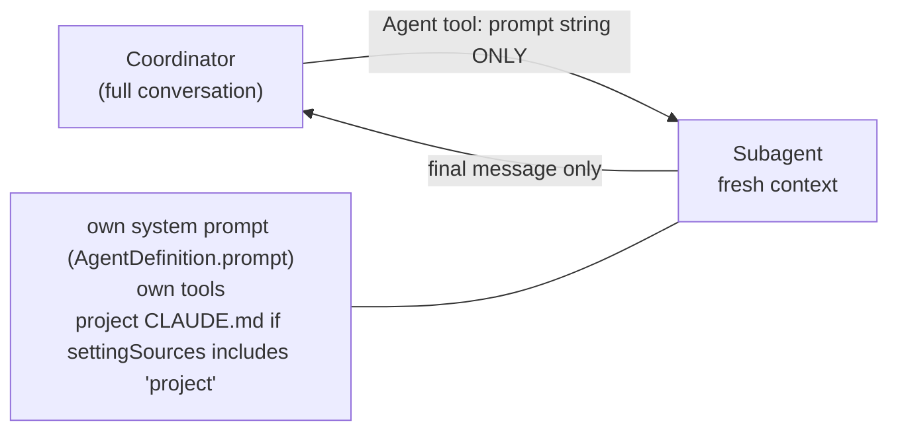
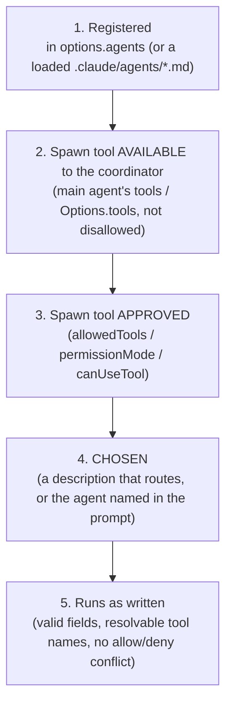

# Part 5 — Subagents with the Agent SDK

Give one agent a big research question and a folder of twenty documents, and you can watch it run out of road. It
reads the first few sources carefully, skims the next few, and by source fifteen its context window is a pile of
half-relevant excerpts and tool output. Its conclusions get vaguer as the pile grows. Meanwhile it's doing everything
one step after another, even though reading source 3 never depended on reading source 2.

**Subagents** are the standard answer. A coordinating agent hands well-defined pieces of work to specialist agents.
Each one starts with a clean context, does its piece with its own tools, and returns a compact result. The
coordinator never sees the raw reading, only the conclusions. That's the design behind Anthropic's own multi-agent
research system, and it's what the Agent SDK's `agents` option gives you in a few lines of configuration.

The few lines are the hard part, though. On your last attempt, four of the six objectives in this chapter scored 0%, and
they're all about those few lines:
- which tools each agent gets
- what each agent can and can't see
- why a subagent silently never runs
- what the coordinator has to write so the subagent can work without coming back to ask
- what the subagent has to send back so the results can be combined

By the end of this chapter you'll be able to write an `AgentDefinition` from memory, debug a broken multi-agent
configuration from its symptoms, and write delegation prompts and output schemas that survive the hand-off in both
directions. The three lessons that follow have you build all of that.

> **Objectives:** O05 tool restrictions, context scoping and system prompts per subagent · O33 tool distribution by role · O06 diagnose misconfigured spawning · O04 goal-oriented vs procedural delegation · O03 complete subagent prompts · O18 subagent output schemas
> **Lessons:** [Lesson 11](../../../lessons/11-agent-definitions-and-tool-scoping/) · [Lesson 12](../../../lessons/12-diagnose-broken-subagent-spawning/) · [Lesson 13](../../../lessons/13-delegation-prompts-and-output-schemas/)
> **Sources checked:** 2026-10-18 (links in *Going deeper*). SDK pinned: `@anthropic-ai/claude-agent-sdk` 0.3.302.

## The running example

Throughout this chapter we'll build one system: a small research team that answers a question for an engineering
leadership group. It uses the same data as the lessons (`fixtures/research/`).

The question is:

> *Does a four-day work week (same pay, ~32 hours) improve software team productivity?*

The team has a local corpus of ten sources. They're deliberately uneven, the way real evidence is:

| id | source | org | date | type |
|----|--------|-----|------|------|
| S1 | Four-day week pilot: 12-month outcomes across 61 organisations | Boston College / 4 Day Week Global | 2025-03-14 | peer-reviewed |
| S2 | Reduced working time and software delivery: evidence from engineering telemetry | KTH | 2025-11-02 | peer-reviewed |
| S3 | Shorter working week trial: final evaluation report | UK Government (illustrative) | 2024-09-20 | government |
| S4 | State of Developer Work 2026 | DevPulse | 2026-02-10 | survey |
| S5 | How our startup doubled velocity with a 4-day week | personal blog | 2025-06-01 | blog |
| S6 | The 40% Productivity Dividend | FlexiSched Inc. (a scheduling vendor) | 2025-09-15 | vendor-whitepaper |
| S7 | Compressed work weeks (4×10) and employee performance | Journal of Applied Psychology | **2009**-05-01 | peer-reviewed |
| S8 | Four-day weeks: the on-call problem nobody talks about | InfoQ | 2026-01-22 | news |
| S9 | Hours reduction and output in knowledge work: a randomised field experiment | NBER | 2026-04-30 | peer-reviewed |
| S10 | Four-day week trial in Iceland: a reanalysis | University of Iceland | 2023-08-11 | peer-reviewed |

Each source makes findings about five **claims**: `wellbeing`, `retention`, `output`, `on-call` and `collaboration`.
Some findings agree. On `output`, S1, S2, S3 and S10 say "maintained", but S9, a randomised study, says weekly
deliverables fell 9% while output per hour rose 13%. S5 (one team's blog post) and S6 (a vendor selling scheduling
software) claim big gains with no method behind them. S7 is 17 years old and studies a different schedule (four
ten-hour days). A good answer has to say that `wellbeing` and `retention` are well established, that `output` and
`on-call` are contested, and that `collaboration` lacks evidence.

The team has four members:

- a **coordinator**, which plans, delegates and assembles; it should never do the research itself
- a **source-analyst**, which reads the local corpus and extracts findings with their source metadata
- a **web-researcher**, which looks for newer studies on the web, but only for gaps the coordinator names
- a **report-writer**, which writes `report.md` from the findings it's handed

In Lesson 12 a fifth member, a **fact-checker**, joins in a configuration that doesn't work, and you'll find out why.

## 1. What does a subagent actually see?

### The problem

The intuitive picture of subagents is "colleagues in the same meeting": the coordinator has been reading and thinking,
then turns to the analyst and says "check the sources we discussed". It doesn't work that way, and most subagent bugs
come from that picture. To design anything in this chapter you first need an exact model of what crosses from the
coordinator to a subagent, and back.

### The idea

A **subagent** is a separate agent instance with its own **fresh context window**, its own **system prompt** and its
own **tool set**. The coordinator starts one by calling a tool, the **`Agent` tool**. (Before Claude Code v2.1.63 it was
called **`Task`**, and older exam material and the `system:init` message's tool list still use that name. Treat them as
the same thing, and match both when you detect delegations in code.)

The `Agent` tool call has two inputs that matter: `subagent_type`, which picks the definition, and `prompt`, a string.
**That prompt string is the only thing the subagent receives from the coordinator.** The subagent then runs its own
agentic loop (Part 1) with its own tools until it's done, and **only its final message** goes back to the coordinator
as the tool result. Every intermediate file read, search and dead end stays inside the subagent. That's the
*context-isolation* benefit, and it's also the reason the hand-off has to be designed carefully in both directions.



Here is precisely what a subagent gets, and what it doesn't:

| A subagent receives | A subagent does **not** receive |
|---|---|
| Its own system prompt (the definition's `prompt`) plus the `Agent` tool's prompt string | The coordinator's conversation history, or its tool results |
| Tool definitions: its `tools` subset, or everything available if `tools` is omitted | The coordinator's system prompt |
| Project CLAUDE.md, if `settingSources` loads it and the agent doesn't set `omitClaudeMd` | Skills, unless they're listed in the agent's `skills` |

Two settings scope context for the whole run. **`settingSources`** controls which settings files the SDK loads: leaving
it out loads all of them; `[]` loads none, which gives you an isolated run with no user, project or local settings and no
CLAUDE.md; and it must include `'project'` if you *want* the project's CLAUDE.md and `.claude/agents/`. Per agent,
**`omitClaudeMd: true`** keeps CLAUDE.md out of that one subagent.

One exception to "fresh context" is worth knowing: a **fork** is a subagent that inherits the parent's whole
conversation. That's handy when the background is long and hard to summarise, but it gives up exactly the isolation
this chapter is about.

### Worked example: the coordinator delegates the corpus

Here's the coordinator's turn when it hands the local corpus to the analyst, as it appears in the SDK message stream:

```json
{
  "type": "assistant",
  "parent_tool_use_id": null,
  "message": {
    "content": [
      { "type": "text", "text": "I'll have the source analyst extract findings from the local corpus first." },
      { "type": "tool_use", "id": "toolu_01Qx", "name": "Agent",
        "input": {
          "subagent_type": "source-analyst",
          "description": "Extract findings from local corpus",
          "prompt": "## Objective\nExtract every finding about the five claims from sources/S1.md–S10.md ...\n## Report format\n..."
        } }
    ]
  }
}
```

Notice three things. The tool is named `Agent` (it would be `Task` on an older version). `subagent_type` matches a
key in your `agents` option; leaving it out uses the built-in `general-purpose` agent. And the `prompt` is long, because
it has to stand on its own (section 6 is about what goes in it).

While the analyst works, the stream also carries *its* messages. You can tell them apart because they carry
`parent_tool_use_id: "toolu_01Qx"`, the id of the `Agent` call that started them. The coordinator's own turns have
`parent_tool_use_id: null`. Lesson 11's `listDelegations` uses exactly that to list which agents the coordinator called:

```ts
export function isSubagentCall(block: { type: string; name?: string }): boolean {
  return block.type === 'tool_use' && (block.name === 'Agent' || block.name === 'Task');
}
```

### What goes wrong

**Referring to context the subagent never had.** A delegation like

```json
{ "subagent_type": "source-analyst", "prompt": "Check the sources we discussed for the output claim and tell me if S9 changes things." }
```

reads fine to a human who was in the conversation. The analyst wasn't. It doesn't know which sources "we discussed",
what "the output claim" means here, or what S9's metadata is. It will either guess (and contradict work already done)
or spend its turns rediscovering everything. Worse, if the subagent runs in the background, there may be no way for it
to come back and ask.

**Expecting intermediate work in the coordinator.** The coordinator can't "look at what the analyst read". If the
synthesis step needs quotes or source dates, the subagent must put them *in its final message* (section 7).

> **Check yourself:** The coordinator's system prompt says "All agents must cite sources as [S#] and never use
> sources older than 2015." The analyst's reports keep citing S7 (2009) and use a different citation style. The
> coordinator's prompt is clearly correct. What's wrong?
>
> <details><summary>Answer</summary>
>
> The subagent never sees the coordinator's system prompt, only its own (`AgentDefinition.prompt`) and the `Agent`
> tool's prompt string. Rules that every subagent must follow belong in each subagent's definition `prompt`, in the
> delegation prompt, or in project CLAUDE.md (loaded when `settingSources` includes `'project'`). The tempting wrong
> answer, making the coordinator's prompt more emphatic, changes nothing for the subagent.
>
> </details>

## 2. How do you define a subagent?

### The problem

You know you want a source-analyst. Now you have to tell the SDK it exists, and tell Claude when to use it. If the
definition is sloppy, Claude may never pick it, or pick it for the wrong job. Worse, a sloppy definition can be
*accepted without any error* and still not do what you wrote.

### The idea

In the Agent SDK, a subagent is an **`AgentDefinition`**, passed in the `agents` option of `query()` and keyed by name.
Two fields are required:

- **`description`**: what the agent does and **when to use it**. This is the **routing signal**. Claude decides
  whether to delegate, and to which agent, by reading the descriptions, the same way it picks a tool from a tool
  description (Part 1). Wording like "use proactively" encourages delegation.
- **`prompt`**: the subagent's **system prompt**. It replaces the parent's for that agent. This is where the role's
  rules, constraints and output expectations live.

The important optional fields:

| Field | What it does |
|---|---|
| `tools` | Allowlist of tool names. **Omitted means the agent inherits every tool available to subagents.** A tool that isn't listed doesn't exist in that agent's session. |
| `disallowedTools` | Denylist, applied after `tools`; deny wins. `mcp__server` or `mcp__*` remove whole MCP servers. |
| `model` | `'haiku'`, `'sonnet'`, `'opus'`, `'fable'`, a full model id, or `'inherit'`. |
| `maxTurns`, `skills`, `mcpServers`, `permissionMode`, `background`, `omitClaudeMd`, `memory`, `effort`, `autoCompactWindow`, `initialPrompt` | Per-agent limits and context, covered where they matter. |

There are three places a subagent definition can come from. **Programmatically**, through the `agents` option, is the
recommended way for SDK applications. **On the filesystem**, as `.claude/agents/*.md` files with YAML frontmatter
(`name`, `description`, `tools`, `model`, …) and the system prompt as the body, which is how Claude Code projects
share agents. And the **built-in `general-purpose`** agent, used whenever `Agent` is called without a `subagent_type`.
If a programmatic definition and a file agent share a name, the programmatic one wins.

Finally, any definition can run as the **main thread** instead of as a subagent: `Options.agent: 'name'` (the SDK
equivalent of `claude --agent`) applies that definition's prompt, tools and model to the main conversation itself.
That's how you constrain the coordinator, as you'll see in section 3.

### Worked example: the source-analyst

Here's the analyst from Lesson 11, with the call that registers it:

```ts
import { query, type AgentDefinition } from '@anthropic-ai/claude-agent-sdk';

const sourceAnalyst: AgentDefinition = {
  description:
    'Reads the local source documents in sources/ and extracts findings with their source metadata. ' +
    'Use for any question that the provided corpus can answer. Read-only.',
  prompt:
    'You analyse research documents in the sources/ directory. For every finding you report, include the source id, ' +
    'title, organisation, date and source type, and quote the supporting sentence. Flag outdated or low-quality sources. ' +
    'Never modify files.',
  tools: ['Read', 'Grep', 'Glob'],
  model: 'haiku',
};

for await (const message of query({
  prompt: 'Which claims about the four-day week are well established?',
  options: { agents: { 'source-analyst': sourceAnalyst /* , … */ } },
})) {
  // stream handling
}
```

Walk through it field by field. The `description` says *what* ("extracts findings with their source metadata"),
*when* ("for any question that the provided corpus can answer") and a boundary ("Read-only"), so the coordinator can
route to it without guessing. The `prompt` is written *to* the analyst, in the second person, and states the rules
that make its output usable later: source metadata on every finding, a supporting quote, and flagging outdated
sources. Notice that the prompt and the `tools` list agree: "never modify files", and no `Write` or `Edit` in its
tools. The prompt *asks*, the tool list *enforces*. `model: 'haiku'` makes the high-volume reading cheap, while the
coordinator can run on a stronger model.

### What goes wrong

**A description that doesn't route.** `description: 'Analyst'` is legal, and it's the field Claude routes on. Given
that and the built-in `general-purpose` agent, the coordinator may well hand document analysis to `general-purpose`,
which has none of the analyst's rules and possibly every tool.

**A field name that doesn't exist.** These configurations often arrive as JSON or YAML, or through an `as any` cast,
where TypeScript can't check them. At runtime, **unknown fields are silently ignored.** So this definition:

```json
"fact-checker": {
  "description": "Re-checks each claim in a draft against its cited source. Use after the report is drafted.",
  "systemPrompt": "Verify every claim against the cited source and list unsupported claims.",
  "tools": ["Read", "WebFetch"]
}
```

loads without complaint, and the fact-checker runs **without its instructions**, because the field is `prompt`, not
`systemPrompt`. The same thing happens with `allowedTools` written inside a definition (section 3 shows why that one is
even worse).

> **Check yourself:** You add a `.claude/agents/security-reviewer.md` file to a project and also pass an
> `agents: { 'security-reviewer': … }` definition in `query()` options with a different prompt. Which prompt does the
> subagent run with, and how would you make the coordinator run *as* that reviewer instead of delegating to it?
>
> <details><summary>Answer</summary>
>
> The programmatic definition wins over a file agent with the same name, so the `query()` options' prompt applies. To
> make the main conversation itself use that definition's prompt, tools and model, set `Options.agent: 'security-reviewer'`
> (the SDK equivalent of `claude --agent`). Listing it in `agents` only makes it *available* to delegate to.
>
> </details>

## 3. Which tools should each agent get?

### The problem

The easiest configuration gives every agent every tool "just in case". It also produces the two most common complaints
about multi-agent systems. Specialists do things outside their role: the report-writer goes browsing, or an analyst
edits a source file. And the coordinator, holding every research tool itself, simply does the research instead of
delegating, so you pay for an orchestration layer that never orchestrates.

### The idea

Give each role the **smallest tool set that does its job** (least privilege). That has two separate benefits, and the
exam asks about both. First, **fewer tools means fewer wrong choices**: an agent with three tools picks the right one
more reliably than one with fifteen. Second, out-of-role actions become **impossible**, not merely discouraged. A prompt
that says "don't edit files" is a request; a tool list without `Edit` is a guarantee.

Typical role sets:

| Role | Tools |
|---|---|
| Read-only analysis | `Read`, `Grep`, `Glob` |
| Test execution | `Bash`, `Read`, `Grep` |
| Code modification | `Read`, `Edit`, `Write`, `Grep`, `Glob` |
| Web research | `WebSearch`, `WebFetch` |
| Coordinator | `Agent` (plus `Read`/`Glob` to orient itself), and **no** research or write tools |

Four different settings touch tools, and confusing them is the root of most configuration bugs:

| Setting | Where | What it decides |
|---|---|---|
| `Options.tools` | top-level options | The base set of tools that **exist** in the session |
| `AgentDefinition.tools` | per agent | Which of those tools **exist for that agent**. Omitted means it inherits all of them. |
| `disallowedTools` | top level or per agent | Tools **removed**; deny wins over any allow |
| `Options.allowedTools` | top-level options | Tools **pre-approved**, so they run without a permission prompt. **It never adds a tool to an agent that doesn't have it.** |

The last row is the distinction to remember: `tools` decides **availability**, and `allowedTools` decides
**approval**. Adding `WebSearch` to `allowedTools` doesn't give it to an analyst whose `tools` lacks it. Listing
`Agent` in the coordinator's `tools` doesn't approve it in a run where nobody can answer a permission prompt.

**Nesting.** Subagents *can* spawn subagents. The default depth is 3 since Claude Code v2.1.219. (It has changed
several times, and older material says subagents can't spawn at all, so watch for that distractor.) To stop a
specialist from spawning, leave `Agent` out of its `tools`, add it to its `disallowedTools`, or set
`CLAUDE_CODE_MAX_SUBAGENT_SPAWN_DEPTH=1`. In a *main-thread* agent's `tools`, `Agent(worker, researcher)` limits which
agent types it may spawn.

**Caps.** `maxTurns` bounds each loop. `maxBudgetUsd` bounds spend, and subagent spend counts toward it: at the cap,
new spawns are refused with `Budget limit reached`. `CLAUDE_CODE_MAX_CONCURRENT_SUBAGENTS` limits how many run at once.

### Worked example: the research team's tool map

Lesson 11 builds the team like this:

```ts
export const ROLE_TOOLS: Record<SubagentName, string[]> = {
  'source-analyst': ['Read', 'Grep', 'Glob'],
  'web-researcher': ['WebSearch', 'WebFetch'],
  'report-writer': ['Read', 'Write'],
};

export const COORDINATOR: AgentDefinition = {
  description: 'Plans research, delegates to specialists and assembles their results.',
  prompt: 'You coordinate a research team. … Do not research or write files yourself.',
  tools: ['Agent', 'Read', 'Glob'],
};

export function buildOptions(cwd: string, model = modelFromEnv()): Options {
  const subagentTools = Object.values(ROLE_TOOLS).flat();
  return {
    cwd,
    model,
    agent: 'coordinator',                                   // the coordinator IS the main thread
    agents: { coordinator: COORDINATOR, ...SUBAGENTS },
    allowedTools: [...new Set(['Agent', ...COORDINATOR.tools!, ...subagentTools])], // approval, not availability
    permissionMode: 'dontAsk',                              // headless: unapproved tools are denied, not prompted
    settingSources: [],                                     // don't pull in the developer's settings or CLAUDE.md
    maxTurns: 20,
    maxBudgetUsd: 1,
  };
}
```

Trace what each agent can actually do. The coordinator runs as the main thread through `agent: 'coordinator'`, so
*its* `tools` list applies to the main conversation. It can delegate (`Agent`) and glance at the question files
(`Read`, `Glob`), but it **cannot** search the web or write the report. Delegating is the only way forward, which is
the point. No specialist has `Agent`, so none can spawn further agents. The analyst can't touch the web; the
web-researcher can't read the local files; the report-writer can read findings and write `report.md`, but can't go
looking for new evidence of its own.

`allowedTools` lists every tool any agent uses, because the run is headless. `permissionMode: 'dontAsk'` means that
anything *not* pre-approved is denied rather than waiting for a human who isn't there. Lesson 11's `effectiveTools` makes the
availability rule concrete:

```ts
export function effectiveTools(def: Pick<AgentDefinition, 'tools' | 'disallowedTools'>, available: string[]): string[] {
  const base = def.tools ? def.tools.filter((t) => available.includes(t)) : available; // omitted tools = inherit all
  return base.filter((t) => !(def.disallowedTools ?? []).includes(t));                // deny wins
}
```

### What goes wrong

**The writer that browsed the web.** Someone restricts the report-writer like this:

```json
"report-writer": {
  "description": "Writes report.md from findings the coordinator hands over. Use once research is complete.",
  "prompt": "Write report.md from the findings you are given. Keep every citation.",
  "allowedTools": ["Read", "Write"]
}
```

It looks restricted. But `allowedTools` isn't an `AgentDefinition` field, so it's silently ignored. That leaves the
definition with **no `tools`**, and an agent with no `tools` **inherits everything**, including `WebSearch`. The fix is
`tools: ['Read', 'Write']`. This is the nastiest kind of misconfiguration: the code you wrote *says* the right thing,
and the run does the opposite.

**The coordinator that did everything itself.** Give the coordinator `Read`, `Grep`, `Glob`, `WebSearch` and `WebFetch`
"so it can check things", and it will often answer the whole question itself. The subagents never run, and the context
fills up exactly as described in this chapter's opening. Restrict the coordinator to `Agent` and orientation tools.

> **Check yourself:** A teammate wants the web-researcher to be able to read the local corpus too, so they add `Read`
> to the top-level `allowedTools`. In the next run, the web-researcher still can't read `sources/S2.md`. Why, and what's
> the right change?
>
> <details><summary>Answer</summary>
>
> `allowedTools` only pre-approves. The web-researcher's `tools` is `['WebSearch', 'WebFetch']`, so `Read` doesn't
> exist in its session at all. The fix is to add `Read` to the web-researcher's `tools` in its definition. Better
> still, ask whether it should read the corpus at all, given that the analyst owns that job and duplicated work is a
> cost.
>
> </details>

## 4. Why didn't the subagent spawn?

### The problem

Multi-agent configurations fail quietly. Nothing throws at startup. The run completes, the coordinator writes an answer,
and only later does someone notice that no specialist ever ran, or that one ran with the wrong tools or without its
instructions. Exam questions in this area give you a symptom and a configuration and ask for the cause. You need a
systematic way to go from one to the other.

### The idea

For a subagent to do its job, four links have to hold, in order:



Each broken link has a recognisable symptom:

| Symptom | Likely cause |
|---|---|
| The coordinator does everything itself | `Agent` isn't in its tool set (link 2), or its descriptions don't route (link 4), or it holds research tools it should hand off |
| Delegation attempts come back denied in CI | `Agent` isn't in `allowedTools` in a headless or `dontAsk` run, and there's no `canUseTool` (link 3) |
| A named agent never runs | It isn't registered in `agents` (link 1), or a new `.claude/agents/` directory was created mid-session and needs a restart |
| An agent fails to launch, naming a tool entry | The tool name doesn't resolve: `grep` instead of `Grep`, or a made-up name (link 5) |
| An agent uses tools it "shouldn't have" | A wrong field (`allowedTools`, `allowed_tools`) inside the definition is ignored, so `tools` is missing and it inherits everything (link 5) |
| An agent ignores its instructions | `systemPrompt` instead of `prompt`: the real prompt field is empty (link 5) |
| An agent can't use a tool that's listed | It's also in `disallowedTools` (deny wins), or the agent is at the nesting depth limit, where `Agent` is removed |
| A call without `subagent_type` fails | `CLAUDE_AGENT_SDK_DISABLE_BUILTIN_AGENTS=1` removed `general-purpose` |

### Worked example: the nightly job (Lesson 12)

Lesson 12 hands you a headless nightly job that's been failing. Here's an excerpt of its configuration:

```json
{
  "tools": ["Read", "Grep", "Glob"],
  "allowedTools": ["Read", "Grep", "Glob"],
  "permissionMode": "dontAsk",
  "agents": {
    "source-analyst": { "description": "Analyst", "prompt": "Extract findings …", "tools": ["Read", "grep", "Glob"] },
    "report-writer":  { "description": "Writes report.md …", "prompt": "Write report.md …", "allowedTools": ["Read", "Write"] }
  }
}
```

The first on-call note says "the coordinator never delegates and runs every Read/Grep itself". Walk the chain. Link 1:
the agents are registered. Link 2: `Options.tools` is `["Read", "Grep", "Glob"]`, which is the base set of tools that
exist in the session, and `Agent` isn't in it. **The coordinator has no spawn tool**, so it can't delegate and does the
work with what it has. The fix is to add `Agent` to `tools`.

The second note says that after someone fixed the first problem, "delegation attempts come back denied". That's link
3. The run is headless with `permissionMode: 'dontAsk'`, which denies anything not pre-approved, and `Agent` isn't in
`allowedTools`. Adding `Agent` to `tools` made it available but not approved. The fix is to add `Agent` to
`allowedTools` as well.

Look at the source-analyst once more: its description is `"Analyst"`, and its tools include `"grep"`. You've seen both
of those faults in sections 2 and 3. Lesson 12 has you write a linter that finds all of them (`diagnose(setup)` returns
a list of findings) before anyone pays for a run, and then a fixed configuration that the linter passes. There are
seven symptoms in the incident report, and every one maps to a broken link in the chain above.

### What goes wrong

**Fixing permissions with a sledgehammer.** The tempting fix for "delegation attempts come back denied" is
`permissionMode: 'bypassPermissions'`. It does make the denial go away, but it approves *every* tool for *every* agent,
including the ones you deliberately kept out of reach. The targeted fix is to pre-approve exactly the tools the run
needs (`Agent` plus the role tools) in `allowedTools`, or to decide per call with `canUseTool`. On the exam,
"bypass permissions" is almost never the best answer when a scoped allowlist would do.

**Fixing the wrong link.** If an agent never runs because it isn't registered, rewriting its description won't help.
If the coordinator lacks the `Agent` tool, adding agents won't help. Diagnose in chain order: registered → available →
approved → chosen → runs as written.

> **Check yourself:** A team's research job works on a developer's laptop but, in CI, the coordinator never uses the
> project's `.claude/agents/` reviewers. The CI job passes `settingSources: []` "to keep runs reproducible". What's the
> cause, and what are the two possible fixes?
>
> <details><summary>Answer</summary>
>
> `settingSources: []` loads no settings files, so the project's `.claude/agents/*.md` files are never loaded and the
> agents aren't registered (link 1). On the laptop, the defaults loaded everything. Either include `'project'` in
> `settingSources` (accepting that project settings and CLAUDE.md load too), or define the agents programmatically in
> the `agents` option so the run doesn't depend on files at all. Adding the agents to `allowedTools` is the tempting
> wrong answer: approval doesn't register anything.
>
> </details>

## 5. Should the coordinator give goals or steps?

### The problem

With the team wired correctly, the coordinator now has to tell each specialist what to do. There are two broad styles,
and they fail in opposite ways. Tell an analyst exactly which steps to take, and it will follow them even when
the evidence makes them pointless. Tell it "find out about productivity" and nothing else, and two agents research the
same thing, nobody covers on-call, and you can't tell afterwards what was looked at.

### The idea

**Procedural delegation** lists steps: "1. Read S1–S4. 2. Extract the output finding from each. 3. Summarise." It gives
predictable behaviour and makes the path visible. But the subagent can't adapt: if a step turns out to be wrong, it
does it anyway, and anything the steps didn't foresee is invisible.

**Goal-oriented delegation** states an objective and its boundaries: what to find out, what counts as success, what's
in and out of scope, and what to report. The subagent chooses its own path, so it can follow a lead or skip a dead end.
The cost is visibility, and you buy that back with a **required report**: what was searched, what wasn't found, which
sources were discounted, and why.

| | Goal-oriented | Procedural |
|---|---|---|
| States | Objective, success criteria, scope, output format | Numbered steps |
| Adapts to findings | Yes | No: follows the steps even when they're wrong |
| Coordinator visibility | Through the required report (searched, gaps, discounted) | Through the steps, but blind to anything off-script |
| Use when | The default for research, exploration and analysis | A mandated, audited sequence that must run exactly |

The exam's preferred answer is usually **goal-oriented with explicit success criteria, scope boundaries and a structured
report**. It keeps the subagent's adaptivity *and* gives the coordinator the visibility and control it needs. The two
tempting wrong answers are the extremes: rigid step lists, and open goals with no boundaries.

### Worked example: delegating the `output` claim

The coordinator wants the analyst to establish what the corpus says about `output`. A procedural version:

```text
1. Open S1, S2, S3 and S10.
2. Copy each source's statement about productivity.
3. Write a one-paragraph summary saying whether productivity is maintained.
```

Follow it literally. The analyst reads four sources that all say "maintained", and writes "productivity is
maintained". It never opens S9, the randomised study that found weekly deliverables fell 9%, because step 1 didn't
list it. The steps encoded the coordinator's *guess* about which sources mattered, and that guess was wrong.

The goal-oriented version (Lesson 13's `chooseDelegationStyle` returns `'goal-oriented'` unless a procedure is mandated):

```text
## Objective
Establish what the corpus says about the effect of a four-day week on software output.
## Success criteria
- Every source in sources/ that reports on output is examined, not only the ones that agree.
- Conflicting findings are reported side by side with their study design, not averaged.
## Scope
- In scope: output and delivery metrics in S1–S10.
- Out of scope: wellbeing and retention (another analyst covers them); web search (web-researcher covers named gaps).
## Report format
JSON matching the schema below, including what you searched for but could not find and any source you discounted.
```

This analyst decides for itself which files to open, so it finds S9 when it greps for "output", and the success
criteria tell it to report the conflict instead of smoothing it over. The scope lines stop it duplicating the other
analyst's work. The required report tells the coordinator exactly which sources were used and which were discounted
(S6 for having no method, S7 as outdated), so the coordinator keeps control without dictating the path.

### What goes wrong

**Goal with no edges.** "Research the four-day week and report back" is goal-oriented in name only. With no success
criteria, the analyst stops when it feels done. With no scope, the analyst and the web-researcher both end up searching
for output studies. With no report format, the coordinator can't tell coverage from silence.

**Procedural where judgement is the point.** Procedural delegation is right for a mandated, audited sequence, such as a
compliance checklist that must run exactly as written. Using it for open research is like hard-coding a search path
before you've seen the evidence.

> **Check yourself:** A regulated bank needs subagents to run a fixed five-step anti-fraud review in exactly that order,
> with each step logged for auditors. A colleague suggests goal-oriented delegation "because it's the best practice".
> Is it?
>
> <details><summary>Answer</summary>
>
> Not here. The sequence is mandated and audited, so procedural delegation is right: the subagent must follow the steps
> exactly, and the steps themselves are the visibility the auditors need. Goal-oriented delegation is the default for
> research and exploration, where the path should adapt to what's found. Recognising when the exception applies is
> what the objective tests.
>
> </details>

## 6. What must the delegation prompt carry?

### The problem

Section 1 established that the `Agent` tool's prompt string is the subagent's **only** input from the coordinator.
Section 5 decided the *style*. This section is about *content*: what does a subagent need in that one string so it can
finish the task without coming back to ask, and without redoing work that's already been done?

### The idea

A complete delegation prompt carries:

- the **objective**, the overall **question** it serves, and the **success criteria**
- the **scope**: what's in scope, what's out of scope, and **what other subagents are covering**
- the **prior findings** so far, with their source ids and confidence, so the subagent builds on them instead of
  rediscovering or contradicting them
- the **source metadata** for every source it should examine (id, title, org, date, type and url), so it can weigh
  evidence without re-fetching it
- the **constraints** (read-only, budget, no web) and the **output format**

A subagent that has to "come back and ask" for any of these is a prompt-design failure. It costs a round trip, and with
background subagents there may be no way back at all. The cost of a long, explicit delegation prompt is a few hundred
tokens; the cost of a missing piece is a whole subagent run.

### Worked example: Lesson 13's `buildDelegationPrompt`

Lesson 13 builds the prompt from a typed `DelegationTask`, so nothing can be forgotten:

```ts
export interface DelegationTask {
  subagent: string;
  question: string;
  objective: string;
  successCriteria: string[];
  inScope: string[];
  outOfScope: string[];          // includes what other subagents are covering
  priorFindings: PriorFinding[]; // { claim, statement, sourceIds, confidence }
  sources: SourceRef[];          // { id, title, org, date, type, url }
  constraints: string[];
}
```

Suppose the first analyst run has already established that wellbeing improved, and the coordinator now sends a second
analyst after `output`. The rendered prompt (shortened) looks like this:

```markdown
## Objective
Establish what the corpus says about the effect of a four-day week on software output.

## Context
This is part of answering: "Does a four-day work week (same pay, ~32 hours) improve software team productivity?"

## Success criteria
- Every source that reports on output is examined, including those that disagree.
- Conflicting findings are reported side by side with their study design.

## Scope
- In scope: output and delivery metrics in the sources below
- Out of scope: wellbeing and retention (covered by the first analyst)
- Out of scope: web search (web-researcher handles gaps the coordinator names)

## What we already know
- [wellbeing] Burnout fell and stayed lower at 12 months. (sources: S1, S3, S10; confidence: high)

## Sources to examine
| id | title | org | date | type | url |
|---|---|---|---|---|---|
| S2 | Reduced working time and software delivery: … | KTH | 2025-11-02 | peer-reviewed | … |
| S6 | The 40% Productivity Dividend | FlexiSched Inc. | 2025-09-15 | vendor-whitepaper | … |
| S9 | Hours reduction and output in knowledge work: … | NBER | 2026-04-30 | peer-reviewed | … |
| … | | | | | |

## Constraints
- Read-only. Do not search the web.

## Report format
You decide how to investigate. Report back as a single JSON object matching this schema … (schema follows)
```

Read it as the analyst would, with nothing else to go on. It knows the overall question, so it can judge relevance. It
knows what's already established, so it doesn't spend turns on wellbeing. It knows another agent owns the web, so it
won't try. And the source table tells it, before opening a single file, that S6 is a vendor whitepaper and S9 is a
recent peer-reviewed study, which is exactly the information it needs to weigh the conflict.

### What goes wrong

**The prompt that points at context.** "Look into output using the sources we found earlier" is the section 1 mistake
again. Which sources? Found by whom?

**Missing "what others cover".** Without the out-of-scope lines, two analysts sent in parallel will each cover the
easy, well-documented claims, and nobody will cover `collaboration`. Gaps and duplication are both scope failures.

**Missing source metadata.** If the prompt lists only `S6, S9`, the analyst must open each file before it knows S6 is a
vendor paper. Worse, its report may not carry the date and type, so synthesis can't weigh it either (section 7).

> **Check yourself:** A coordinator delegates "Summarise the output findings" to an analyst. The analyst returns a
> summary that treats S6's "+40%" as credible and doesn't mention that S1 already settled wellbeing. Which parts of a
> complete delegation prompt would have prevented each problem?
>
> <details><summary>Answer</summary>
>
> Source metadata (S6 is a `vendor-whitepaper` from a scheduling vendor), together with success criteria about weighing
> evidence quality, would have flagged the "+40%" as a weak source. Prior findings and scope ("wellbeing is already
> covered by the first analyst") would have kept the analyst focused and consistent with earlier results. The tempting
> wrong answer is to give the analyst `WebSearch` "so it can check S6": that adds cost and still doesn't tell it what's
> already known.
>
> </details>

## 7. What should the subagent send back?

### The problem

The other half of the boundary is the return trip. The subagent's final message is everything the coordinator will
ever learn from that run. If it comes back as a few paragraphs of prose, synthesis has to re-read and re-interpret it:
Which source said that? How recent was it? Was that the analyst's opinion or a quote? When several subagents return
prose, merging them loses exactly the source-level detail the final report needs.

### The idea

Design the subagent's output for its **consumer**, the synthesis step. In practice that means a schema in which:

- **structured findings carry the facts, and prose only summarises them**; a fact should never exist only in prose
- every finding carries **citation metadata** (source id, date, type and a verbatim quote), so synthesis can
  attribute, date-weight and de-duplicate without going back to the sources
- judgement fields (`stance`, `confidence`) are **enums**, so they can be compared across subagents
- fields that might be absent are **nullable**, so nothing gets invented to fill them
- the report includes **gaps** (what was searched for and not found) and **sources consulted**, with a reason for any
  discounted source; this is the visibility goal-oriented delegation promised the coordinator

Then **validate on arrival**: pull the JSON out of any surrounding prose or code fences, reject unknown source ids and
missing citations, and only then pass it on. For large artifacts, such as a long extracted table, have the subagent write
a file and return a reference to it, instead of passing everything through the coordinator like a game of telephone.

### Worked example: the analyst's report on `output`

Lesson 13's schema, abbreviated:

```json
{
  "type": "object",
  "required": ["summary", "findings", "gaps", "sources_consulted"],
  "properties": {
    "summary": { "type": "string", "description": "At most 3 sentences. Never the only place a fact appears." },
    "findings": { "type": "array", "items": {
      "required": ["claim", "statement", "evidence_quote", "source_id", "source_date", "source_type", "stance", "confidence"],
      "properties": {
        "claim": { "enum": ["wellbeing", "retention", "output", "on-call", "collaboration"] },
        "source_id": { "type": "string", "pattern": "^S\\d+$" },
        "source_type": { "enum": ["peer-reviewed", "government", "survey", "news", "blog", "vendor-whitepaper"] },
        "stance": { "enum": ["supports", "contradicts", "mixed"] },
        "confidence": { "enum": ["high", "medium", "low"] },
        "metric": { "type": ["string", "null"] }
      } } },
    "gaps": { "type": "array", "items": { "type": "string" } },
    "sources_consulted": { "type": "array", "items": { "required": ["source_id", "used", "reason"] } }
  }
}
```

And a report that satisfies it:

```json
{
  "summary": "Most trials report output maintained; one recent randomised study finds weekly deliverables fell 9% while output per hour rose.",
  "findings": [
    { "claim": "output", "statement": "Objective delivery metrics were unchanged.",
      "evidence_quote": "Objective delivery metrics (PRs, deploys) unchanged.",
      "source_id": "S2", "source_date": "2025-11-02", "source_type": "peer-reviewed",
      "stance": "mixed", "confidence": "high", "metric": "PRs/engineer −2% (CI −7%..+3%)" },
    { "claim": "output", "statement": "Weekly deliverables fell, though output per hour rose.",
      "evidence_quote": "Total weekly deliverables fell 9%, though output per hour rose 13%.",
      "source_id": "S9", "source_date": "2026-04-30", "source_type": "peer-reviewed",
      "stance": "contradicts", "confidence": "high", "metric": "deliverables −9%, per-hour +13%" }
  ],
  "gaps": ["No study measured output for on-call-heavy teams specifically."],
  "sources_consulted": [
    { "source_id": "S6", "used": false, "reason": "Vendor whitepaper; +40% claim with no method." },
    { "source_id": "S7", "used": false, "reason": "2009, studies 4×10 compressed schedules, not reduced hours." }
  ]
}
```

Notice what synthesis can now do without opening a single source. It can see that two peer-reviewed findings disagree
on `output`, and how (S9 measured weekly totals, S2 measured per-engineer delivery). It can see the dates and know S9
is the newest. It knows S6 and S7 were looked at and *why* they were set aside, so a reviewer won't ask "did you
consider the 40% study?". Lesson 13's `parseSubagentReport(text, knownSourceIds)` rejects a report that cites `S11` or
omits `source_date`, and `toSynthesisInput` merges several reports into findings grouped by claim, keeping every
citation. That grouped input is what Part 6's synthesis agent works from.

### What goes wrong

**Facts that only exist in prose.** If the summary says "most studies show no drop" and the findings list doesn't
contain those studies, synthesis can't check or cite the claim. Prose is for humans; findings are for the pipeline.

**Citations without metadata.** `"source": "S9"` alone forces synthesis to look up S9's date and type again, and if
a subagent misremembers an id, nobody notices. Carrying `source_date`, `source_type` and a verbatim
`evidence_quote` makes every finding self-describing, and validation catches invented ids.

**Free-text judgements.** One analyst writes "fairly confident", another writes "high", and a third writes "8/10".
None of them can be compared. Enums make them comparable.

> **Check yourself:** Three analysts return reports; the synthesis agent's output keeps stating "studies show a 40%
> productivity gain", even though every analyst discounted S6. What in the subagent output design would you check
> first?
>
> <details><summary>Answer</summary>
>
> Whether discounted sources are reported in a structured way (`sources_consulted` with `used: false` and a `reason`)
> and whether synthesis consumes that field. If the analysts only mentioned S6 in their prose summaries ("we ignored the
> vendor's 40% claim"), synthesis may pick up the number but miss the rejection. Making the rejection a structured,
> required part of the report, and passing `discounted` into synthesis as `toSynthesisInput` does, fixes it. Rewording
> the synthesis prompt alone is the tempting but weaker answer.
>
> </details>

## 8. Putting it together

Here's one full run of the research team, with every idea from this chapter in place. (You'll write the pieces yourself
in Lessons 11–13; this is the narrated run.)

1. **Configuration (sections 2–4).** `buildOptions` registers four definitions and runs the coordinator as the main
   thread (`agent: 'coordinator'`), with `tools: ['Agent', 'Read', 'Glob']`. Each specialist has its least-privilege
   `tools`, and none has `Agent`. The run is headless, so `allowedTools` pre-approves `Agent` and every role tool, with
   `permissionMode: 'dontAsk'` and `settingSources: []`. Before launch, Lesson 12's `diagnose()` reports no findings.
2. **Planning.** The coordinator reads `QUESTION.md` (it has `Read`) and plans one analyst task per group of claims.
   It can't search or write, so it delegates.
3. **Delegation (sections 5–6).** It calls `Agent` twice in one turn (Part 1's parallel tool calls apply here too),
   once per analyst task. Each call is goal-oriented, and each prompt carries the question, success criteria,
   scope (naming what the other analyst covers), prior findings and a source metadata table.
4. **Work in isolation (section 1).** Each analyst reads its sources with `Read`/`Grep`/`Glob` in its own context. Its
   messages appear in the stream with `parent_tool_use_id` pointing at its `Agent` call; none of its reading lands in
   the coordinator's context.
5. **Reports (section 7).** Each returns schema-valid JSON. The coordinator validates both reports, merges them by claim
   and sees one gap: no study covers on-call-heavy teams. It sends the web-researcher after exactly that gap, with a
   prompt that says what the analysts already found.
6. **Writing.** The report-writer receives the merged findings and writes `report.md`. It can't browse, so it can't
   "improve" the evidence. Its prompt tells it to keep every citation and to separate established from contested
   findings.

The coordinator's context at the end holds the plan, three compact reports and the writer's confirmation. That's a
few thousand tokens, instead of the full text of ten sources and every search along the way.

## Summary

- A **subagent** has a fresh context, its own system prompt and its own tools. The **`Agent` tool's prompt string**
  (the tool was called `Task` before Claude Code v2.1.63) is its only input from the coordinator, and only its
  **final message** comes back.
- **`AgentDefinition`** requires `description` (the **routing** signal: what it does and when to use it) and `prompt`
  (its **system prompt**). Unknown fields such as `systemPrompt` or `allowedTools` are **silently ignored**.
- **`tools` decides availability; `allowedTools` decides approval.** An omitted `tools` means the agent **inherits every
  tool**. `disallowedTools` wins over any allow.
- Give each role the **smallest tool set** it needs. Restrict the coordinator to `Agent` (via `Options.agent`) so it
  delegates instead of doing the work itself. Leave `Agent` out of specialists to stop nesting (default depth is 3).
- Diagnose spawning in chain order: **registered → available → approved → chosen → runs as written**.
- Default to **goal-oriented** delegation with success criteria, scope and a required report. Use **procedural**
  delegation only for mandated, audited sequences.
- The delegation prompt carries the **objective, question, success criteria, scope (including what others cover),
  prior findings, source metadata, constraints and output format**.
- Subagent output is a **schema**: structured findings with citation metadata, enums for judgements, nullable fields,
  gaps and discounted sources. Validate it on arrival.

## Traps and decision rules

| If the scenario says… | The answer is… | The tempting wrong answer |
|---|---|---|
| The coordinator answers without using the specialists | Make `Agent` available to it, give clear descriptions, and take away the research tools it should hand off | Make the coordinator prompt say "always delegate" more forcefully |
| Works locally, but in CI the subagents never run | `Agent` missing from `allowedTools` in a headless or `dontAsk` run; or project agents not loaded because `settingSources` excludes `'project'` | `permissionMode: 'bypassPermissions'` |
| The doc-review subagent edited files | Its `tools` was omitted or misspelled (inherits everything); give it `Read, Grep, Glob` | Add "never edit files" to its prompt |
| Subagent ignores its instructions | `systemPrompt` used instead of `prompt` | Repeat the instructions in the coordinator's system prompt |
| A tool is in `allowedTools` but an agent can't use it | It's not in that agent's `tools` (availability), or it's in `disallowedTools` | Add it to `allowedTools` again, or switch permission modes |
| Subagents keep asking for the file list or earlier results | Put findings, paths and source metadata into the delegation prompt | Give subagents access to the coordinator's history |
| Two subagents researched the same thing; a topic was missed | Scope boundaries naming what each other agent covers | More subagents |
| Synthesis can't tell which source said what | An output schema with per-finding citation metadata | A longer prose summary |
| The research plan must adapt, but the lead needs to see what was covered | Goal-oriented delegation plus a required report of gaps and sources consulted | Procedural steps "for visibility" |
| A regulated, audited sequence must run exactly | Procedural delegation | Goal-oriented "because it's best practice" |
| "Subagents can't spawn subagents" | They can now (default depth 3); prevent it by leaving `Agent` out of their `tools` | Accept the outdated claim |

And a cost trap: **subagents aren't free.** Each one starts cold and rebuilds its context, which costs tokens and
latency. For a three-file lookup, a direct tool call in the main agent is cheaper. Anthropic's research system scales
the number of subagents with the complexity of the query. Likewise, tools that are too narrow make agents fail or
flail (a test runner needs `Bash`), and a huge output schema pasted into every prompt costs tokens on every call, so
keep it focused on what synthesis actually consumes.

## Going deeper

- [Subagents in the SDK](https://code.claude.com/docs/en/agent-sdk/subagents): the `AgentDefinition` table, what subagents inherit, `Agent`/`Task` naming, tool restrictions, caps and troubleshooting.
- [Claude Code subagents](https://code.claude.com/docs/en/sub-agents): the `.claude/agents/*.md` file format and frontmatter, locations and precedence, available tools, nesting history, `Agent(type)` allowlists and forks.
- [Agent SDK TypeScript reference](https://code.claude.com/docs/en/agent-sdk/typescript): every `Options` field used here (`agent`, `agents`, `tools`, `allowedTools`, `disallowedTools`, `permissionMode`, `settingSources`, `maxTurns`, `maxBudgetUsd`, `outputFormat`).
- [How we built our multi-agent research system](https://www.anthropic.com/engineering/multi-agent-research-system): Anthropic's account of delegation essentials (objective, output format, tool and source guidance, boundaries), scaling effort to the query, and writing artifacts instead of passing everything through the lead.
- Installed types: `node_modules/@anthropic-ai/claude-agent-sdk/sdk.d.ts` (`AgentDefinition`, `Options`).
- Next: **Part 6 — Multi-agent orchestration**: choosing between coordinator-worker, parallel and pipeline structures (O10), persisting state so a pipeline can resume (O09), and synthesis that keeps uncertainty instead of flattening it (O19), using the same research corpus.
