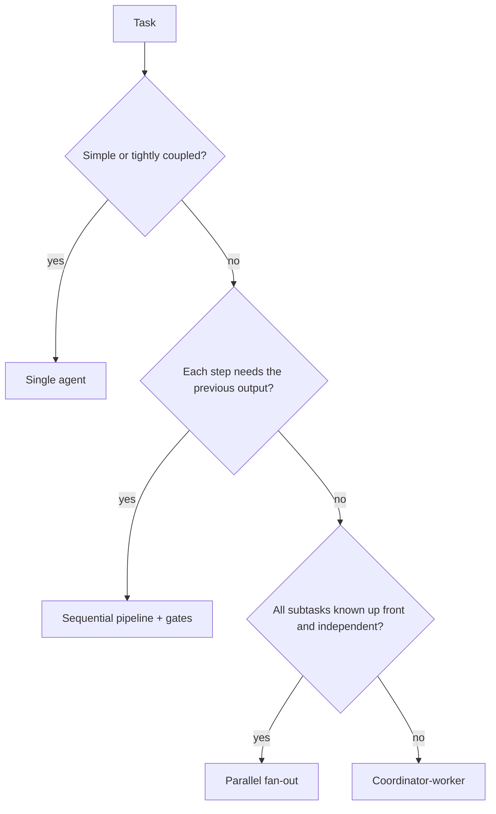
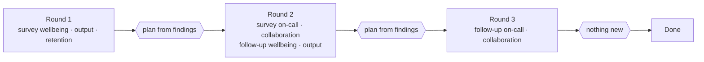
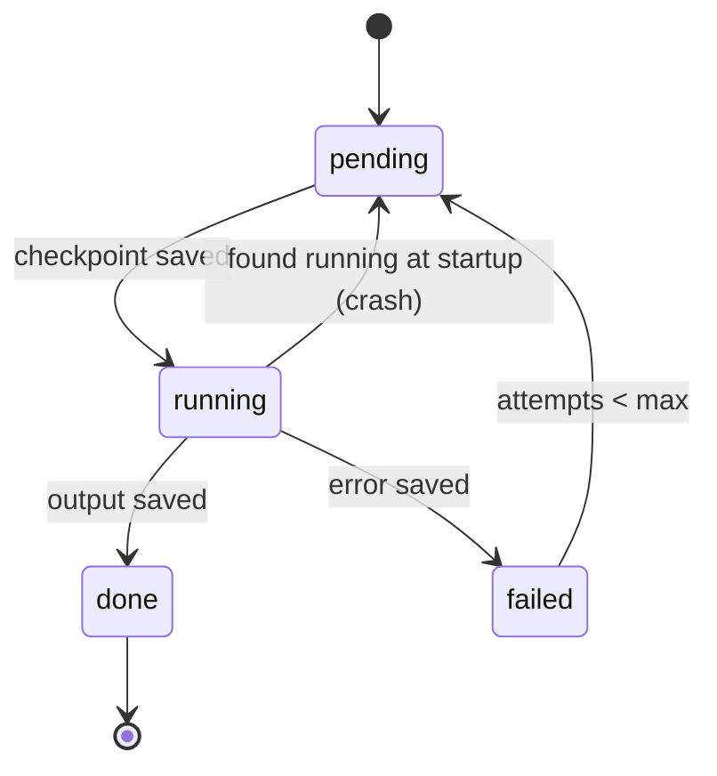
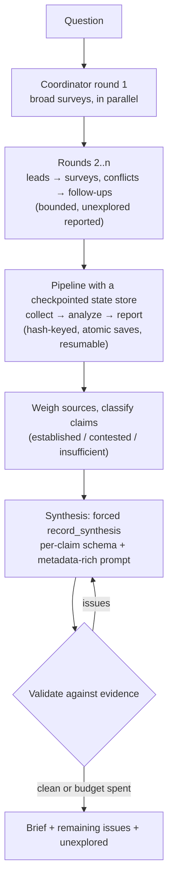

# Part 6 — Multi-agent orchestration

In Part 5 you learned how to define a subagent: its description, its prompt, its tools, and the boundary that
separates it from the agent that spawned it. That answers *how* to make one helper. This chapter answers the
questions that come next, when there are several helpers and real work riding on them. How many agents does this
task actually need, and how should they be arranged? Who decides what the next piece of work is? What happens when
the process dies halfway through a two-hour run? And when ten workers come back with findings that disagree, how do
you write one report without lying about the disagreement?

These questions have answers that are easy to get wrong in convincing ways. A team that adds more agents usually
gets more cost, not more quality. A coordinator that follows a fixed plan looks organised but misses whatever its
plan didn't anticipate. A pipeline that "resumes" by asking a model where it was will redo paid work and quietly
lose some. And a synthesis step that's asked for "one clear answer" will give you exactly that, even when the
honest answer is "two good studies disagree".

By the end of this chapter you'll be able to choose an orchestration structure from a task's requirements, let
intermediate findings drive decomposition, design state that survives interruption, and write a synthesis that keeps
source-level uncertainty visible. Your two lowest-scoring objectives from the last attempt, durable state (O09) and
uncertainty-preserving synthesis (O19), get two full sections each.

> **Objectives:**
>
> - O10 orchestration patterns
> - O07 dynamic decomposition
> - O09 state persistence for multi-agent pipelines
> - O19 synthesis that preserves uncertainty
>
> **Lessons:**
>
> - Lesson 14 Orchestration patterns and dynamic decomposition
> - Lesson 15 Pipeline state persistence and resumption
> - Lesson 16 Synthesis that preserves uncertainty
>
> **Sources checked:** 2026-10-18 (links in *Going deeper*). SDKs pinned: `@anthropic-ai/sdk` 0.135.0, `@anthropic-ai/claude-agent-sdk` 0.3.302.

## The running example

Leadership has asked one question: **"Does a four-day work week (same pay, about 32 hours) improve software team
productivity?"** They want an evidence brief by Friday. This is the research corpus from Part 5
(`fixtures/research/`), ten short sources of very different quality:

| id | what it is | type | date | headline |
|----|------------|------|------|----------|
| S1 | 61-organisation pilot, 12 months | peer-reviewed | 2025 | burnout down, output maintained, resignations −57% |
| S2 | engineering telemetry, 410 engineers | peer-reviewed | 2025 | PRs unchanged, meetings −30%, incident acknowledgement slower |
| S3 | government trial with a comparison group | government | 2024 | wellbeing and retention up, service maintained, on-call needed rota planning |
| S4 | developer survey, 8,200 self-selected | survey | 2026 | higher satisfaction, more context switching |
| S5 | a CTO's blog, one 9-person team | blog | 2025 | "velocity doubled" |
| S6 | scheduling-software vendor whitepaper | vendor-whitepaper | 2025 | "up to +40% productivity", method not disclosed |
| S7 | meta-analysis of 4×10-hour schedules | peer-reviewed | **2009** | no productivity effect, more fatigue |
| S8 | feature article, 6 SRE interviews | news | 2026 | slower incident response unless a Friday rota exists |
| S9 | randomised field experiment, 1,100 staff | peer-reviewed | 2026 | **total deliverables −9%**, output per hour +13%, retention up |
| S10 | Iceland reanalysis (35–36h, not 32h) | peer-reviewed | 2023 | wellbeing up, service maintained |

The sources make claims about five things: **wellbeing**, **retention**, **output**, **on-call** coverage and
**collaboration**. They don't all agree. Most rigorous studies find output *maintained*, but the one randomised
experiment (S9) finds total output *fell*. The two loudest "big gain" claims come from a blog (S5) and a vendor
(S6). S7 is old and studied a different intervention (the same 40 hours squeezed into four days, not fewer hours).

The fixture also has an `ANSWER_KEY`: what a careful analyst concludes. Wellbeing and retention are
**well-established**, output and on-call are **contested**, and collaboration has **insufficient evidence**. S5, S6
and S7 should be discounted, with reasons. Every section of this chapter moves us closer to a system that produces
that answer on its own, and keeps producing it when things break.

## 1. Do you need more than one agent?

### The problem

The first version of the research system did what many first versions do: every request went to a coordinator,
which spawned workers. "What year was S7 published?" got a coordinator and three workers. It worked, in the sense
that the answer was right. It was also slow and expensive, and when a teammate asked it to refactor a module, the
workers kept overwriting each other's edits.

### The idea

Anthropic draws a useful line between two kinds of LLM systems. **Workflows** are "systems where LLMs and tools are
orchestrated through predefined code paths": your code decides the sequence. **Agents** are "systems where LLMs
dynamically direct their own processes and tool usage": the model decides. A **multi-agent system** is one where
several model instances (a lead and its subagents, or workers) each run with their own context window.

More agents is not automatically better. In Anthropic's own measurements, agents use about **4×** the tokens of a chat
interaction, and multi-agent systems about **15×**. Their advice, repeated across their engineering writing, is to
find "the simplest solution possible, and only increase complexity when needed". Often a single, well-prompted
call with good retrieval and examples is enough.

Multi-agent setups earn their cost in a specific shape of task: **breadth-first** work that can be split into
independent directions, where each direction needs more context than one window comfortably holds. Research across
many sources is the canonical example. Anthropic's research system, with Claude Opus 4 as lead and Sonnet 4
subagents, beat a single Opus 4 agent by 90.2% on their internal research evaluation. They also name the bad fits:
tasks where agents need to share a lot of context, or have many dependencies between them, "such as most coding
tasks". Two workers editing the same files don't parallelise. They collide.

### Worked example: three requests to the research desk

Take three requests that arrive on the same morning and decide, for each, whether it needs a team.

1. *"What year was S7 published, and what schedule did it study?"* One fact, one source. A single agent with a
   handful of tool calls answers it. A coordinator here is pure overhead.
2. *"Rewrite `analyze.ts` and `report.ts` so they share one evidence type."* Both files must change together,
   consistently. Splitting the edit between agents means each must learn the other's half. Keep it in one agent.
3. *"Write the leadership brief: what does all the evidence say about each effect?"* Five claims, ten sources,
   and it's not known up front which claims matter. This is the breadth-first case where parallel workers pay off.

```ts
// the first two rules of choosePattern
if (r.complexity === 'simple' || r.heavySharedContext) return 'single-agent';
```

### What goes wrong

The common mistake is treating "multi-agent" as a quality upgrade you can apply to anything. The symptom is a bill
that's an order of magnitude higher for the same answers, and, on coupled work, inconsistent edits. The fix is a
deliberate default: one agent, until the task is broad, parallelisable and valuable enough to justify roughly 15×
the tokens.

> **Check yourself:** A team wants to speed up a feature that changes a database schema, the repository that reads
> it, and the API handler that returns it. They propose three subagents, one per layer, running in parallel. What's
> the risk, and what would you suggest?
>
> <details><summary>Answer</summary>
>
> The three layers depend on each other: the repository needs the new schema, and the handler needs the repository's
> new shape. Parallel agents would each guess at the others' changes and need to share context they don't have. That's
> exactly the "many dependencies / shared context" case Anthropic calls a poor fit. A single agent (or a sequential
> pipeline: schema, then repository, then handler, with checks between) is the better structure. Parallelism helps
> when the parts are independent, not just when there are several parts.
>
> </details>

## 2. Choosing a structure: pipeline, fan-out or coordinator

### The problem

Once a task does justify several model calls, there's still a choice of *shape*. The research team's second
version used a coordinator for everything. That included a nightly job whose steps were completely predictable
(extract → classify → write up) and where a coordinator only added an expensive planning call that always produced
the same plan.

### The idea

Anthropic's "Building effective agents" catalogue gives the vocabulary the exam uses. Three patterns matter here:

- **Prompt chaining (a sequential pipeline).** "Decomposes a task into a sequence of steps, where each LLM call
  processes the output of the previous one." You can add programmatic **gates** between steps that check the
  intermediate output before continuing. Use it when the task "can be easily and cleanly decomposed into fixed
  subtasks". It trades latency for accuracy, because each call has an easier job.
- **Parallelization.** Either *sectioning*, "breaking a task into independent subtasks run in parallel", or
  *voting*, "running the same task multiple times to get diverse outputs". Use it when subtasks are independent
  and you want speed, or when several attempts raise confidence.
- **Orchestrator-workers (coordinator-worker).** "A central LLM dynamically breaks down tasks, delegates them to
  worker LLMs, and synthesizes their results." The key difference from parallelization: the subtasks "aren't
  pre-defined, but determined by the orchestrator based on the specific input."

To choose, ask three questions in order. Does each step need the previous step's output? Then it's a pipeline. Do
you know all the subtasks up front, and are they independent? Then fan out in parallel for the lowest latency. Do
the subtasks depend on what you find? Then you need a coordinator. Each pattern trades off **coverage** (will we
look everywhere we should?), **latency** (how long until the answer?) and **reliability** (how predictable and
recoverable is it?) differently. Pipelines are the most predictable and the slowest. Fan-out is the fastest, but
only covers what you listed. Coordinators adapt their coverage, at the price of less predictability and more tokens.



Even with a coordinator, *how much* effort to spend is a separate decision. Anthropic found that early lead agents
over-invested in simple questions, so they put explicit **effort-scaling rules** into the lead's prompt. Simple
fact-finding gets one agent with 3–10 tool calls. Direct comparisons get 2–4 subagents with 10–15 calls each.
Complex research gets more than 10 subagents with clearly divided responsibilities.

### Worked example: the research desk's three jobs

| Job | Each step needs the last? | Subtasks known and independent? | Structure |
|-----|---------------------------|---------------------------------|-----------|
| Nightly: extract findings from each new source, then classify each claim, then write the digest | yes | – | pipeline: `collect` → `analyze` → `report` |
| "Summarise S1, S2 and S3 separately for the reading group" | no | yes, three known summaries | parallel fan-out, three calls at once |
| The leadership brief | no | **no**: which claims matter and where the evidence conflicts only shows up once you read | coordinator-worker |

A `choosePattern` helper encodes exactly this order:

```ts
export function choosePattern(r: Requirements): Pattern {
  if (r.complexity === 'simple' || r.heavySharedContext) return 'single-agent';
  if (r.stepsDependOnPreviousOutput) return 'sequential-pipeline';
  if (r.subtasksKnownUpfront) return 'parallel-fanout';
  return 'coordinator-worker';
}
```

### What goes wrong

Two mirror-image mistakes. The first is using a coordinator where the subtasks are fixed. You pay for a planning
call that always plans the same thing, and you add a place for things to go wrong. The second is using a fixed
fan-out where the subtasks aren't knowable up front. The system is fast and confidently incomplete: it surveys the
three angles someone thought of and never notices the fourth. If you see "coverage gaps" in a scenario, suspect a
predefined structure applied to an open-ended task. If you see "unnecessary cost and latency", suspect a coordinator
applied to a fixed task.

> **Check yourself:** A compliance team needs a report on 40 contracts. Each contract must be checked against the
> same 12-point checklist, and the checks for one contract don't depend on any other. Latency matters: the report is
> due in an hour. Which structure fits, and why not a coordinator?
>
> <details><summary>Answer</summary>
>
> Parallel fan-out (sectioning). The subtasks (contract × checklist) are known up front and independent, so they can
> all run at once, which minimises latency. A coordinator adds a planning step whose output is already known, plus
> extra tokens and variability, and no coverage benefit, because nothing about the task is discovered along the way.
> If the checklist results then fed a final cross-contract summary, that last step would be a short sequential stage
> after the fan-out.
>
> </details>

## 3. Letting the findings decide the next step

### The problem

With a coordinator in place, the research team wrote its plan the obvious way: survey wellbeing, then output, then
retention, then stop. The brief came back clean and confident. It didn't mention on-call coverage at all, though
three sources discuss it, or the fact that the output evidence contradicts itself. The plan was decided before
anyone had read a source, and the system executed it "regardless of intermediate findings".

### The idea

**Dynamic decomposition** means the list of subtasks isn't fixed at the start. It grows and changes as results
arrive. The coordinator runs a round of work, reads what came back, and plans the next round *from what it learned*.
Anthropic's research system works this way. The lead plans, spawns subagents, synthesises their results, "and
decide[s] whether more research is needed". Their prompting advice for searching mirrors it: "start with short,
broad queries, evaluate what's available, then progressively narrow focus."

Two kinds of discovery should change the plan:

- **Leads.** A worker reading about output notices that S2 and S3 also discuss on-call coverage. Nobody asked about
  on-call, but now somebody should.
- **Conflicts.** The output findings point in different directions: maintained (S1, S2, S3, S10), improved (S5, S6)
  and worsened (S9). A conflict is a finding, not noise. It deserves a *targeted* follow-up that asks *why* the
  sources disagree (method, population, date, the exact intervention) and which evidence is stronger.

Adaptivity needs guard rails, or it runs away. Never plan the same task twice. Bound the number of rounds and the
total number of tasks. And when a budget cuts something off, **report it** as unexplored, so the final brief can say
"not investigated" instead of implying it covered everything.

### Worked example: three rounds on the four-day week

Round 1 is the deliberately broad initial plan: `survey:wellbeing`, `survey:output`, `survey:retention`, all
running in parallel. Each worker returns findings, and also *leads*: other claims that its sources mention.

```json
{
  "taskId": "survey:output",
  "findings": [
    { "claim": "output", "sourceId": "S2", "direction": "no-change", "statement": "PRs and deploys unchanged" },
    { "claim": "output", "sourceId": "S9", "direction": "worsens",   "statement": "deliverables −9%, per hour +13%" },
    { "claim": "output", "sourceId": "S6", "direction": "improves",  "statement": "up to +40%" }
  ],
  "leads": [ { "claim": "on-call", "reason": "S2 and S3 report incident-response effects" },
             { "claim": "collaboration", "reason": "S2 reports meeting hours −30%" } ]
}
```

The coordinator now plans round 2 from these results. It adds new surveys for the leads (`survey:on-call`,
`survey:collaboration`). It adds follow-ups for the conflicting claims (`follow-up:wellbeing`, because S7's
"mixed" disagrees with the rest, and `follow-up:output`). Each follow-up names the sources that disagree:

```ts
{ id: 'follow-up:output', kind: 'follow-up', claim: 'output',
  objective: 'Sources disagree on output. Explain why (method, population, date, intervention) and say which evidence is stronger.',
  sourceIds: ['S1', 'S2', 'S3', 'S5', 'S6', 'S7', 'S9', 'S10'] }
```

Round 2's new surveys reveal conflicts of their own (on-call: S2 says worse, S3 and S8 say mixed). So round 3
holds `follow-up:on-call` and `follow-up:collaboration`. After that, no new leads or conflicts appear, and the loop
stops with `stoppedBy: 'no-new-tasks'`. Nine tasks in total, and none of rounds 2 and 3 was in the original plan.



### What goes wrong

The fixed-sequence coordinator is the obvious failure, and its symptom is a confident report with blind spots. The
less obvious failure is the *unbounded* adaptive coordinator. Without a `planned` set, the output conflict spawns a
new follow-up every round, forever. Without budgets, an interesting lead can eat the whole run. The third failure is
silent truncation: the budget ends the run, and the brief reads as if it were complete. For example, a
`maxRounds: 2` run returns `unexplored: [follow-up:on-call, follow-up:collaboration]`, and synthesis can say so.

> **Check yourself:** A due-diligence agent is told to "check the company's financials, litigation history and key
> customers". The financials worker finds that 60% of revenue comes from one customer who is suing the company.
> The coordinator finishes its three tasks and writes "no material risks found in litigation". What went wrong?
>
> <details><summary>Answer</summary>
>
> The decomposition was fixed. The litigation worker searched in general terms, the financials worker found a
> specific, high-stakes lead (the largest customer is a litigant), and nothing turned that lead into a new, targeted
> task. A coordinator that plans from intermediate findings would have spawned a follow-up such as "investigate the
> lawsuit by customer X and its revenue exposure". The fix isn't a longer fixed checklist, which would still miss the
> next surprise. It's planning each round from what the last round found.
>
> </details>

## 4. Surviving a crash: state that outlives the process

### The problem

The leadership brief runs as a pipeline: one `collect` call per source to extract findings, one `analyze` call per
claim, one `report`. Last night the container running it was recycled at `collect:S7`. The morning run started again
from `collect:S1`, paying for six extractions twice. A week earlier, one source failed to parse. The whole run threw
an exception, and the nine good extractions were lost with it. The state file it does write is written once, at the
very end, straight over the previous one.

### The idea

Long-running agent systems fail in the middle: processes are killed, rate limits hit, a tool times out. Anthropic's
research system writes about this directly. Because agents are long-running and stateful, restarting from the
beginning is expensive and frustrating, so they built the system to **resume from where the error occurred**. They
use deterministic safeguards like retries and **regular checkpoints** alongside the model's own ability to adapt.

The design that achieves this rests on a few ideas:

1. **Keep state in your own store, not in a model session.** A session transcript records a *conversation*. It
   doesn't know which of your pipeline's tasks finished, and the Agent SDK docs are explicit that sessions persist
   the conversation, not the filesystem. For work that must survive hosts and restarts, the same docs suggest
   capturing "the results you need … as application state" and passing them into a fresh session, calling this
   "often more robust than shipping transcript files around".
2. **One record per task.** Each task (`collect:S7`, `analyze:output`, `report`) has a status (`pending`,
   `running`, `done`, `failed`), its output, its error, an attempt count, and an **input hash**.
3. **Idempotency by content hash.** The input hash is a hash of exactly what the task consumes. On the next run, a
   task that is `done` with the *same* input hash is skipped, and its stored output is reused. If the input changed,
   the task reruns. Because downstream tasks hash *their* inputs (the upstream outputs), invalidation propagates
   automatically, and only as far as it needs to.
4. **Checkpoint per task, atomically.** Mark the task `running` and save, do the work, mark it `done` with its output
   and save. Each save writes a temporary file and **renames** it over the checkpoint, so a crash mid-write leaves the
   old checkpoint intact instead of a half-written one.
5. **Recover on load.** A task found `running` at startup was interrupted, so it goes back to `pending`. A `failed`
   task is retried until it reaches a maximum number of attempts. A `done` task is never touched.
6. **Isolate failures.** An ordinary error marks *that* task `failed` and the run continues. The report names the
   gap. Only a real crash stops the run, and the checkpoint already holds everything finished before it.



### Worked example: the crash at `collect:S5`

Run 1 processes S1–S4 and is killed while extracting S5. Because every task was checkpointed, `state.json` holds:

```json
{
  "version": 1,
  "tasks": {
    "collect:S1": { "status": "done",    "attempts": 1, "inputHash": "9f2c…", "output": [ { "claim": "wellbeing", "…": "…" } ] },
    "collect:S4": { "status": "done",    "attempts": 1, "inputHash": "41ad…", "output": [ "…" ] },
    "collect:S5": { "status": "running", "attempts": 1, "inputHash": "c07e…" }
  }
}
```

Run 2 loads the file. `recoverState` turns `collect:S5` back into `pending`. The pipeline then walks the task list:
S1–S4 are `done` with matching hashes, so they're skipped with no model call. S5–S10 run, followed by the five
`analyze` tasks and the `report`. The summary reports `skipped: [collect:S1 … collect:S4]`. A third run with nothing
changed makes **zero** model calls.

Now an editor corrects a typo in S9. Its content hash changes, so `collect:S9` reruns. S9 contributes to `output` and
`retention`, so those two analyses get new inputs and rerun. If their outputs come out identical, the `report`'s input
hash is unchanged and the report is reused. Nobody wrote that rule. It falls out of hashing inputs.

```ts
// the heart of runPipeline
const inputHash = hashInput(input);
const prev = state.tasks[id];
if (prev?.status === 'done' && prev.inputHash === inputHash) return prev.output;   // reuse
state.tasks[id] = { id, inputHash, status: 'running', attempts: attempts + 1 };
await store.save(state);                                                          // checkpoint before
const output = await work();
state.tasks[id] = { id, inputHash, status: 'done', attempts: attempts + 1, output };
await store.save(state);                                                          // checkpoint after
```

### What goes wrong

- **"Resume" by asking the coordinator what it did.** Resuming the lead's session and asking "where were you?" relies
  on a model's recollection of a long transcript. It's expensive, it isn't guaranteed to be accurate, and the
  transcript may not even exist on the new host. Pipeline progress is data; keep it as data.
- **Hashing unstable input.** `JSON.stringify` of an object whose keys arrive in a different order produces a
  different string. Every task looks "changed" after a restart, and everything reruns. Canonicalise (sort keys)
  before hashing. Don't put timestamps in the hashed input.
- **Saving once at the end.** The symptom is the morning rerun from scratch. Checkpoint per task.
- **Writing the checkpoint in place.** A crash mid-write leaves truncated JSON, and every finding is lost. Write a temp
  file, then rename.
- **Letting one failure abort the run.** The symptom is losing nine good results because of one bad one. Record the
  failure, continue, report the gap, and bound the retries.

On the platform side, two related tools are easy to confuse with this. Agent SDK `resume` (with `forkSession` to
branch) restores a *conversation* so one agent can continue its reasoning. **File checkpointing** reverts *file edits*
an agent made. Neither tracks your pipeline's tasks. Claude Code's experimental **agent teams** have a shared task list,
but the docs list "no session resumption with in-process teammates" among their limitations, and they don't run in
non-interactive (`-p`) or Agent SDK sessions. For a production pipeline, your own state store is the source of truth.

> **Check yourself:** A nightly extraction pipeline stores each document's result in a database row keyed by the
> document's URL. After a vendor re-publishes several documents at the same URLs with corrected numbers, the reports
> still show the old numbers. What's wrong with the idempotency key, and what should it be?
>
> <details><summary>Answer</summary>
>
> The key identifies the *location*, not the *content*, so the pipeline sees "already done" and reuses stale output.
> The task should be keyed by (or at least check) a hash of its actual input, here the document content. A changed
> document then reruns its extraction, and downstream tasks whose inputs changed rerun too. Keying by URL plus content
> hash keeps both the identity and the invalidation.
>
> </details>

## 5. Synthesis that keeps the doubt

### The problem

The first brief that reached leadership said: *"A four-day week increases productivity by up to 40%. Confidence:
0.9."* That's the vendor's number (S6), method undisclosed. The randomised experiment (S9), where total output fell
9%, isn't mentioned. Nobody told the model to hide it. The output schema had one `conclusion` field and one
`confidence` number, so there was nowhere to put a disagreement. The prompt asked for "one clear, confident answer".
And the excerpts arrived without dates or source types, so a 2009 study of a different schedule looked the same as a
2026 randomised trial.

### The idea

A **synthesis agent** combines findings from many workers into one answer. That's where uncertainty is most easily
destroyed, because "combine" invites "average" or "pick the majority". **Preserving source-level uncertainty** means
the final output still shows, per claim, how strong the evidence is, which sources support it, which disagree, and
which were set aside and why. Three tools make that happen. Each fixes one cause of the bad brief.

**First, a schema with room for uncertainty.** If the output format has a single verdict, the model must produce a
single verdict. Give each claim its own entry with a status from a small, meaningful set. *Well-established* means
several strong sources agree. *Contested* means good sources disagree. *Insufficient evidence* means there's too little
strong evidence to say either way. Contested and insufficient need different follow-up actions, so they shouldn't be
merged. Then give disagreement and discounting their own fields:

```json
{
  "claim": "output",
  "status": "contested",
  "statement": "Most rigorous studies find output maintained (S1, S2, S3, S10); a randomised experiment found total deliverables fell 9% while output per hour rose 13% (S9).",
  "supporting_sources": ["S1", "S2", "S3", "S10"],
  "conflicting_sources": ["S9"],
  "discounted_sources": [
    { "source_id": "S6", "reason": "vendor marketing; methodology not disclosed" },
    { "source_id": "S5", "reason": "anecdotal blog post" },
    { "source_id": "S7", "reason": "outdated (2009); studied 4×10 compressed hours" }
  ]
}
```

**Second, weigh sources before you count them.** Not all evidence is equal, and the synthesis step needs the
metadata to tell. A simple scheme gives each source a weight by type: 1.0 for peer-reviewed or government, 0.6 for
a survey, 0.4 for news, 0.15 for a blog, 0.1 for a vendor whitepaper. Anything more than ten years old has its
weight cut to a quarter. Anything below 0.3 is **discounted**: named, with a reason, but never counted as support. Then
classify each claim from the *kept* sources. Fewer than two strong sources means insufficient evidence. Kept sources
pointing in more than one direction means contested. Otherwise it's well-established. This is a rule you can
inspect and argue with, which a model's mood is not.

**Third, a prompt that passes the metadata through and states the behaviour.** The synthesis model can only weigh
what it can see, so the prompt carries every source's id, date, type and basis, each finding tagged with its source,
and the evidence table you computed. Then it says plainly what you want: report every claim separately with its
status, never merge conflicting evidence into one confident statement, present both sides of a contested claim
with their sources, keep numbers as reported and attribute them, and never cite discounted sources as support.

### Worked example: classifying output and wellbeing

For **output**, the sources with a finding are S1, S2, S3, S5, S6, S7, S9 and S10. Weighing them sets aside S5 (blog,
0.15), S6 (vendor, 0.1) and S7 (peer-reviewed but from 2009: 1.0 × 0.25 = 0.25). That leaves S1, S2, S3 and S10
("no change") and S9 ("worsens"). There are five strong sources, so the evidence isn't insufficient. Two directions
remain, so the status is **contested**. The dominant direction by weight is "no change", so S1, S2, S3 and S10 are
supporting and S9 is conflicting.

For **wellbeing**, S1, S3, S4 and S10 all say "improves". S5 is a discounted blog. S7's "mixed" finding would have
made wellbeing look contested, but S7 is discounted as outdated and as a different intervention. So the status is
**well-established**, with S5 and S7 listed under discounted. Notice how much the weighting step matters: without it,
a 2009 study of 10-hour days would downgrade a well-supported finding about a different policy.

Compare a naive majority-vote version. Five of the eight output sources say "no change", which
is more than half, so it reports output as "well-established: no change". That's the collapse the exam objective
describes, and it has a respectable-looking justification ("most studies agree").

### What goes wrong

- **The single-verdict schema** (`conclusion` + `confidence`) forces the collapse no matter what the prompt says.
- **Majority vote** turns "four studies vs one randomised trial" into "well-established".
- **Dropping metadata at the hand-off** (bare excerpts) makes source quality invisible to the synthesiser.
- **Discarding weak sources silently.** The reader then can't see why the +40% headline isn't in the brief, and may
  think it was missed. List discounted sources with reasons.
- **Averaging numbers.** "+40%", "maintained" and "−9%" don't average to "+10%". Keep each number attached to
  its source.

> **Check yourself:** A synthesis agent receives five worker reports. Four say a drug interaction is "not
> significant" (all small observational studies). One, a large randomised trial, finds a significant interaction.
> The agent writes "The interaction is not significant (4 of 5 studies)." What two changes most directly fix this?
>
> <details><summary>Answer</summary>
>
> Weigh evidence by quality instead of counting studies, and give the output a way to express disagreement. In
> practice: pass study type and size through to synthesis, and classify the claim from weighted evidence. A strong
> trial that disagrees makes the claim at least *contested*. Use a per-claim schema with a status and with
> supporting and conflicting sources, so the model can say "contested: four small observational studies find no
> effect; a large RCT finds one". Asking the model to "be more careful" without changing the schema and the
> inputs rarely fixes it.
>
> </details>

## 6. Checking the synthesis before anyone reads it

### The problem

With a better schema and prompt, most synthesis runs come back right. "Most" isn't good enough for a brief that
leadership will act on. Models can still upgrade a status ("contested" becomes "well-established"), leave the
conflicting side empty, cite the vendor as support, or invent a source id. You need to catch these before the report
ships, and fix them without a long back-and-forth.

### The idea

This is the **evaluator-optimizer** pattern: one step generates, another evaluates against clear criteria, and the
feedback drives a revision. Anthropic recommends it "when we have clear evaluation criteria, and when iterative
refinement provides measurable value". Here the criteria are crisp because you already computed the evidence table,
so the evaluator can be plain code:

- **missing-claim**: a claim in the evidence has no entry
- **overclaimed**: the entry says well-established, but the evidence doesn't
- **status-mismatch**: any other status difference
- **conflict-dropped**: the evidence is contested, but the entry lists no conflicting sources
- **relies-on-discounted**: a discounted source is cited as support
- **unknown-source**: a cited id isn't in the corpus

When there are issues, send them back in the shape the API expects. The synthesis was produced by a forced tool
call, so the next user message must contain a `tool_result` for that `tool_use`. Mark it `is_error: true` and list
**every** issue in that one message. Specific, batched feedback lets the model fix everything in one consolidated
revision, instead of fixing one issue per round trip (this is the same idea as O12's iterative refinement). Bound the
loop with a repair limit, and if issues remain, return them with the synthesis so a human sees them.

### Worked example: repairing the +40% draft

The first draft for output comes back as `status: "well-established"`, statement *"Productivity rises by up to 40%
[S6]"*, `supporting_sources: ["S6", "S5"]`, `conflicting_sources: []`. The validator returns:

```text
- [overclaimed] "output" is contested on the evidence, not well-established.
- [conflict-dropped] "output" is contested but no conflicting sources are listed (expected S9).
- [relies-on-discounted] S6 is discounted (vendor marketing; methodology not disclosed) but cited as support for "output".
- [relies-on-discounted] S5 is discounted (anecdotal blog post) but cited as support for "output".
```

The loop appends the draft as the assistant turn, then sends:

```json
{
  "role": "user",
  "content": [{
    "type": "tool_result",
    "tool_use_id": "toolu_draft",
    "is_error": true,
    "content": "The synthesis does not match the evidence:\n- [overclaimed] …\n- [conflict-dropped] …\n- [relies-on-discounted] …\nCall record_synthesis again with every issue fixed."
  }]
}
```

The second call (still forced to `record_synthesis`) returns output as contested with S9 on the conflicting side and
S5 and S6 under discounted. The validator returns no issues, and `renderReport` turns the result into a brief with three
sections: *Well-established*, *Contested*, *Insufficient evidence*.

### What goes wrong

The tempting shortcuts each fail in a recognisable way. Re-prompting with a vague "please double-check your sources"
gives a different draft with different errors. Sending issues one at a time costs one round trip per issue. Silently
overwriting the model's status with the computed one ships a statement that contradicts its own label: the
statement still says "+40%". Looping until the output is perfect, with no limit, turns one stubborn disagreement
into an unbounded bill. Validate against criteria you control, batch the feedback, revise a bounded number of times,
and surface what's left.

Anthropic's research system adds one more step: a separate **CitationAgent** that, after synthesis, maps claims back
to the specific places in the sources that support them. Keeping `supporting_sources` and `conflicting_sources` in
the schema from the start serves the same goal: no claim without a citation.

> **Check yourself:** Your validator finds three problems in a synthesis. A teammate proposes: send the first
> problem, wait for the fix, re-validate, send the next. Another proposes fixing the statuses in code and
> publishing. What do you recommend, and why?
>
> <details><summary>Answer</summary>
>
> Send all three problems in one feedback message (as an `is_error` tool result answering the synthesis tool call),
> and allow a bounded number of revisions. One at a time costs extra round trips, and fixes can conflict across
> rounds. Patching statuses in code leaves statements and citations that no longer match their labels. If problems
> remain after the repair budget, return them with the synthesis so a reviewer sees them, rather than shipping a
> brief that looks clean.
>
> </details>

## 7. Putting it together

Here's the leadership brief end to end, with every piece from this chapter in its place:



1. **Structure (section 2).** The brief is open-ended research, so it gets a coordinator. The nightly ingestion of new
   sources is a fixed pipeline. A one-fact question goes to a single agent.
2. **Dynamic decomposition (section 3).** The coordinator starts with three broad surveys, discovers on-call and
   collaboration from leads, and spends follow-ups only on the claims where evidence conflicts. It runs three rounds
   and nine tasks, and stops when nothing new appears.
3. **Durability (section 4).** Every extraction and analysis is a task in a checkpoint file, keyed by its input hash.
   When the container is recycled at `collect:S7`, the next run resumes at S7. When S9 is corrected, only S9 and the two
   claims it touches are recomputed.
4. **Synthesis (section 5).** Sources are weighed. Wellbeing and retention come out well-established, output and
   on-call contested, collaboration insufficient. S5, S6 and S7 are discounted with reasons. The schema and prompt keep all
   of that visible.
5. **Verification (section 6).** A draft that slips back to "+40%" is caught, sent back with all its issues at once,
   and corrected in one revision.

The brief that reaches leadership now says: wellbeing and retention improve (well-established, S1, S3, S9, …).
Delivered output is **contested**: most rigorous studies find it maintained, one randomised experiment finds total
deliverables fell 9% while per-hour output rose. On-call coverage needs rota planning. Collaboration effects are
unclear. The "+40%" claim was discounted as vendor marketing. That brief is less exciting than the first one, and
it's true.

## Summary

- Multi-agent systems cost roughly **15×** the tokens of chat. Default to the **simplest** structure, and keep simple
  tasks and tightly coupled work (shared context, same files) in **one agent**.
- **Pipeline** when each step needs the previous output (add gates). **Parallel fan-out** when subtasks are known and
  independent (lowest latency). **Coordinator-worker** when subtasks can't be predicted. They trade coverage, latency
  and reliability differently.
- **Effort scaling:** simple → 1 agent, 3–10 calls; comparison → 2–4 subagents, 10–15 calls each; complex → 10+
  subagents with divided responsibilities.
- **Dynamic decomposition:** plan each round from findings. Leads become new tasks, and conflicts become targeted
  follow-ups. Never plan twice, bound rounds and tasks, and report what was left unexplored.
- **Durable state:** keep pipeline progress in your own store, not a session. Use one record per task (status,
  attempts, output, error, **input hash**), skip `done` tasks with unchanged input, checkpoint **per task** with
  **atomic** writes, reset `running` to `pending` on load, isolate failures, and bound retries.
- **Uncertainty-preserving synthesis:** use a per-claim schema with a status (well-established / contested /
  insufficient) plus supporting, conflicting and discounted sources. Weigh sources by type and age, and classify
  from the weighted evidence rather than a majority vote. Pass metadata into the prompt and tell the model not to
  collapse conflicts.
- **Evaluator-optimizer:** validate the synthesis in code, send all issues back in one `is_error` tool result, revise
  a bounded number of times, and surface whatever is left.

## Traps and decision rules

| If the scenario says… | The answer is… | The tempting wrong answer |
|---|---|---|
| A single-fact question is slow and expensive in the research system | Route simple queries to one agent, and put effort-scaling rules in the lead's prompt | Add more subagents to parallelise it |
| Workers on a coding task overwrite each other's edits | One agent, or a sequential pipeline, for tightly coupled work | Parallel workers with a merge step |
| Steps each consume the previous step's output | Sequential pipeline with gates | Parallel fan-out ("faster") |
| Many known, independent subtasks and a deadline | Parallel fan-out (sectioning) | A coordinator that plans what's already known |
| Subtasks can't be known until you start reading | Coordinator-worker | A longer fixed checklist |
| The report has blind spots its sources clearly mention | Plan each round from intermediate findings (leads → tasks) | Re-run the same plan with a bigger model |
| Sources disagree on a key claim mid-research | A targeted follow-up that asks *why* they disagree, naming the sources | Ignore it, or let the majority win |
| The adaptive agent keeps re-investigating the same thing | Dedupe planned tasks and bound rounds and tasks | Remove adaptivity entirely |
| The pipeline restarts from scratch after a crash | Per-task checkpoints in your own store, skipping done tasks by input hash | Resume the coordinator's session and ask where it was |
| The checkpoint is corrupt after a crash | Atomic writes: temp file, then rename | Save less often |
| Everything reruns after a restart even though nothing changed | Canonicalise (sort keys, no timestamps) before hashing | Delete the state and start clean |
| One failed document aborts a long run | Mark it failed, continue, report the gap, bounded retries | Wrap the whole run in a retry |
| Synthesis says "well-established" while good sources disagree | Per-claim status schema + weighted classification + "present both sides" | Ask for a single confidence score |
| A vendor or anecdotal source drives the headline | Weigh by type and age, discount it with a reason, never cite it as support | Drop it silently |
| The validator finds several problems | Send all of them in one `is_error` tool result, with a bounded number of revisions | One issue per round trip, or patch the labels in code |

## Practice

You've seen every piece of this chapter's running example. Now build it yourself: the research coordinator, its checkpointed pipeline and the uncertainty-preserving synthesis for the four-day-week brief.

- **Lesson 14 — Orchestration patterns and dynamic decomposition** (`lessons/14-orchestration-patterns-and-dynamic-decomposition/`): pick the simplest structure that fits, apply effort-scaling rules, and turn a fixed-plan coordinator into one that plans each round from leads and conflicts, within budgets, reporting what it left unexplored.
- **Lesson 15 — Pipeline state persistence and resumption** (`lessons/15-pipeline-state-persistence/`): make the `collect` → `analyze` → `report` pipeline resumable with order-independent input hashes, atomic checkpoint saves, crash recovery and per-task checkpoints that skip finished work.
- **Lesson 16 — Synthesis that preserves uncertainty** (`lessons/16-synthesis-preserving-uncertainty/`): replace the single-verdict "+40%" brief with a per-claim schema, weighted source classification, a metadata-rich prompt and a validator that sends every issue back in one `is_error` tool result.
- **Quiz:** 12 exam-style questions on this part in the teach-me portal.

## Going deeper

- [Building effective agents](https://www.anthropic.com/engineering/building-effective-agents): workflows vs agents, prompt chaining, routing, parallelization (sectioning, voting), orchestrator-workers, evaluator-optimizer, and "start simple".
- [How we built our multi-agent research system](https://www.anthropic.com/engineering/multi-agent-research-system): orchestrator-worker architecture, the 90.2% result, ~15× token cost, effort-scaling rules, start-broad-then-narrow, resuming from the point of failure with checkpoints, the synchronous bottleneck, the CitationAgent.
- [Agent SDK: work with sessions](https://code.claude.com/docs/en/agent-sdk/sessions): `continue`, `resume`, `forkSession`; sessions persist the conversation, not the filesystem; resuming across hosts; capturing results as application state.
- [Claude Code: agent teams](https://code.claude.com/docs/en/agent-teams): an experimental shared task list and messaging between teammates, when to use teams vs subagents, and limitations (no in-process teammate resumption, not available in `-p` / SDK sessions).
- [Claude Code: subagents](https://code.claude.com/docs/en/sub-agents): the Agent tool, context isolation and what returns to the caller (Part 5).
- Next: **Part 7 — MCP**, which covers exposing data as resources instead of exploratory tools (O34), tool descriptions that route correctly (O36), and server scope and authentication (O35).
