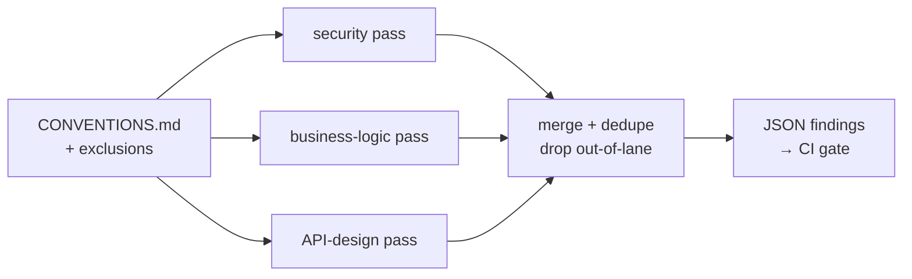

# Part 8 — Configuring Claude Code

Every team that adopts Claude Code goes through the same phase. Someone writes a `CLAUDE.md`, it works, and from then
on every new wish goes into that file: "always run prettier", "NEVER read `.env`", the release checklist, the API
style guide, a paragraph about the payment provider's webhooks. A few weeks later the file is three hundred lines
long and Claude follows it *mostly*. The `.env` rule is respected nine times out of ten. Prettier runs when Claude
remembers. The review bot flags the same harmless `any` in legacy code on every pull request, and the CI job that
runs Claude hangs whenever someone forgets a flag.

None of these are model problems. They're configuration problems. Claude Code has half a dozen places to put
guidance, and each one behaves differently: some load in every session and some only when a file matches, some are
advice and some are guarantees, some run in your conversation and some in an isolated subagent. Knowing which
mechanism fits which kind of guidance is most of what this exam domain tests. The rest covers how to wire Claude Code
into automation: reviews that produce data instead of prose, CI runs that can't run away, exploration that doesn't
drown in its own context, and generated tests that actually test something.

By the end of this chapter you'll be able to look at a piece of guidance and say where it belongs. You'll also be able
to configure a read-only multi-pass review, choose between plan mode and direct execution, write a CI invocation that
is safe to run unattended, and get Claude to explore and test a codebase economically.

> **Objectives:** O16 choose the config mechanism · O14 `context: fork` · O13 review configurations · O24 specialised review passes · O30 cutting false positives with persistent conventions · O08 plan mode vs direct vs multi-phase · O11 CLI in CI/CD · O32 choosing Grep/Glob/Read/Bash · O17 systematic exploration · O15 test-generation quality
> **Lessons:** [Lesson 19](../../../lessons/19-config-mechanisms-and-context-fork/) · [Lesson 20](../../../lessons/20-review-configs-and-specialized-passes/) · [Lesson 21](../../../lessons/21-plan-mode-workflows-and-ci/) · [Lesson 22](../../../lessons/22-exploration-tools-and-test-generation/)
> **Sources checked:** 2026-10-18 against code.claude.com/docs (links in *Going deeper*) and Claude Code 2.1.302 (`claude --help`).

## The running example

The whole chapter works on one repository: **Ledgerly**, a small order-and-billing API written in TypeScript. It's
the fixture in `fixtures/codebase/` that the lessons use.

```text
ledgerly/
├── CONVENTIONS.md            # the team's standards
├── src/
│   ├── config.ts  db.ts  http.ts  auth.ts
│   ├── routes/orders.ts  routes/invoices.ts
│   ├── services/billingService.ts  services/orderService.ts
│   ├── repositories/orderRepository.ts  repositories/invoiceRepository.ts
│   ├── utils/money.ts  utils/logger.ts
│   └── legacy/csvExport.ts
└── tests/
    ├── billingService.spec.ts    # tests splitInstalments only
    └── orderRepository.spec.ts   # defines the makeOrder()/makeLine() factories
```

`CONVENTIONS.md` is the heart of it. A few of its rules:

- **Money** is integer cents, rounded **once** at the end with `roundHalfEven`, and tax is applied **after** discounts.
- **Data access** uses `$1` placeholders; string-built SQL with user input is forbidden.
- **HTTP API**: resource-oriented routes (no verbs in paths), every error goes through
  `httpError(status, code, message)`, and every route that touches customer data calls `authorize(principal, customerId)` first.
- **Accepted patterns (do NOT flag)**: `any` in `src/legacy/**`, the logger's empty `catch` marked `// best-effort`,
  `Math.random()` for non-security request ids, `console.log` inside the logger, and admins reading any customer's data.

The codebase also contains nine seeded problems that we'll meet again: a hard-coded fallback API key (SEC-1), SQL
built by string concatenation (SEC-2), a `GET /orders/:id` route with no authorization check (SEC-3), per-line rounding
(BIZ-1), tax computed before the discount (BIZ-2), an off-by-one in pagination (BIZ-3), and three API design problems:
a `{ message }` error body (API-1), `POST /orders/:id/delete` (API-2), and every error reported as 404 (API-3). The
answer key is `ISSUES.md`. Claude never sees it; we use it to score reviews.

Finally, the team's first-draft Claude Code setup: one long `CLAUDE.md`, an empty-ish `.claude/settings.json`, a
single `reviewer` subagent, and a CI job that runs `claude "Review this PR and fix any problems you find"
--dangerously-skip-permissions`. Each section of this chapter fixes one part of that setup.

## 1. Where should this instruction live?

### The problem

Here's an excerpt of Ledgerly's first `CLAUDE.md`:

```markdown
## HTTP routes (src/routes)
- Resource-oriented routes only. No verbs in paths…
## Release procedure
1. Make sure main is green. 2. Bump the version… 7. Post the notes in #releases.
## IMPORTANT
- NEVER read `.env` or `.env.*` files. They contain live credentials.
- NEVER edit anything under `migrations/`.
- ALWAYS run `npx prettier --write <file>` after editing a file.
```

Every line is reasonable. The problem is where it sits. `CLAUDE.md` is loaded into context at the start of
**every** session. The docs describe it as context Claude reads, **not enforced configuration**. So the release
procedure costs tokens in sessions that have nothing to do with releases. The route rules sit in the context while
Claude edits a logger. The three "NEVER/ALWAYS" lines are requests, and a model that follows a request 95% of the
time leaks credentials one session in twenty. The docs also note that longer files reduce adherence: past a point,
adding a rule makes Claude follow *all* rules less reliably. Their target is under 200 lines per file.

### The idea

Claude Code gives you six places to put guidance. They differ on two axes: **when the guidance is loaded** and
**whether it's advice or a guarantee**.

| Mechanism | Lives in | Loaded | Advice or guarantee |
|---|---|---|---|
| **CLAUDE.md** | `./CLAUDE.md`, `./.claude/CLAUDE.md`, `~/.claude/CLAUDE.md`; subdirectory files load when Claude works there | Every session | Advice |
| **Rules** | `.claude/rules/*.md`, optionally with `paths:` globs in the frontmatter | Rules without `paths` at launch; path-scoped ones when Claude reads or edits a matching file | Advice |
| **Skills** | `.claude/skills/<name>/SKILL.md` (and the older `.claude/commands/<name>.md`, now the same mechanism) | The description is always visible, and the body loads when invoked (by `/name` or by Claude) | Advice / procedure |
| **Hooks** | `hooks` in `.claude/settings.json` | Run by Claude Code at lifecycle events (`PreToolUse`, `PostToolUse`, `Stop`, `SessionStart`, …) | **Guarantee**: a script runs every time |
| **Permissions** | `permissions.allow / ask / deny` in settings | Evaluated on every tool call: deny, then ask, then allow | **Guarantee**: deny rules block in every mode, even `bypassPermissions` |
| **Subagents** | `.claude/agents/<name>.md` | When Claude delegates (or you name them) | Separate context, own tools |

From the table you can derive a decision procedure. Ask the questions in this order and stop at the first "yes":

1. **Is it about which tools or files may be used?** ("never read `.env`", "never edit migrations") → a
   **permission** rule. A deny rule is enforced by Claude Code itself, not by the model's goodwill.
2. **Must it happen every time, with zero exceptions?** ("format every edited file", "tests must pass before
   stopping") → a **hook**. The best-practices guide puts it directly: CLAUDE.md instructions are advisory; hooks
   are deterministic.
3. **Is it a self-contained task that reads a lot or needs its own tools?** ("audit the codebase for float money
   maths") → a **subagent**, or a skill that runs in one (section 2).
4. **Is it a procedure, or knowledge needed only sometimes?** (the release checklist, webhook quirks) → a **skill**,
   whose body costs nothing until it's used.
5. **Does it apply to only part of the codebase?** (route rules, test rules) → a **path-scoped rule**.
6. Otherwise it's a fact every session needs (commands, the money rules) → **CLAUDE.md**.

The order matters. "Never read `.env`" is also something every session needs, but it's an *access* rule first, so
it belongs in permissions. The release checklist is a procedure, but it isn't "every time, zero exceptions", so it's a
skill and not a hook.

### Worked example: re-homing Ledgerly's CLAUDE.md

Applying the procedure line by line gives this layout. The slimmed `CLAUDE.md` keeps only what every session needs:

```markdown
# Ledgerly
Order and billing API. TypeScript, Vitest. Full standards: CONVENTIONS.md.

## Commands
- `npm test` runs the test suite
- `npm run typecheck` runs tsc

## Money
- All amounts are integer cents (`...Cents`). Never use floating-point dollars.
- Round once, at the end of a calculation, with `roundHalfEven` from `src/utils/money.ts`.
- Tax is applied after discounts.
```

The route rules move into a path-scoped rule. The `paths` field is the only frontmatter field Claude Code reads
from a rule file, and it takes glob patterns:

```markdown
---
paths:
  - "src/routes/**/*.ts"
---
# HTTP route rules
- Resource-oriented routes only. No verbs in paths: use `DELETE /orders/:id`, not `POST /orders/:id/delete`.
- Every error response uses `httpError(status, code, message)`.
- Every route that reads or changes customer data calls `authorize(principal, customerId)` first.
```

Notice what that buys you. When Claude edits `src/utils/logger.ts`, the route rules aren't in its context at all.
The moment it reads `src/routes/orders.ts`, they are. The same goes for a `tests.md` rule scoped to `tests/**`.

The three "IMPORTANT" lines become settings, because they're controls rather than advice:

```json
{
  "permissions": {
    "deny": ["Read(./.env)", "Read(./.env.*)", "Edit(./migrations/**)", "Write(./migrations/**)"]
  },
  "hooks": {
    "PostToolUse": [
      {
        "matcher": "Edit|Write",
        "hooks": [{ "type": "command", "command": "jq -r '.tool_input.file_path' | xargs npx prettier --write" }]
      }
    ]
  }
}
```

A hook receives the tool call as JSON on stdin, which is why the command pipes it through `jq` to get the edited file's
path. The matcher `Edit|Write` is an exact list of tool names. Characters other than letters, digits, `_`, `-`, spaces,
`,` and `|` would turn it into a regular expression. For a blocking hook, exit code **2** is the one that matters:
on events that can block, such as `PreToolUse`, it stops the action and feeds stderr back to Claude as the reason. Any
other non-zero exit is a non-blocking error.

The release checklist becomes `.claude/skills/release/SKILL.md`. Because releasing tags and pushes code, its
frontmatter says `disable-model-invocation: true`: only a human typing `/release` can start it. (The opposite switch,
`user-invocable: false`, hides a skill from the `/` menu so that only Claude loads it, which suits background
knowledge.)

### What goes wrong

The classic mistake is to treat louder text as stronger enforcement. When the `.env` rule is ignored once, the team
changes it to "**IMPORTANT: NEVER EVER** read `.env`". That nudges the odds, nothing more. The docs' own troubleshooting
advice is the opposite: if Claude keeps ignoring a rule, the file is probably too long, so prune it, and convert
must-always rules to hooks. A second mistake runs the other way: putting *advice* into hooks. A `PreToolUse` hook that
blocks every edit not matching your naming convention will fight Claude all day. Naming is a convention, so it belongs
in CLAUDE.md or a rule.

Two precedence facts trip people up. First, permission rules are evaluated **deny → ask → allow**, and the first match
wins regardless of specificity, so an allow rule can't carve an exception out of a broader deny. Second, a hook that
exits 2 blocks the call even if an allow rule would permit it, and a hook returning "allow" doesn't override a
matching deny rule.

> **Check yourself:** The Ledgerly security lead wants Claude to never run `curl` against the production API host. A
> teammate proposes adding "Do not call the production API with curl" to `CLAUDE.md` in capitals. What do you propose
> instead, and why?
>
> <details><summary>Answer</summary>
>
> A permission deny rule, for example `Bash(curl *prod.ledgerly.example*)`, or for robustness a `PreToolUse` hook
> on `Bash` that inspects the command and exits 2. Paired with sandbox network rules, either can't be talked around. This is an
> *access* rule, the first question in the decision order, and CLAUDE.md is advisory however it's capitalised. The
> docs also warn that a deny rule doesn't match the same program run by path or inside `sh -c`, which is why a hook or
> sandbox network allowlist is the stronger form when it really must hold.
>
> </details>

## 2. Running a skill in isolation with `context: fork`

### The problem

Ledgerly's `money-audit` skill asks Claude to search every file under `src/` for floating-point money maths and
report a table. Invoked inline, it runs *in your conversation*: every file it greps and reads lands in your context
window, and when it's done you're left with a context full of billing code you no longer need. Meanwhile the team
also added `context: fork` to `money-style`, a skill that only lists style guidelines, and noticed it returns nothing
useful.

### The idea

A skill normally runs **inline**: its body is injected into the current conversation and Claude carries on with full
access to everything said so far. Adding `context: fork` to the frontmatter runs the skill in a **new subagent**
instead. The skill's content becomes that subagent's prompt, the subagent works in its own context window, and only
its final result comes back to your conversation. The `agent:` field picks which subagent type runs it: `Explore`,
`Plan`, `general-purpose` (the default) or one of your custom agents. That agent's definition supplies the model, the
tools and the permissions. Forked skills run in the background by default, and `background: false` makes the caller
wait for the result.

Two consequences follow, and the exam tests both:

- **Isolation.** The fork can't pollute your session: its file reads, dead ends and intermediate notes stay in its
  own context. This is what the objective calls "preventing cross-contamination of session state".
- **No shared memory.** The fork **does not see your conversation history**. Its instructions must be
  self-contained, and a skill that says "audit the files we discussed" has nothing to go on.

Hence the docs' rule of thumb: fork a skill that has an **explicit task**. A skill that is only guidelines ("use these
conventions") has no task, so in a fork it produces no useful output. Keep it inline. When the work genuinely depends
on the conversation so far, a forked skill is the wrong tool. Claude Code has a separate "fork the conversation"
feature for that.

### Worked example: `money-audit`, forked

```markdown
---
name: money-audit
description: Audit the whole Ledgerly codebase for floating-point money math and rounding mistakes. Use when asked to check money handling.
context: fork
agent: Explore
---

You are auditing the Ledgerly codebase (TypeScript, under `src/`) for money-handling bugs. You have no
prior conversation context: everything you need is here.

Project rules (from CONVENTIONS.md):
- All amounts are integer cents. Floating-point dollar arithmetic is a bug.
- Round once, at the end of a calculation, with `roundHalfEven` from `src/utils/money.ts`.
- Tax is applied after discounts.

Steps: grep for `Cents`, `roundHalfEven`, `Math.round`, `toFixed`, `taxRate`; read only the matching functions;
do not edit files. Return a Markdown table: file, line, problem, rule violated, suggested fix.
```

Walk through the choices. `agent: Explore` picks the built-in read-only agent (Write and Edit are denied), which is
right for an audit. The body restates the rules instead of saying "use our conventions", because the fork can't see
the conversation in which you might have mentioned them. It ends with an explicit output format, because the only
thing that crosses back into your session is that result. When you type `/money-audit`, your context gains one
table, not twenty files.

### What goes wrong

The first failure is the one the team hit: `context: fork` on `money-style`. The subagent receives a list of style
rules as its entire prompt, has no task, and returns a polite summary of the rules. The fix is to delete `context:
fork`, and optionally add `user-invocable: false` so Claude loads it as background knowledge when writing money code.
The second failure is a forked skill whose body leans on the conversation: "Check the function we just changed for
rounding issues." The fork doesn't know which function that is. It guesses, or it reports nothing.

> **Check yourself:** A `/summarize-pr` skill reads the diff, the linked issue and the CI logs, then writes a two-line
> summary. Developers complain that after running it their session is sluggish and Claude starts forgetting earlier
> instructions. What one-line frontmatter change helps, and what must you check in the body when you make it?
>
> <details><summary>Answer</summary>
>
> Add `context: fork` (optionally with `agent: Explore` if it only reads). The diff, issue and logs then stay in the
> subagent's context and only the summary returns. You must check that the body is self-contained: it should say how to find
> the PR (for example from `$ARGUMENTS` or `` !`gh pr view` ``) instead of relying on "the PR we're discussing",
> because the fork doesn't see the conversation.
>
> </details>

## 3. Configuring automated review: standards, tools, passes and false positives

### The problem

Ledgerly's review bot is a single subagent:

```markdown
---
name: reviewer
description: Reviews code.
---
You are a code reviewer. Review the code and point out every problem you can find: bugs, security,
style, naming, missing comments, anything. Be thorough and fix what you can.
```

Run it over Ledgerly and you get a long prose list. It mentions rounding twice and naming five times, flags the
logger's empty `catch` and the `any` in legacy code, both of which the team explicitly allows, and misses the
authorization bug in `GET /orders/:id`. Because the frontmatter lists no `tools`, the subagent inherits **every**
tool, so "fix what you can" means it edits files during a review. The CI step that consumes the output can't parse it.

### The idea

A good automated review configuration has four properties, and each maps to an exam objective.

**It loads the right standards (O13, O30).** False positives mostly come from the reviewer not knowing local
conventions. A generic reviewer *should* flag an empty `catch`; a Ledgerly reviewer must know that the logger's
`// best-effort` catch is allowed. So the conventions, and especially the accepted patterns and exclusions, must be
**persistent context applied on every review**, not something mentioned once in a chat. In Claude Code that means
importing them from `CLAUDE.md` (`@CONVENTIONS.md`), which subagents also load unless they set `omitClaudeMd`, and
having each reviewer read them. In an API-based pipeline it means putting them in every pass's system prompt. Add
explicit **exclusion criteria** too: no style nits, and only report what violates a named rule.

**It's restricted to the tools it needs (O13).** A reviewer reads, so give it `tools: Read, Grep, Glob`.
Omitting `tools` means *inherit everything*, including Edit, Bash and MCP tools. The docs warn not to rely on a
subagent's `permissionMode` for read-only enforcement, because it's ignored when the main session runs in
`bypassPermissions`, `acceptEdits` or auto mode. The allowlist is the reliable constraint.

**It produces structured output (O13).** Downstream automation needs data: category, severity, file, line, summary,
and the rule violated, with enums and a `line` that can be `null` rather than invented. In the API that's a forced tool
with this schema. In Claude Code CI it's `--json-schema`, which puts validated output in `structured_output`.

**It separates concerns into passes (O24).** A single prompt asked to find security, logic and API problems at once
trades recall between them: the model's attention and its examples are spread thin, and whichever concern is most
salient crowds out the others. Three focused passes do better. Each one names its concern, says what to ignore,
and carries **its own few-shot examples**, including one "looks suspicious but is fine" example that teaches the
threshold.



### Worked example: Ledgerly's three reviewers

The Claude Code side is three subagent files. Here is the security one. The other two differ in focus and examples:

```markdown
---
name: security-reviewer
description: "Security review of Ledgerly code: injection, authorization, secrets. Use proactively when reviewing a change or a pull request."
tools: Read, Grep, Glob
model: sonnet
---
You are a security reviewer. Report only security issues: injection, missing authorization, exposed secrets,
unsafe input handling. Ignore business logic and API design; other reviewers cover those.

Before reviewing, read CONVENTIONS.md. Report only violations of a rule stated there. Never report anything
listed under "Accepted patterns (do NOT flag)", and never report style, naming or missing comments.

<examples>
<example>db.query(`SELECT * FROM invoices WHERE id = '${id}'`) → security/critical: SQL built from request input.</example>
<example>router.get('/invoices/:id', h) with no authorize call → security/high: IDOR.</example>
<example>Math.random() for a log correlation id → no finding (accepted pattern).</example>
</examples>

Return only JSON: {"findings": [{"category": "security", "severity": "...", "file": "...", "line": 123 or null,
"summary": "...", "rule": "..."}]}.
```

Notice the description's quotes: it contains `: `, which a YAML parser would otherwise read as a nested mapping.
"Use proactively" is the phrase the docs recommend to encourage Claude to delegate to a subagent on its own.

In Lesson 20 you build the same thing on the Messages API: three requests, run concurrently, each with system prompt =
focus + conventions + examples, and `tool_choice` forcing `report_findings`. Merging then drops any finding whose
category doesn't match its pass and de-duplicates by category, file and line. Scored against `ISSUES.md`, the target
is high recall on SEC/BIZ/API and **zero** OK-* findings.

### What goes wrong

Three tempting fixes don't work. "Tell the single reviewer to be more thorough" makes the list longer, not better
balanced. "Filter accepted patterns out with a regex afterwards" treats the symptom: the model still spends its
attention on them, and every new accepted pattern needs new code. "Raise the severity threshold" hides real
medium-severity findings along with the noise. The fixes that work are structural: persistent conventions,
exclusion criteria, focused passes with examples, and a schema.

> **Check yourself:** After you add CONVENTIONS.md to the reviewer's context, it stops flagging the legacy `any`, but
> it still sometimes edits files "to fix" what it finds, and once it ran `npm install`. The subagent's frontmatter has
> `permissionMode: plan`. Why isn't that enough, and what's the fix?
>
> <details><summary>Answer</summary>
>
> A subagent's `permissionMode` is ignored when the parent session runs in `bypassPermissions`, `acceptEdits` or auto
> mode, and with no `tools` field the subagent inherits Edit and Bash. The reliable fix is an explicit allowlist,
> `tools: Read, Grep, Glob`. Also remove "fix what you can" from the prompt: a review reports, it doesn't edit.
>
> </details>

## 4. Plan mode, direct execution, or a multi-phase workflow?

### The problem

Ledgerly's team runs every request the same way: type it in and let Claude work. For "fix the typo in README.md"
that's ideal. For "change how invoice totals are rounded", where the billing lead wanted to approve the approach
first, Claude had already edited two files by the time anyone looked. For "migrate 400 test files from Jest to
Vitest", one long session produced a diff nobody could review, and when it was interrupted halfway, nobody knew which
files were done.

### The idea

There are three ways to have Claude carry out a change, and they differ in how much human review sits between
understanding and editing.

**Direct execution**: Claude explores and edits in one go. The best-practices guide's test: *if you could describe the
diff in one sentence, skip the plan.* Typos, a log line, a local rename.

**Plan mode** is a permission mode (`--permission-mode plan`, Shift+Tab, `/plan`, or `permissions.defaultMode: "plan"`
in settings). Claude reads files and runs exploratory commands, then writes a plan, and **edits stay blocked until you
approve it**. Approving switches the session into an editing mode. The docs recommend it when you're uncertain about
the approach, when the change touches several files, or when you're unfamiliar with the code, and it's the
natural fit whenever a human must sign off *before* edits. Plan mode keeps its blocks in non-interactive `-p` runs too.

**A multi-phase workflow** is for work that one plan-then-execute cycle can't hold: many repeated units (hundreds of
files), or several stages that each need their own sign-off (schema change, then API change, then data backfill). You
make the phases explicit: explore and inventory, pilot on a few items, then batches with verification after each, then a final
check. Put human checkpoints between phases and keep a progress file so an interrupted run can resume. In Claude
Code that's often a skill whose body lays out the phases, or a script that fans out `claude -p` per batch.

The deciding factors, then, are **scope** (one file, several, unknown, hundreds), **risk** (cosmetic vs money or
security), **clarity of approach**, and **approval requirements** (none, before any edit, or between stages).

### Worked example: Ledgerly's backlog

| Task | Approach | Why |
|---|---|---|
| Fix a typo in README.md | Direct | One-sentence diff, no risk |
| Rename `tmp` to `subtotalCents` in `computeTotals` | Direct | Local, clear |
| Add Google OAuth login | Plan mode | Approach unclear, unknown set of files |
| Change invoice rounding; billing lead approves first | Plan mode | High risk, approval before edits |
| Find out why the pagination test is flaky | Plan mode | Cause unknown, so explore first |
| Migrate 400 test files to Vitest | Multi-phase | Many units: pilot, batches, progress file |
| Extract billing into its own service, three signed-off stages | Multi-phase | Stages with approval gates |

The migration skill's body makes the phases unmistakable:

```markdown
## Phase 1: Explore
List every test file and every Jest API in use. Write the list to `migration/inventory.md`. Do not edit any test file.
**Checkpoint:** show the inventory and a migration plan, then stop and wait for approval.
## Phase 2: Pilot
Migrate 3 representative files. Run `npm test` on them.
**Checkpoint:** show the diff and the test output, then stop and wait for approval.
## Phase 3: Batches
Migrate the rest in batches of 20. After each batch, run the tests and append the result to `migration/progress.md`.
## Phase 4: Verify
Run the full suite and the typechecker. Report remaining failures. Do not commit.
```

It also sets `disable-model-invocation: true`, because a workflow that edits hundreds of files should start only when
a human asks for it.

### What goes wrong

Over-planning is a real failure, not just a waste: plan mode on a typo costs a review round trip for nothing, and teams
that plan everything stop reading the plans. The more common failure is the opposite, direct execution on a change
that needed approval, where "I'll review the diff afterwards" turns into reviewing a fait accompli. For large work,
the trap is a single huge plan: approving a 400-file plan isn't meaningful review, and without a progress file an
interruption means starting over or re-checking everything.

> **Check yourself:** A teammate asks Claude to "update the date format in every API response". Nobody knows how many
> files format dates, and the change is visible to API clients. Which approach do you pick, and what would change
> your answer to multi-phase?
>
> <details><summary>Answer</summary>
>
> Plan mode. The scope is unknown and the change is client-visible, so you want Claude to find every formatting site
> and propose an approach before editing. It would become multi-phase if the exploration showed many independent
> sites (dozens of endpoints, best done in verified batches), or if the change needed staged rollout with sign-off,
> for example a deprecation period before switching formats.
>
> </details>

## 5. Running Claude Code unattended in CI

### The problem

Ledgerly's review workflow step is:

```yaml
run: claude "Review this pull request and fix any problems you find" --dangerously-skip-permissions
```

It has four defects. Without `-p`, `claude` starts an **interactive** session, which in CI waits for input until the
job times out. `--dangerously-skip-permissions` is `bypassPermissions`: every check off, on a runner that holds
secrets. Nothing caps turns or spend, so a confused run can loop and bill for an hour. The output is prose, so the
job can't decide pass or fail. (Asking a review job to "fix" things is a fifth, design-level problem.)

### The idea

The non-interactive CLI is built for this. The flags that matter:

| Flag | What it does |
|---|---|
| `-p` / `--print` | Run the prompt non-interactively and exit. Exit code 0 on success, non-zero on failure |
| `--output-format json` | One JSON object: `subtype` (`success`, `error_max_turns`, `error_max_budget_usd`, `error_during_execution`, …), `is_error`, `result`, `session_id`, `num_turns`, `total_cost_usd` |
| `--json-schema '<schema>'` | Validated output matching the schema, returned in `structured_output` |
| `--permission-mode dontAsk` | Anything that would prompt is denied. Reads in the working directory, read-only commands, and pre-approved tools still run. Designed for locked-down CI |
| `--allowedTools "Read,Grep,Bash(git diff *)"` | Pre-approve exactly these. The space before `*` matters: `Bash(git diff*)` would also match `git diff-index` |
| `--tools "Read,Grep"` | Restrict which built-in tools *exist* (different from pre-approving them) |
| `--max-turns N` | Stop after N agentic turns, ending with an error result. (It works but isn't listed in `claude --help`.) |
| `--max-budget-usd X` | Stop once estimated spend reaches X. Leave headroom, since spend can pass the cap |
| `--no-session-persistence` | Don't save a resumable transcript on the runner |
| `--bare` | Skip auto-discovery of CLAUDE.md, hooks, skills, agents, MCP and plugins for reproducible scripted runs, and pass what you need with `--settings`, `--agents`, `--mcp-config`, `--append-system-prompt-file`. Recommended for scripted calls, and slated to become the `-p` default |

Two things about permission modes are worth keeping straight. `dontAsk` is the CI mode: it never waits, and it runs
exactly what you allowed. `bypassPermissions` runs everything and is meant for isolated containers only, though deny
rules still apply even there. And a `-p` run **without** `--bare` loads the repository's hooks and `.mcp.json`
servers with no trust dialog, which matters when CI runs on code from forks.

### Worked example: the fixed workflow step

```yaml
- name: Review
  run: >-
    claude -p "Review the diff against origin/main for violations of CONVENTIONS.md. Report findings only; do not edit files."
    --output-format json
    --permission-mode dontAsk
    --allowedTools "Read,Grep,Glob,Bash(git diff *)"
    --max-turns 15
    --max-budget-usd 3.00
    --no-session-persistence
    --json-schema "$(cat .claude/review-schema.json)"
    > review.json
- name: Fail on errors or hit limits
  run: jq -e '.is_error == false and .subtype == "success"' review.json
- name: Fail on high-severity findings
  run: jq -e '[.structured_output.findings[] | select(.severity == "critical" or .severity == "high")] | length == 0' review.json
```

Read the gate carefully: a run that hits `--max-turns` produces a result with `subtype: "error_max_turns"`. That is
a **failed** step, not a review with no findings. Lesson 21's `interpretResult` encodes the same rule in TypeScript, using
the Agent SDK's own `SDKResultMessage` type so that a renamed field would fail to compile.

### What goes wrong

"The job hangs" almost always means a missing `-p`. "Claude couldn't read the diff" in `dontAsk` mode means the
needed command wasn't in `--allowedTools`. `dontAsk` denies rather than prompting, which is the point. Reaching for
`--dangerously-skip-permissions` to make the errors go away is the exam's favourite wrong answer. A bare `Bash` in
`--allowedTools` approves every shell command, so prefer patterns. And a gate that only checks the exit code can let a
capped, half-finished run through if your wrapper swallows the status, so check `subtype`.

> **Check yourself:** A nightly job runs `claude -p "Fix lint errors" --output-format json --permission-mode
> acceptEdits` and occasionally runs for 40 minutes, costing more than the rest of the pipeline. What do you add, and
> how should the pipeline treat a run that hits the limit?
>
> <details><summary>Answer</summary>
>
> Add `--max-turns` and `--max-budget-usd` (and a job timeout as a backstop). A run that hits either cap ends
> with `subtype` `error_max_turns` or `error_max_budget_usd` and `is_error: true`. The pipeline should fail that step
> and surface it, not treat whatever partial edits happened as success. You might also scope the job with
> `--allowedTools` (for example, the lint command) instead of a broad mode.
>
> </details>

## 6. Finding your way around: choosing tools and exploring incrementally

### The problem

Asked "which routes reach customer data without an authorization check?", the first-draft agent read every file
under `src/` in full, about 12,500 characters for a codebase this small, and far more in a real one. Then it flagged
four routes in `orders.ts`, because none of them contains the string `authorize(`. Three of those were false
positives: their handlers pass `req.principal` to a service method that performs the check. The agent spent its
context on reading and had none left for following references.

### The idea

Claude Code's built-in tools each answer one kind of question, and each returns as little text as that question
allows:

- **Glob** finds files by **name** pattern (`src/routes/**/*.ts`, `**/*.config.ts`). It returns only paths.
- **Grep** finds **content**. It's built on ripgrep, so patterns use ripgrep regex syntax. Its output modes are
  `files_with_matches` (the default, paths only), `content` (matching lines with line numbers), and `count` (matches
  per file).
- **Read** opens a **known** file. With `offset` and `limit` it returns just a window, which is how you look at
  lines 4,000–4,080 of a huge log without loading 20,000 lines.
- **Bash** **runs** things: tests, builds, `git log`, `git diff --name-only`.

Systematic exploration chains them from cheapest to most expensive: Glob to narrow by name, Grep to locate by
content, Read a small window around each hit, then follow **one** reference at a time (the service a handler calls,
the import a function uses), and stop when the question is answered. Keep notes of confirmed facts with file:line
as you go. When an investigation will touch many files, hand it to a subagent (the built-in `Explore`, or your own
read-only one) so the reading happens in its context and only the summary returns to yours.

There's one current-behaviour wrinkle to know. On macOS, Linux and WSL, Claude Code now leaves **Glob and Grep out
of the default tool set**, and Claude searches with `find` and `grep` through Bash, which run embedded `bfs` and
`ugrep`. Naming `Glob`/`Grep` in `--tools` or `--allowedTools`, or in a subagent's `tools` list that leaves out
`Bash`, brings the dedicated tools back. The exam frames this the classic way: Grep for content, Glob for names. The
reasoning is the same either way.

### Worked example: SEC-3, the economical way

```ts
const files = ws.glob('src/routes/**/*.ts');                       // 2 paths
for (const file of files) {
  const starts = ws.grep(/method: '/, { glob: file, mode: 'content' });   // e.g. orders.ts:8, :17, :30, :38
  for (const [i, s] of starts.entries()) {
    const end = starts[i + 1]?.line ?? s.line + 16;
    const body = ws.read(file, { offset: s.line, limit: Math.min(end - s.line, 16) }).join('\n');
    if (!/authorize\(|req\.principal/.test(body)) flag(file, body);  // only GET /orders/:id
  }
}
```

The Glob returns two paths. The Grep returns five lines. Each Read returns at most sixteen lines around a route. The
handler for `GET /orders/:id` calls `service.getOrder(req.params.id)` and passes no principal, so it's the only
route flagged. Total text in context: well under a quarter of the codebase, and the answer is the right one.

### What goes wrong

The two failure modes mirror each other. **Over-reading**: "read every file so you understand the codebase" fills
the context before the question is even asked, and the docs list "the infinite exploration" among the common failure
patterns. **Under-reading**: one grep, then report. A string match isn't a finding until you've checked the one hop
that matters. Tool misuse belongs in the same family: `cat`-ing a 20,000-line file through Bash instead of a windowed
Read, using Grep to find files you know by name, or reading whole files when a `count` would answer the question.

> **Check yourself:** You need to know how many TODO comments each file under `src/` has, then read the two worst
> files' TODOs. Which tool calls, in what order?
>
> <details><summary>Answer</summary>
>
> First Grep for `TODO` in **count** mode over `src/` (no lines enter context, just counts per file). Then Grep in
> **content** mode restricted to the two worst files, to get the TODO lines with line numbers. Read a window around a
> TODO only if its line alone isn't enough. Reading all files, or `content` mode over everything, wastes context.
>
> </details>

## 7. Getting tests worth having

### The problem

"Write tests for `computeTotals`" produced this, and it passed:

```ts
it('computes totals', () => {
  const totals = computeTotals(makeOrder(), 0.2);
  expect(totals).toBeDefined();
  expect(typeof totals.taxCents).toBe('number');
});
```

It passes against the buggy implementation, which rounds per line (BIZ-1) and taxes before the discount (BIZ-2).
A test that passes against a bug proves nothing. The model also wasn't shown the existing tests, so it
re-invented fixtures instead of using `makeOrder`/`makeLine`, and it had no idea that "tax after discount" is a rule.

### The idea

Generated tests are only as good as the context and criteria the model is given. Three things move the quality most:

1. **Existing tests as context.** They show the framework, the style ("one `describe` per exported function") and,
   crucially, the **fixture conventions**: Ledgerly's factories live in `tests/orderRepository.spec.ts`. Seeing them
   is what makes the model reuse them.
2. **The rules the code must satisfy.** Behavioural tests assert *expected* values computed from the business rules,
   so the model needs those rules: the code under test, what it depends on (`roundHalfEven`), and the relevant
   conventions.
3. **Explicit criteria for a meaningful test.** Say what counts: concrete expected values (exact cents), named edge
   cases (tax after discount, rounding once, discount larger than the subtotal, several lines, zero tax). Say what
   doesn't count: tests whose only assertions are `toBeDefined`, `toBeTruthy`, `typeof` checks, `not.toThrow`, or mock
   call counts.

In Claude Code you can package all three in a skill. The `` ```! `` blocks run before the skill reaches Claude and
inline their output, so the existing tests and conventions are always fresh:

````markdown
---
name: write-tests
description: Write behavioural Vitest tests for a Ledgerly function, following the project's test conventions.
allowed-tools: Read, Grep, Glob, Bash(cat tests/*)
---
Write Vitest tests for `$0` in `$1`.

```!
cat tests/orderRepository.spec.ts tests/billingService.spec.ts
```

What counts as a meaningful test: it fails when the behaviour is wrong. Assert exact cents computed by hand from the
business rules. Do NOT write tests whose only assertions are `toBeDefined`, `toBeTruthy`, `typeof`, `not.toThrow`, or
mock call counts. If a test fails against the current code, report it; don't change the expected value to make it pass.
````

### Worked example: the test that catches BIZ-2

With that context, a typical generated test looks like this:

```ts
it('applies tax after the discount', () => {
  const order = makeOrder({ discountCents: 1000, lines: [makeLine({ quantity: 2, unitPriceCents: 5000 })] });
  expect(computeTotals(order, 0.2)).toEqual({ subtotalCents: 10000, discountCents: 1000, taxCents: 1800, totalCents: 10800 });
});
```

The expected tax is 20% of 9,000 (after the discount), which is 1,800. The current code computes 20% of 10,000,
which is 2,000, so the test fails, and that failure is the point: it found BIZ-2. Note the last instruction in the
skill. A model told to "make the tests pass" would happily change 1800 to 2000.

### What goes wrong

The usual mistakes: asking for "100% coverage" (which rewards trivial assertions), letting the model compute
expected values by running the code (which bakes the bug into the test), giving no existing tests (so you get new
fixture helpers in every file), and accepting the output unread. A cheap automated gate helps. Lesson 22's `isTrivialTest`
flags any test file with no behaviour-pinning assertion before a human spends time on it.

> **Check yourself:** Claude's generated tests for `splitInstalments` all assert `expect(result).toHaveLength(parts)`.
> They pass, and coverage is 100%. What's missing, and what would you add to the prompt?
>
> <details><summary>Answer</summary>
>
> Nothing checks the behaviour that matters: that the parts **sum to the total** and that the **remainder goes on the
> last instalment** (an accepted, tested convention). Add the existing `splitInstalments` tests as examples, state the
> rule, and require concrete expected arrays, for example `[333, 333, 334]` for 1000 in 3 parts. Coverage measures
> which lines ran, not whether anything was asserted about them.
>
> </details>

## 8. Putting it together

Here is Ledgerly after the chapter, as a tree with the mechanism behind each file:

```text
ledgerly/
├── CLAUDE.md                         # 15 lines: commands, money rules, @CONVENTIONS.md
├── CONVENTIONS.md
├── .claude/
│   ├── settings.json                 # deny .env + migrations; PostToolUse prettier hook; defaultMode: plan
│   ├── review-schema.json            # --json-schema for the CI review
│   ├── rules/
│   │   ├── http-routes.md            # paths: src/routes/**/*.ts
│   │   └── tests.md                  # paths: tests/**
│   ├── skills/
│   │   ├── money-audit/SKILL.md      # context: fork, agent: Explore
│   │   ├── money-style/SKILL.md      # inline background knowledge
│   │   ├── release/SKILL.md          # disable-model-invocation: true
│   │   ├── migrate-tests/SKILL.md    # phases + checkpoints + progress file
│   │   └── write-tests/SKILL.md      # injects existing tests, defines meaningful tests
│   └── agents/
│       ├── security-reviewer.md      # tools: Read, Grep, Glob
│       ├── logic-reviewer.md
│       ├── api-reviewer.md
│       └── codebase-explorer.md      # read-only, search-first, haiku
└── .github/workflows/claude-review.yml   # -p, json, dontAsk, allowlist, caps, jq gate
```

Follow one pull request through it. A developer opens a PR that changes `src/routes/orders.ts` and
`src/services/billingService.ts`. In CI, the review job runs `claude -p` with `dontAsk`, a read-only allowlist plus
`Bash(git diff *)`, 15 turns, a $3 budget and the review schema. Claude Code loads `CLAUDE.md`, and with it
`CONVENTIONS.md`. When Claude reads the route file, the `http-routes.md` rule loads. Claude delegates to the three
reviewer subagents, each read-only, each focused, each applying the accepted patterns. The run returns
`structured_output.findings`, and two `jq` gates fail the job on an error result or on any high-severity finding.
Back on a laptop, a developer fixing the finding works in plan mode by default (it's a billing repo). Every file Claude
edits is formatted by the hook, and the `.env` file stays unreadable whatever anyone types.

## Summary

- **Where guidance lives** decides how it behaves. CLAUDE.md and rules are *advice* loaded into context; hooks and
  permissions are *guarantees* run by Claude Code. Decision order: access → permissions; must-always → hook;
  self-contained task → subagent or forked skill; procedure or occasional → skill; part of the codebase → rule with
  `paths`; otherwise CLAUDE.md. Keep CLAUDE.md short (target < 200 lines).
- **`context: fork`** runs a skill in a subagent: isolated context, only the result returns, chosen `agent:` type.
  The fork doesn't see the conversation, so the body must be self-contained. Fork tasks, not guidelines.
- **Review configs**: conventions and accepted patterns as persistent context on every review, explicit exclusions,
  read-only `tools` allowlists (omitting `tools` inherits everything), structured output with a schema, and separate
  focused passes with their own few-shot examples.
- **Plan mode** when the approach or scope is unclear, risk is high, or approval is needed before edits. **Direct** for
  one-sentence diffs. **Multi-phase** for many units or staged sign-off, with checkpoints and a progress file.
- **CI**: `-p`, `--output-format json` (+ `--json-schema`), `--permission-mode dontAsk`, a scoped `--allowedTools`,
  `--max-turns`, `--max-budget-usd`. Treat `error_max_turns` and `error_max_budget_usd` as failures. Never use
  `--dangerously-skip-permissions` on a shared runner. Consider `--bare` for reproducibility.
- **Tools**: Glob = names, Grep = contents (files / content / count), Read = known file or window, Bash = run
  commands. Explore cheapest-first and follow one reference at a time. Delegate big investigations to a subagent.
- **Tests**: give existing tests (style + factories), the rules, and explicit meaningful-test criteria with named
  edge cases. Ban `toBeDefined`/`typeof`-only tests. A failing behavioural test against buggy code is a finding.

## Traps and decision rules

| If the scenario says… | The answer is… | The tempting wrong answer |
|---|---|---|
| Claude sometimes reads `.env` despite a CLAUDE.md rule | `permissions.deny` (`Read(./.env)`), or a `PreToolUse` hook that exits 2 | Capitalise the rule, or repeat it |
| A formatter must run after every edit | `PostToolUse` hook with matcher `Edit\|Write` | A CLAUDE.md "ALWAYS run prettier" line |
| Route conventions crowd the context when editing unrelated files | `.claude/rules/` file with `paths: ["src/routes/**/*.ts"]` | A nested CLAUDE.md in every folder, or a longer root CLAUDE.md |
| A long checklist used once a month | A skill (side effects → `disable-model-invocation: true`) | CLAUDE.md, or a hook |
| A skill's file reads flood the session | `context: fork` (+ `agent: Explore` if read-only), with a self-contained body | `/compact` after every run |
| A forked guideline skill returns nothing useful | Remove `context: fork`; forks need a task | Add more guidelines to it |
| Reviewer keeps flagging allowed patterns | Conventions + accepted patterns + exclusions as persistent context on every review | Post-filter with regexes, or raise the severity threshold |
| One review prompt misses security bugs while catching style | Separate focused passes with their own few-shot examples | "Be more thorough" |
| Reviewer edits files or runs commands | `tools: Read, Grep, Glob` allowlist | `permissionMode: plan` on the subagent (ignored under bypass/acceptEdits/auto parents) |
| Review output must feed CI | Schema-validated JSON (`--json-schema` / forced tool) | Regex over prose |
| Billing change the lead must approve first | Plan mode | Direct execution, then review the diff |
| One-line typo fix | Direct execution | Plan mode for everything |
| 400-file migration | Multi-phase: inventory → pilot → batches + progress file → verify | One giant plan, one giant run |
| CI job hangs | Missing `-p` | Increase the job timeout |
| CI run needs to avoid prompts safely | `--permission-mode dontAsk` + scoped `--allowedTools` | `--dangerously-skip-permissions` |
| Runaway CI cost | `--max-turns`, `--max-budget-usd`; fail on `error_max_*` | Cheaper model only |
| Find files named `*.config.ts` | Glob | Grep, or `ls -R` via Bash |
| Find who calls `authorize(` | Grep | Read every file |
| Lines 4,000–4,080 of a huge log | Read with offset/limit | Read the whole file, or `cat` via Bash |
| Generated tests pass but assert nothing | Existing tests as context, rules, explicit criteria, banned trivial assertions | Ask for 100% coverage |

## Going deeper

- [CLAUDE.md and rules](https://code.claude.com/docs/en/memory): load order, imports, `.claude/rules/` with `paths:` globs, size guidance, auto memory.
- [Skills](https://code.claude.com/docs/en/skills): frontmatter reference (`context`, `agent`, `disable-model-invocation`, `user-invocable`, `allowed-tools`, `paths`), arguments, `` !`cmd` `` injection, commands merged into skills.
- [Hooks](https://code.claude.com/docs/en/hooks) and the [hooks guide](https://code.claude.com/docs/en/hooks-guide): events, matchers, exit code 2, `permissionDecision`.
- [Permissions](https://code.claude.com/docs/en/permissions) and [permission modes](https://code.claude.com/docs/en/permission-modes): rule syntax, deny → ask → allow, plan / dontAsk / bypassPermissions.
- [Subagents](https://code.claude.com/docs/en/sub-agents): frontmatter fields (`tools`, `disallowedTools`, `model`, `permissionMode`, `skills`, `maxTurns`), built-in Explore/Plan, delegation.
- [CLI reference](https://code.claude.com/docs/en/cli-reference) and [headless mode](https://code.claude.com/docs/en/headless): `-p`, output formats, `--json-schema`, `--max-turns`, `--max-budget-usd`, `--bare`, `--permission-prompts`.
- [Tools reference](https://code.claude.com/docs/en/tools-reference): Glob/Grep/Read/Bash behaviour, including the default-tool-set change on macOS/Linux.
- [Best practices](https://code.claude.com/docs/en/best-practices): explore → plan → implement → commit, verification, subagents for investigation, writer/reviewer, fan-out with `claude -p`.
- Back to: **Part 5 — Subagents with the Agent SDK** (the same `tools` scoping ideas, in code) and **Part 4 — Context management** (why exploration budgets matter).
